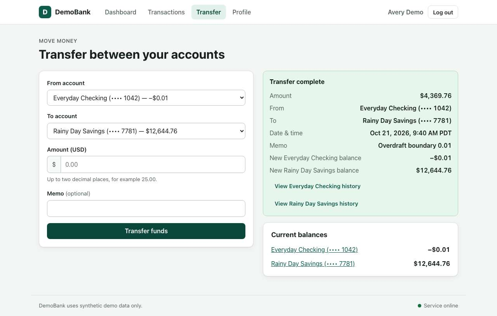
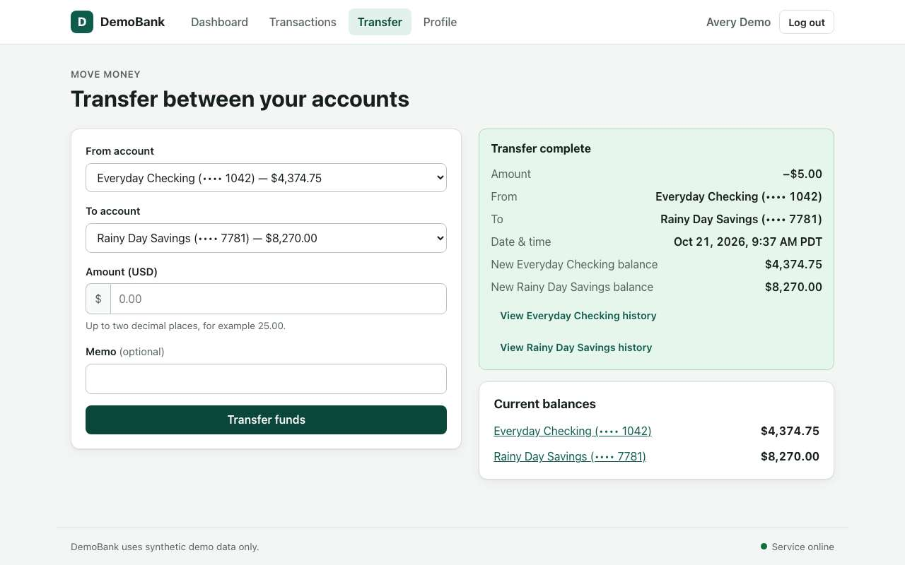

# DemoBank Test Results: Plain-Language Summary

*For readers who want to know what was tested, what's broken and why it matters, without the
technical detail. Developers should read the full technical report: [report.md](report.md).*

---

## What was tested

**DemoBank** is a practice banking website. You can see a checking and a savings account, view
your transaction history, and move money between the two accounts. A written document (the
"specification") describes exactly how it is supposed to behave.

We built an **automated tester**: a program that reads that document, works out what to check,
and then uses the website in a real browser, the way a person would, clicking buttons, typing
amounts and reading what's on screen. It doesn't just check that a button *can* be clicked. It
checks what actually happened afterwards: did the balances change correctly, was a record
created, did the right message appear?

It took **about an hour** and checked **32 separate assertions** made in the specification.

## The bottom line

| | Result | Meaning |
|---|---|---|
| ✅ | **27 passed** | The website does what the specification promises |
| ❌ | **3 failed** | The website breaks a promise. These are real bugs |
| ⚠️ | **2 couldn't be confirmed** | The tester couldn't reach a trustworthy answer, so it says so instead of guessing |

**Most of the website works well.** Signing in and out, viewing accounts, normal transfers and the
privacy protections all behave as promised. **The problems are concentrated in one place: the
transfer form accepts transfers it should refuse.** Two of the three bugs let money move in ways a
real bank would never allow.

---

## The three problems

### 1. You can transfer more money than you have 🔴 *Serious*

**What should happen:** If you try to send more than your account holds, the bank should refuse and
explain why, and nothing should change.

**What actually happens:** The transfer goes through. The tester had $4,369.75 in checking and sent
$4,369.76, one cent more. The website said **"Transfer complete"** and the checking account dropped
to **–$0.01**. No warning was shown.

**Why it matters:** Customers can overdraw their accounts with no warning, and the bank's records
show money that doesn't exist.

---

### 2. You can transfer zero dollars, or even a negative amount 🔴 *Serious*

**What should happen:** Amounts must be positive. Zero, negative numbers, blanks and text like
"abc" should all be refused with a clear message.

**What actually happens:**
- **Text** ("abc", "ten") and **too many decimals** ("1.005") are correctly refused. ✅
- **Zero** ("0" or "0.00") is accepted and records a pointless **$0.00 transfer** in the history. ❌
- **Negative amounts** are accepted, and **the money moves in the opposite direction.** Sending
  **–$5.00** from checking to savings *added* $5 to checking ($4,369.75 → $4,374.75) and *took* $5
  from savings ($8,275.00 → $8,270.00). The website again said **"Transfer complete"**. ❌

**Why it matters:** A negative transfer is effectively a way to pull money *out* of an account
using a form meant only for sending money *into* it. In a real bank this would be a security
problem.

---

### 3. The "End date" filter leaves out the last day 🟠 *Moderate*

**What should happen:** On the Transactions page you can filter by date. The specification says the
start and end dates are **inclusive**: picking an end date of October 21 should include transactions
*on* October 21. The page even says so: *"Start and end dates are inclusive."*

**What actually happens:** Transactions made on the end date are **left out**. The tester made
transfers on October 21, set the end date to October 21, and those transfers disappeared. Only the
12 older transactions were shown.

**Why it matters:** Anyone checking "what happened up to today" gets an incomplete picture. For
statements or reconciling accounts, a missing day can mean missing money.

---

## What couldn't be confirmed, and why

The tester is designed to say **"I'm not sure"** rather than report something it can't prove.

- **"The website explains when a transfer fails."** The tester tried to cause a failed transfer to see
  the explanation, but because of bugs 1 and 2 the transfers *didn't fail*: they went through. It
  correctly refused to blame this requirement for problems already reported above.
- **"The landing page has a clearly labelled Enter Demo button."** A mistake in the tester itself
  (it opened the wrong web address). We fixed the tester and re-checked: **this passes.**
  [Re-check report](../20261021-102012-ACC-01-retest/report.md)

## Worth a closer look (not counted as a failure)

On the Transactions page, **pending and failed transactions show "$0.00"** instead of their actual
amount. You can see it in the screenshot above: "Pending demo debit: $0.00". An earlier test run
flagged this as a bug; in this run the tester judged it differently. It may be intended (no money
has moved yet), but a customer can't tell how much a pending payment is for.

---

## How we know these results are trustworthy

A wrong "this is broken" report wastes developers' time, so every failure had to pass three checks
before it appears here:

1. **It had to happen twice.** Every failure was repeated from a clean start to rule out a fluke.
2. **Three independent reviews.** An AI reviewer re-read the exact sentence of the specification
   three separate times and asked: "Did the test expect what the specification really says?" All three
   problems above were confirmed **3 out of 3**.
3. **Evidence for everything.** Every result comes with screenshots, the exact values seen on screen,
   and step-by-step instructions to reproduce it (in the [technical report](report.md)).

We also tested the tester. We deliberately planted bugs in a copy of the website to see whether it
would notice. It caught **3 of the 4** that a user could see. Details: [fault-injection results](../../eval/FAULT_INJECTION.md).

## What it cost

The tester uses an AI model (Google Gemini) to read the specification, plan the tests and review its
own findings. The whole run cost **$2.02** in AI usage, about **6 cents per requirement checked**.
Clicking and measuring is done by ordinary code, which costs nothing extra.

## Recommended fixes (in priority order)

1. **Refuse transfers larger than the available balance**, and show a clear "insufficient funds" message.
2. **Refuse zero and negative amounts** in the transfer form, both on screen and on the server.
3. **Include the end date** in the date filter, as the page itself promises.
4. *(Optional)* Show the real amount for pending and failed transactions.

---

*Test run `20261021-092147` · October 21, 2026 · Local copy of DemoBank with fictional data only.
Full technical report: [report.md](report.md).*
