# DemoBank QA Audit Report

- **Target:** http://localhost:5173  (local copy, database reset between scenarios)
- **Specification:** `../test-website/PRD.md`
- **Run:** `20261021-092147`  ·  started 20261021-092147  ·  duration 54.8 min
- **Models:** gemini-3.5-flash-lite, gemini-3.8-flash  ·  pricing as of 2026-10-21
- **Requirements tested:** 32  ·  **PASS 27**  ·  **FAIL 3**  ·  **UNVERIFIED 2**
- **Total model cost of this run:** **$2.0167** (140 calls, 564,799 input / 426,519 output tokens)

Verdicts follow the evidence model: PASS = observed state matches the PRD; FAIL = evidence shows a meaningful mismatch that reproduced on a fresh re-run and was confirmed by a majority review against the PRD sentence; UNVERIFIED = no reliable conclusion, with the reason stated.

## Executive summary

QA audit evaluation ran against the local test target at http://localhost:5173 across 32 requirements tested. Overall, 27 passed, 3 failed, and 2 were unverified. The test suite revealed critical issues in transfer validation and ledger integrity, including the execution of zero-dollar transfers and allowed overdrafts, as well as an inclusive date-filtering defect in transaction history.

### Key findings

- Under TRF-03, submitting blank or zero-dollar amounts fails to trigger validation alerts, permitting a zero-value transfer ('$0.00') to be completed and recorded in history.
- Under TRF-04, the application permits transfers that exceed available balances without displaying an error, driving checking balances negative (from $4,369.75 to -$0.01) and recording an overdraft transfer in transaction history.
- Under TXN-04, transaction history date-range filtering fails to include transactions timestamped on the specified end-date boundary.

## Results by requirement

| ID | Area | Depth | Verdict | Scenarios | Reason |
|---|---|---|---|---|---|
| [ACC-01](#acc-01) | access | deep | ⚠️ UNVERIFIED | 1 unverified | Landing page provides clearly labeled Enter Demo action that opens dashboard without credentials: plan could not be made valid: check 'Enter Demo button is present on landing page  |
| [ACC-02](#acc-02) | access | deep | ✅ PASS | 3 pass | 3 scenario(s) passed |
| [ACC-03](#acc-03) | access | deep | ✅ PASS | 3 pass | 3 scenario(s) passed |
| [ACC-04](#acc-04) | access | deep | ✅ PASS | 3 pass | 3 scenario(s) passed |
| [ACC-05](#acc-05) | access | deep | ✅ PASS | 3 pass | 3 scenario(s) passed |
| [DSH-01](#dsh-01) | accounts | light | ✅ PASS | 1 pass | 1 scenario(s) passed |
| [DSH-02](#dsh-02) | accounts | light | ✅ PASS | 1 pass | 1 scenario(s) passed |
| [DSH-03](#dsh-03) | accounts | light | ✅ PASS | 1 pass | 1 scenario(s) passed |
| [DSH-04](#dsh-04) | accounts | light | ✅ PASS | 1 pass | 1 scenario(s) passed |
| [TRF-01](#trf-01) | transfers | deep | ✅ PASS | 3 pass | 3 scenario(s) passed |
| [TRF-02](#trf-02) | transfers | deep | ✅ PASS | 2 pass | 2 scenario(s) passed |
| [TRF-03](#trf-03) | transfers | deep | ❌ FAIL | 2 fail, 1 pass | failed: Validation error message is displayed when submitting invalid amount (PRD: Blank, zero, negative, non-numeric, and over-precision values must be rejected with a clear valid |
| [TRF-04](#trf-04) | transfers | deep | ❌ FAIL | 2 fail | failed: Rejection error message is displayed when amount exceeds balance; UI balances remain unchanged after rejected transfer; API account balances remain unchanged; No completed  |
| [TRF-05](#trf-05) | transfers | deep | ✅ PASS | 3 pass | 3 scenario(s) passed |
| [TRF-06](#trf-06) | transfers | deep | ✅ PASS | 2 pass | 2 scenario(s) passed |
| [TRF-07](#trf-07) | transfers | deep | ⚠️ UNVERIFIED | 2 pass, 1 unverified | Zero amount transfer is rejected with failure explanation and balances unchanged: no conclusive result after 2 attempt(s); last outcome: FAIL |
| [TRF-08](#trf-08) | transfers | deep | ✅ PASS | 3 pass | 3 scenario(s) passed |
| [TXN-01](#txn-01) | history | deep | ✅ PASS | 3 pass | 3 scenario(s) passed |
| [TXN-02](#txn-02) | history | deep | ✅ PASS | 2 pass | 2 scenario(s) passed |
| [TXN-03](#txn-03) | history | deep | ✅ PASS | 4 pass | 4 scenario(s) passed |
| [TXN-04](#txn-04) | history | deep | ❌ FAIL | 1 pass, 1 fail, 1 unverified | failed: A transaction dated exactly on the end date is visible in the filtered results |
| [TXN-05](#txn-05) | history | deep | ✅ PASS | 2 pass | 2 scenario(s) passed |
| [TXN-06](#txn-06) | history | deep | ✅ PASS | 3 pass | 3 scenario(s) passed |
| [PRO-01](#pro-01) | profile | light | ✅ PASS | 1 pass | 1 scenario(s) passed |
| [PRO-02](#pro-02) | profile | light | ✅ PASS | 1 pass | 1 scenario(s) passed |
| [GEN-01](#gen-01) | general | light | ✅ PASS | 1 pass | 1 scenario(s) passed |
| [GEN-02](#gen-02) | general | light | ✅ PASS | 1 pass | 1 scenario(s) passed |
| [GEN-03](#gen-03) | general | light | ✅ PASS | 1 pass | 1 scenario(s) passed |
| [GEN-04](#gen-04) | general | light | ✅ PASS | 1 pass | 1 scenario(s) passed |
| [GEN-05](#gen-05) | general | light | ✅ PASS | 1 pass | 1 scenario(s) passed |
| [SEED-01](#seed-01) | seed | light | ✅ PASS | 1 pass | 1 scenario(s) passed |
| [SEED-02](#seed-02) | seed | light | ✅ PASS | 1 pass | 1 scenario(s) passed |

## Failures

### TRF-03

**Requirement:** Transfer amounts that are blank, zero, negative, non-numeric, or have more than two decimal places must be rejected with validation messaging, without altering balances or creating transactions.  
**PRD:** “Amount must be a positive number greater than zero, with no more than two digits after the decimal point. Blank, zero, negative, non-numeric, and over-precision values must be rejected with a clear validation message. Rejected input must not create a transaction or change balances.”  
**Verdict:** ❌ FAIL: failed: Validation error message is displayed when submitting invalid amount (PRD: Blank, zero, negative, non-numeric, and over-precision values must be rejected with a clear validation message); Account balances remain unchanged server-side (PRD: Rejected input must not create a transaction or change balances); No transaction is recorded in history (PRD: Rejected input must not create a transaction); Validation message clearly explains the rejection

#### ❌ Scenario: Invalid transfer amounts are rejected with validation messaging leaving balances and transactions unchanged

*negative · equivalence partitioning (code-generated invalid inputs)* · failed: Validation error message is displayed when submitting invalid amount (PRD: Blank, zero, negative, non-numeric, and over-precision values must be rejected with a clear validation message); Account balances remain unchanged server-side (PRD: Rejected input must not create a transaction or change balances); No transaction is recorded in history (PRD: Rejected input must not create a transaction); Validation message clearly explains the rejection

Inputs tried (code-generated): ['', '   ', '0', '0.00', '-5', '-0.01', 'abc', 'ten', '1.005', '12.345']. Failing inputs: ['', '   ', '0', '0.00', '-5', '-0.01']. Steps below are for input ''.

**Steps to reproduce**

1. Open the landing page and enter the demo
2. Navigate to /transfer
3. Read API GET /api/accounts → `acc_before` = `"{\"status\": 200, \"body\": {\"accounts\": [{\"id\": \"00000000-0000-0000-0000-000000000101\", \"name\": \"Everyday Checking\", \"type\": \"checking\", \"maske`
4. Read API GET /api/transactions → `tx_before` = `"{\"status\": 200, \"body\": {\"transactions\": [{\"id\": \"00000000-0000-0000-0000-000000000212\", \"type\": \"deposit\", \"status\": \"failed\", \"amount\": \`
5. Select 'Everyday Checking' in field labelled 'From account'
6. Select 'Rainy Day Savings' in field labelled 'To account'
7. Type '' into field labelled 'Amount (USD)'
8. Click button 'Transfer funds'
9. Read text of 'alert' → `alert_msg` = `null`
10. Read API GET /api/accounts → `acc_after` = `"{\"status\": 200, \"body\": {\"accounts\": [{\"id\": \"00000000-0000-0000-0000-000000000101\", \"name\": \"Everyday Checking\", \"type\": \"checking\", \"maske`
11. Read API GET /api/transactions → `tx_after` = `"{\"status\": 200, \"body\": {\"transactions\": [{\"id\": \"00000000-0000-0000-0000-000000000212\", \"type\": \"deposit\", \"status\": \"failed\", \"amount\": \`
12. Read url of  → `current_url` = `"/transfer"`

| Expected (check) | Kind | Result | Observed |
|---|---|---|---|
| Validation error message is displayed when submitting invalid amount (PRD: Blank, zero, negative, non-numeric, and over-precision values must be rejected with a clear validation message) | functional | ❌ fail | `{"alert_msg": null}` |
| Account balances remain unchanged server-side (PRD: Rejected input must not create a transaction or change balances) | side_effect | ✅ pass | `{"acc_after": {"status": 200, "body": {"accounts": [{"id": "00000000-0000-0000-0000-000000000101", "name": "Everyday Checking", "type": "checking", "masked_number": "\u2022\u2022\u2022\u2022 1042", "currency": "USD", "ba` |
| No transaction is recorded in history (PRD: Rejected input must not create a transaction) | side_effect | ✅ pass | `{"tx_after": "{\"status\": 200, \"body\": {\"transactions\": [{\"id\": \"00000000-0000-0000-0000-000000000212\", \"type\": \"deposit\", \"status\": \"failed\", \"amount\": \"700.00\", \"memo\": \"Returned demo deposit\",` |
| Form submission is blocked and user remains on transfer route | functional | ✅ pass | `{"current_url": "/transfer"}` |
| Validation message clearly explains the rejection | subjective | ❌ fail | `{"alert_msg": null}` |

Review (majority of 3): {'confirm': 3}  
Evidence: [TRF-03-s1-r0-v00-s06.jpg](./screenshots/TRF-03-s1-r0-v00-s06.jpg) · [TRF-03-s1-r0-v00-s07.jpg](./screenshots/TRF-03-s1-r0-v00-s07.jpg) · [TRF-03-s1-r0-v00-s08.jpg](./screenshots/TRF-03-s1-r0-v00-s08.jpg) · [TRF-03-s1-r0-v00-final.jpg](./screenshots/TRF-03-s1-r0-v00-final.jpg)

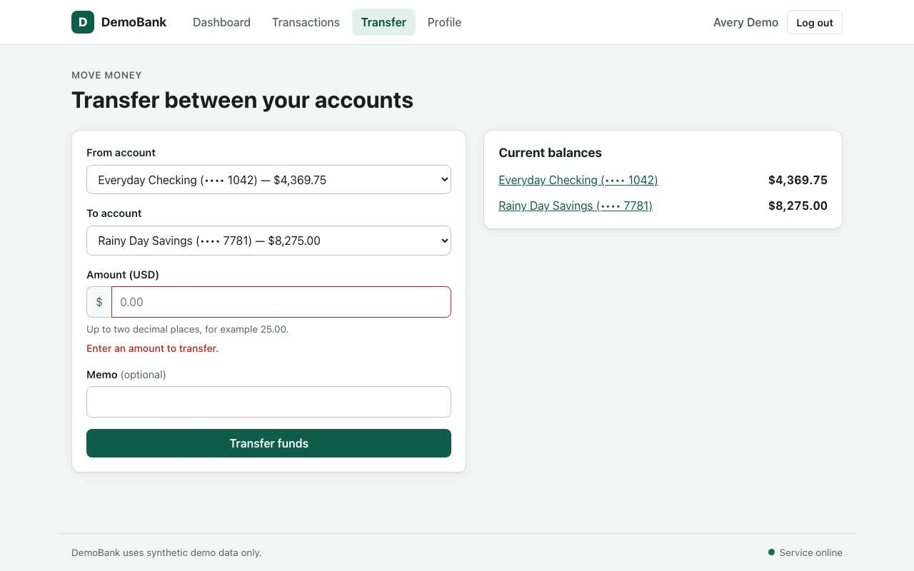

Network calls: `POST /api/demo/session 201`, `GET /api/me 200`, `GET /api/accounts 200`

#### ❌ Scenario: Zero amount transfer boundary is rejected without altering balances

*boundary · boundary-value analysis* · failed: Validation message is displayed for zero amount (PRD: Amount must be a positive number greater than zero); No new transaction was recorded; Validation message clearly states zero amount is not allowed

**Steps to reproduce**

1. Open the landing page and enter the demo
2. Navigate to /transfer
3. Read all_text of element [data-testid=transfer-balance] → `balances_before` = `["$4,369.75", "$8,275.00"]`
4. Read API GET /api/transactions → `tx_before` = `"{\"status\": 200, \"body\": {\"transactions\": [{\"id\": \"00000000-0000-0000-0000-000000000212\", \"type\": \"deposit\", \"status\": \"failed\", \"amount\": \`
5. Select 'Everyday Checking' in field labelled 'From account'
6. Select 'Rainy Day Savings' in field labelled 'To account'
7. Type '0.00' into field labelled 'Amount (USD)'
8. Click button 'Transfer funds'
9. Read text of 'alert' → `alert_msg` = `null`
10. Read all_text of element [data-testid=transfer-balance] → `balances_after` = `["$4,369.75", "$8,275.00"]`
11. Read API GET /api/transactions → `tx_after` = `"{\"status\": 200, \"body\": {\"transactions\": [{\"id\": \"3ddb55ef-497f-4567-895b-4f270cbcab01\", \"type\": \"transfer\", \"status\": \"completed\", \"amount\`
12. Read url of  → `current_url` = `"/transfer"`

| Expected (check) | Kind | Result | Observed |
|---|---|---|---|
| Validation message is displayed for zero amount (PRD: Amount must be a positive number greater than zero) | functional | ❌ fail | `{"alert_msg": null}` |
| Transfer balances displayed on the page remain unchanged | side_effect | ✅ pass | `{"balances_after": ["$4,369.75", "$8,275.00"], "balances_before": ["$4,369.75", "$8,275.00"]}` |
| No new transaction was recorded | side_effect | ❌ fail | `{"tx_after": "{\"status\": 200, \"body\": {\"transactions\": [{\"id\": \"3ddb55ef-497f-4567-895b-4f270cbcab01\", \"type\": \"transfer\", \"status\": \"completed\", \"amount\": \"0.00\", \"memo\": null, \"occurred_at\": \` |
| User remains on the transfer page | functional | ✅ pass | `{"current_url": "/transfer"}` |
| Validation message clearly states zero amount is not allowed | subjective | ❌ fail | `{"alert_msg": null}` |

Review (majority of 3): {'confirm': 3}  
Evidence: [TRF-03-s2-r0-v00-s06.jpg](./screenshots/TRF-03-s2-r0-v00-s06.jpg) · [TRF-03-s2-r0-v00-s07.jpg](./screenshots/TRF-03-s2-r0-v00-s07.jpg) · [TRF-03-s2-r0-v00-s08.jpg](./screenshots/TRF-03-s2-r0-v00-s08.jpg) · [TRF-03-s2-r0-v00-final.jpg](./screenshots/TRF-03-s2-r0-v00-final.jpg)

Network calls: `POST /api/demo/session 201`, `GET /api/me 200`, `GET /api/accounts 200`, `POST /api/transfers 201`

✅ <i>Over-precision amount with three decimal places is rejected</i> (boundary, boundary-value analysis)

#### ✅ Scenario: Over-precision amount with three decimal places is rejected

*boundary · boundary-value analysis* · all checks passed

**Steps to reproduce**

1. Open the landing page and enter the demo
2. Navigate to /transfer
3. Read all_text of element [data-testid=transfer-balance] → `balances_before` = `["$4,369.75", "$8,275.00"]`
4. Read API GET /api/transactions → `tx_before` = `"{\"status\": 200, \"body\": {\"transactions\": [{\"id\": \"00000000-0000-0000-0000-000000000212\", \"type\": \"deposit\", \"status\": \"failed\", \"amount\": \`
5. Select 'Everyday Checking' in field labelled 'From account'
6. Select 'Rainy Day Savings' in field labelled 'To account'
7. Type '5.001' into field labelled 'Amount (USD)'
8. Click button 'Transfer funds'
9. Read text of 'alert' → `alert_msg` = `"Transfer not completed\n\nAmount must be a decimal string with no more than two decimal places.\n\nNo money was moved. Your balances are unchanged."`
10. Read all_text of element [data-testid=transfer-balance] → `balances_after` = `["$4,369.75", "$8,275.00"]`
11. Read API GET /api/transactions → `tx_after` = `"{\"status\": 200, \"body\": {\"transactions\": [{\"id\": \"00000000-0000-0000-0000-000000000212\", \"type\": \"deposit\", \"status\": \"failed\", \"amount\": \`
12. Read url of  → `current_url` = `"/transfer"`

| Expected (check) | Kind | Result | Observed |
|---|---|---|---|
| Validation message is displayed for over-precision amount (PRD: with no more than two digits after the decimal point) | functional | ✅ pass | `{"alert_msg": "Transfer not completed\n\nAmount must be a decimal string with no more than two decimal places.\n\nNo money was moved. Your balances are unchanged."}` |
| Displayed account balances remain unchanged | side_effect | ✅ pass | `{"balances_after": ["$4,369.75", "$8,275.00"], "balances_before": ["$4,369.75", "$8,275.00"]}` |
| No new transaction was created in history | side_effect | ✅ pass | `{"tx_after": "{\"status\": 200, \"body\": {\"transactions\": [{\"id\": \"00000000-0000-0000-0000-000000000212\", \"type\": \"deposit\", \"status\": \"failed\", \"amount\": \"700.00\", \"memo\": \"Returned demo deposit\",` |
| Form submission is blocked and user remains on transfer page | functional | ✅ pass | `{"current_url": "/transfer"}` |
| Validation message clearly communicates decimal precision constraint | subjective | ✅ pass judge: Does this message inform the user that the amount has too many decimal places or is not a valid format? -> True (The observed text explicitly states tha | `{"alert_msg": "Transfer not completed\n\nAmount must be a decimal string with no more than two decimal places.\n\nNo money was moved. Your balances are unchanged."}` |

Evidence: [TRF-03-s3-r0-v00-s06.jpg](./screenshots/TRF-03-s3-r0-v00-s06.jpg) · [TRF-03-s3-r0-v00-s07.jpg](./screenshots/TRF-03-s3-r0-v00-s07.jpg) · [TRF-03-s3-r0-v00-s08.jpg](./screenshots/TRF-03-s3-r0-v00-s08.jpg) · [TRF-03-s3-r0-v00-final.jpg](./screenshots/TRF-03-s3-r0-v00-final.jpg)

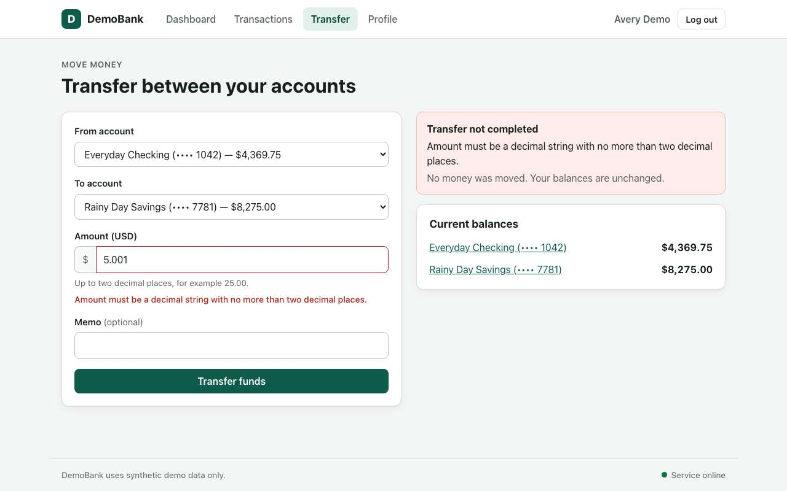

Network calls: `POST /api/demo/session 201`, `GET /api/me 200`, `GET /api/accounts 200`, `POST /api/transfers 422`

### TRF-04

**Requirement:** Transfers exceeding the source account's available balance must be rejected without balance changes or recorded transactions.  
**PRD:** “The amount must not exceed the source account's available balance. If funds are insufficient, the transfer must be rejected, both balances must remain unchanged, and no completed transfer must appear in history.”  
**Verdict:** ❌ FAIL: failed: Rejection error message is displayed when amount exceeds balance; UI balances remain unchanged after rejected transfer; API account balances remain unchanged; No completed transfer is recorded for the overdraft attempt

#### ❌ Scenario: Transfer exceeding checking account balance by $0.01 is rejected without balance changes

*boundary · boundary-value analysis (+0.01 over available balance)* · failed: Rejection error message is displayed when amount exceeds balance; UI balances remain unchanged after rejected transfer; API account balances remain unchanged; No completed transfer is recorded for the overdraft attempt

**Steps to reproduce**

1. Open the landing page and enter the demo
2. Navigate to /transfer
3. Read text of element [data-testid=transfer-balance] → `src_balance_text` = `"$4,369.75"`
4. Read all_text of element [data-testid=transfer-balance] → `all_balances_before` = `["$4,369.75", "$8,275.00"]`
5. Read API GET /api/accounts → `api_accounts_before` = `"{\"status\": 200, \"body\": {\"accounts\": [{\"id\": \"00000000-0000-0000-0000-000000000101\", \"name\": \"Everyday Checking\", \"type\": \"checking\", \"maske`
6. Select 'Everyday Checking' in combobox 'From account'
7. Select 'Rainy Day Savings' in combobox 'To account'
8. Type '4369.76' into field labelled 'Amount (USD)'
9. Type 'Overdraft boundary 0.01' into field labelled 'Memo (optional)'
10. Click button 'Transfer funds'
11. Read text of 'alert' → `error_message` = `null`
12. Read all_text of element [data-testid=transfer-balance] → `all_balances_after` = `["\u2212$0.01", "$12,644.76"]`
13. Read API GET /api/accounts → `api_accounts_after` = `"{\"status\": 200, \"body\": {\"accounts\": [{\"id\": \"00000000-0000-0000-0000-000000000101\", \"name\": \"Everyday Checking\", \"type\": \"checking\", \"maske`
14. Read API GET /api/transactions → `api_tx_after` = `"{\"status\": 200, \"body\": {\"transactions\": [{\"id\": \"bbe0615a-7790-4ce4-8878-fc67d14d2b64\", \"type\": \"transfer\", \"status\": \"completed\", \"amount\`

| Expected (check) | Kind | Result | Observed |
|---|---|---|---|
| Rejection error message is displayed when amount exceeds balance | functional | ❌ fail | `{"error_message": null}` |
| UI balances remain unchanged after rejected transfer | side_effect | ❌ fail | `{"all_balances_after": ["\u2212$0.01", "$12,644.76"], "all_balances_before": ["$4,369.75", "$8,275.00"]}` |
| API account balances remain unchanged | side_effect | ❌ fail | `{"api_accounts_after": {"status": 200, "body": {"accounts": [{"id": "00000000-0000-0000-0000-000000000101", "name": "Everyday Checking", "type": "checking", "masked_number": "\u2022\u2022\u2022\u2022 1042", "currency": "` |
| No completed transfer is recorded for the overdraft attempt | side_effect | ❌ fail | `{"api_tx_after": "{\"status\": 200, \"body\": {\"transactions\": [{\"id\": \"bbe0615a-7790-4ce4-8878-fc67d14d2b64\", \"type\": \"transfer\", \"status\": \"completed\", \"amount\": \"4369.76\", \"memo\": \"Overdraft bound` |

Review (majority of 3): {'confirm': 3}  
Evidence: [TRF-04-s1-r0-v00-s08.jpg](./screenshots/TRF-04-s1-r0-v00-s08.jpg) · [TRF-04-s1-r0-v00-s09.jpg](./screenshots/TRF-04-s1-r0-v00-s09.jpg) · [TRF-04-s1-r0-v00-s10.jpg](./screenshots/TRF-04-s1-r0-v00-s10.jpg) · [TRF-04-s1-r0-v00-final.jpg](./screenshots/TRF-04-s1-r0-v00-final.jpg)

Network calls: `POST /api/demo/session 201`, `GET /api/me 200`, `GET /api/accounts 200`, `POST /api/transfers 201`

#### ❌ Scenario: Transfer exceeding savings balance is rejected and no record appears in transaction history

*negative · equivalence partitioning (transfer exceeding savings balance)* · failed: Rejection error message is displayed when transfer exceeds savings balance; API account balances remain unchanged after rejection; No completed transaction with the overdraft memo appears in transaction history table; No completed transfer is recorded in API transactions for the overdraft attempt

**Steps to reproduce**

1. Open the landing page and enter the demo
2. Navigate to /transfer
3. Read all_text of element [data-testid=transfer-balance] → `all_balances_before` = `["$4,369.75", "$8,275.00"]`
4. Read API GET /api/accounts → `api_accounts_before` = `"{\"status\": 200, \"body\": {\"accounts\": [{\"id\": \"00000000-0000-0000-0000-000000000101\", \"name\": \"Everyday Checking\", \"type\": \"checking\", \"maske`
5. Select 'Rainy Day Savings' in combobox 'From account'
6. Select 'Everyday Checking' in combobox 'To account'
7. Type '8775.00' into field labelled 'Amount (USD)'
8. Type 'Savings overdraft attempt' into field labelled 'Memo (optional)'
9. Click button 'Transfer funds'
10. Read text of 'alert' → `error_message` = `null`
11. Read API GET /api/accounts → `api_accounts_after` = `"{\"status\": 200, \"body\": {\"accounts\": [{\"id\": \"00000000-0000-0000-0000-000000000101\", \"name\": \"Everyday Checking\", \"type\": \"checking\", \"maske`
12. Navigate to /transactions
13. Read table of element [data-testid=transaction-table] → `tx_table` = `"[{\"Date & time\": \"Oct 21, 2026, 9:40 AM PDT\", \"Description\": \"Savings overdraft attempt\", \"Type\": \"Transfer\", \"Account\": \"From Rainy Day Savings`
14. Read API GET /api/transactions → `api_tx_after` = `"{\"status\": 200, \"body\": {\"transactions\": [{\"id\": \"e34a672e-497a-4ec0-95a7-cba89f3dce76\", \"type\": \"transfer\", \"status\": \"completed\", \"amount\`

| Expected (check) | Kind | Result | Observed |
|---|---|---|---|
| Rejection error message is displayed when transfer exceeds savings balance | functional | ❌ fail | `{"error_message": null}` |
| API account balances remain unchanged after rejection | side_effect | ❌ fail | `{"api_accounts_after": {"status": 200, "body": {"accounts": [{"id": "00000000-0000-0000-0000-000000000101", "name": "Everyday Checking", "type": "checking", "masked_number": "\u2022\u2022\u2022\u2022 1042", "currency": "` |
| No completed transaction with the overdraft memo appears in transaction history table | side_effect | ❌ fail | `{"tx_table": "[{\"Date & time\": \"Oct 21, 2026, 9:40 AM PDT\", \"Description\": \"Savings overdraft attempt\", \"Type\": \"Transfer\", \"Account\": \"From Rainy Day Savings (\\u2022\\u2022\\u2022\\u2022 7781) To Everyda` |
| No completed transfer is recorded in API transactions for the overdraft attempt | side_effect | ❌ fail | `{"api_tx_after": "{\"status\": 200, \"body\": {\"transactions\": [{\"id\": \"e34a672e-497a-4ec0-95a7-cba89f3dce76\", \"type\": \"transfer\", \"status\": \"completed\", \"amount\": \"8775.00\", \"memo\": \"Savings overdra` |

Review (majority of 3): {'confirm': 3}  
Evidence: [TRF-04-s2-r0-v00-s08.jpg](./screenshots/TRF-04-s2-r0-v00-s08.jpg) · [TRF-04-s2-r0-v00-s09.jpg](./screenshots/TRF-04-s2-r0-v00-s09.jpg) · [TRF-04-s2-r0-v00-s12.jpg](./screenshots/TRF-04-s2-r0-v00-s12.jpg) · [TRF-04-s2-r0-v00-final.jpg](./screenshots/TRF-04-s2-r0-v00-final.jpg)

Network calls: `POST /api/demo/session 201`, `GET /api/me 200`, `GET /api/accounts 200`, `POST /api/transfers 201`, `GET /api/transactions 200`

### TXN-04

**Requirement:** Date range filtering is inclusive of start and end boundary dates.  
**PRD:** “The start and end dates are inclusive. A transaction occurring on either boundary date must be included when it matches the other filters.”  
**Verdict:** ❌ FAIL: failed: A transaction dated exactly on the end date is visible in the filtered results

✅ <i>Transactions occurring on the start boundary date are included in filtered results</i> (boundary, boundary-value analysis)

#### ✅ Scenario: Transactions occurring on the start boundary date are included in filtered results

*boundary · boundary-value analysis* · all checks passed

**Steps to reproduce**

1. Open the landing page and enter the demo
2. Navigate to /transactions
3. Read API GET /api/transactions → `all_txns` = `"{\"status\": 200, \"body\": {\"transactions\": [{\"id\": \"02c26545-050b-4d2c-9c96-31a3c3b100ba\", \"type\": \"transfer\", \"status\": \"completed\", \"amount\`
4. Type '2026-10-21' into field labelled 'Start date'
5. Click button 'Apply filters'
6. Read table of element [data-testid=transaction-table] → `filtered_rows` = `[{"Date & time": "Oct 21, 2026, 9:52 AM PDT", "Description": "Min boundary reload check", "Type": "Transfer", "Account": "From Rainy Day Savings (\u2022\u2022\u`
7. Read API GET /api/transactions?start_date=2026-10-21 → `api_filtered` = `"{\"status\": 200, \"body\": {\"transactions\": [{\"id\": \"02c26545-050b-4d2c-9c96-31a3c3b100ba\", \"type\": \"transfer\", \"status\": \"completed\", \"amount\`

| Expected (check) | Kind | Result | Observed |
|---|---|---|---|
| A transaction dated exactly on the start date is visible in the filtered results | functional | ✅ pass | `{"all_txns": "{\"status\": 200, \"body\": {\"transactions\": [{\"id\": \"02c26545-050b-4d2c-9c96-31a3c3b100ba\", \"type\": \"transfer\", \"status\": \"completed\", \"amount\": \"0.01\", \"memo\": \"Min boundary reload ch` |
| Every displayed transaction occurred on or after the start date | invariant | ✅ pass | `{"all_txns": "{\"status\": 200, \"body\": {\"transactions\": [{\"id\": \"02c26545-050b-4d2c-9c96-31a3c3b100ba\", \"type\": \"transfer\", \"status\": \"completed\", \"amount\": \"0.01\", \"memo\": \"Min boundary reload ch` |
| UI table row count matches the backend filtered transaction count | cross_source | ✅ pass | `{"api_filtered": "{\"status\": 200, \"body\": {\"transactions\": [{\"id\": \"02c26545-050b-4d2c-9c96-31a3c3b100ba\", \"type\": \"transfer\", \"status\": \"completed\", \"amount\": \"0.01\", \"memo\": \"Min boundary reloa` |

Evidence: [TXN-04-s1-r0-v00-s02.jpg](./screenshots/TXN-04-s1-r0-v00-s02.jpg) · [TXN-04-s1-r0-v00-s04.jpg](./screenshots/TXN-04-s1-r0-v00-s04.jpg) · [TXN-04-s1-r0-v00-s05.jpg](./screenshots/TXN-04-s1-r0-v00-s05.jpg) · [TXN-04-s1-r0-v00-final.jpg](./screenshots/TXN-04-s1-r0-v00-final.jpg)

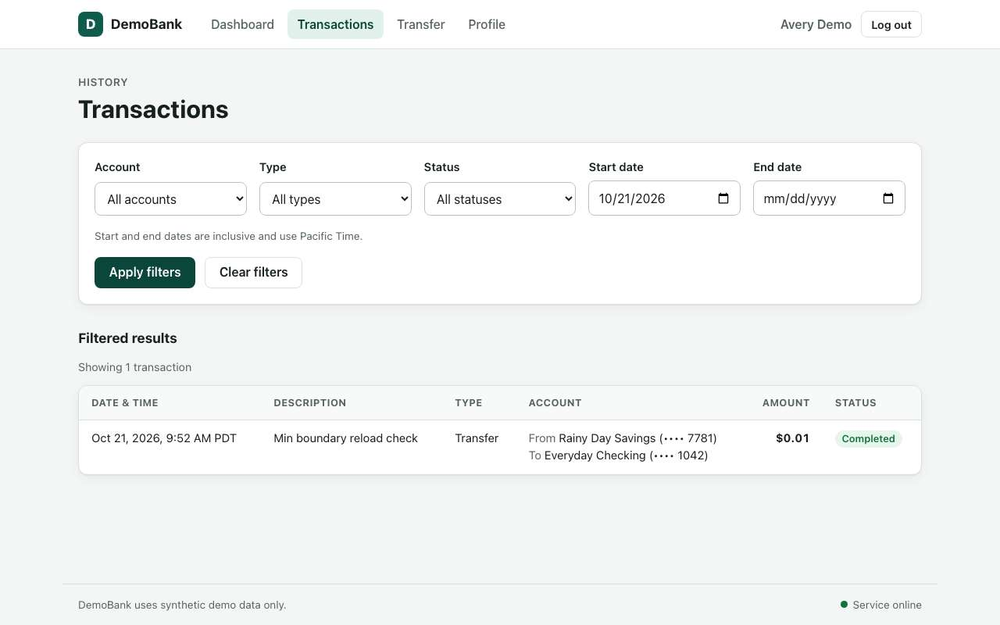

Network calls: `POST /api/demo/session 201`, `GET /api/me 200`, `GET /api/accounts 200`, `GET /api/transactions 200`

#### ❌ Scenario: Transactions occurring on the end boundary date are included in filtered results

*boundary · boundary-value analysis* · failed: A transaction dated exactly on the end date is visible in the filtered results

**Steps to reproduce**

1. Open the landing page and enter the demo
2. Navigate to /transactions
3. Read API GET /api/transactions → `all_txns` = `"{\"status\": 200, \"body\": {\"transactions\": [{\"id\": \"02c26545-050b-4d2c-9c96-31a3c3b100ba\", \"type\": \"transfer\", \"status\": \"completed\", \"amount\`
4. Type '2026-10-21' into field labelled 'End date'
5. Click button 'Apply filters'
6. Read table of element [data-testid=transaction-table] → `filtered_rows` = `"[{\"Date & time\": \"Sep 3, 2025, 7:50 AM PDT\", \"Description\": \"Returned demo deposit\", \"Type\": \"Deposit\", \"Account\": \"Rainy Day Savings (\\u2022\\`
7. Read API GET /api/transactions?end_date=2026-10-21 → `api_filtered` = `"{\"status\": 200, \"body\": {\"transactions\": [{\"id\": \"00000000-0000-0000-0000-000000000212\", \"type\": \"deposit\", \"status\": \"failed\", \"amount\": \`

| Expected (check) | Kind | Result | Observed |
|---|---|---|---|
| A transaction dated exactly on the end date is visible in the filtered results | functional | ❌ fail | `{"all_txns": "{\"status\": 200, \"body\": {\"transactions\": [{\"id\": \"02c26545-050b-4d2c-9c96-31a3c3b100ba\", \"type\": \"transfer\", \"status\": \"completed\", \"amount\": \"0.01\", \"memo\": \"Min boundary reload ch` |
| Every displayed transaction occurred on or before the end date | invariant | ✅ pass | `{"all_txns": "{\"status\": 200, \"body\": {\"transactions\": [{\"id\": \"02c26545-050b-4d2c-9c96-31a3c3b100ba\", \"type\": \"transfer\", \"status\": \"completed\", \"amount\": \"0.01\", \"memo\": \"Min boundary reload ch` |
| UI table row count matches the backend filtered transaction count | cross_source | ✅ pass | `{"api_filtered": "{\"status\": 200, \"body\": {\"transactions\": [{\"id\": \"00000000-0000-0000-0000-000000000212\", \"type\": \"deposit\", \"status\": \"failed\", \"amount\": \"700.00\", \"memo\": \"Returned demo deposi` |

Review (majority of 3): {'confirm': 2, 'reject': 1}  
Evidence: [TXN-04-s2-r0-v00-s02.jpg](./screenshots/TXN-04-s2-r0-v00-s02.jpg) · [TXN-04-s2-r0-v00-s04.jpg](./screenshots/TXN-04-s2-r0-v00-s04.jpg) · [TXN-04-s2-r0-v00-s05.jpg](./screenshots/TXN-04-s2-r0-v00-s05.jpg) · [TXN-04-s2-r0-v00-final.jpg](./screenshots/TXN-04-s2-r0-v00-final.jpg)

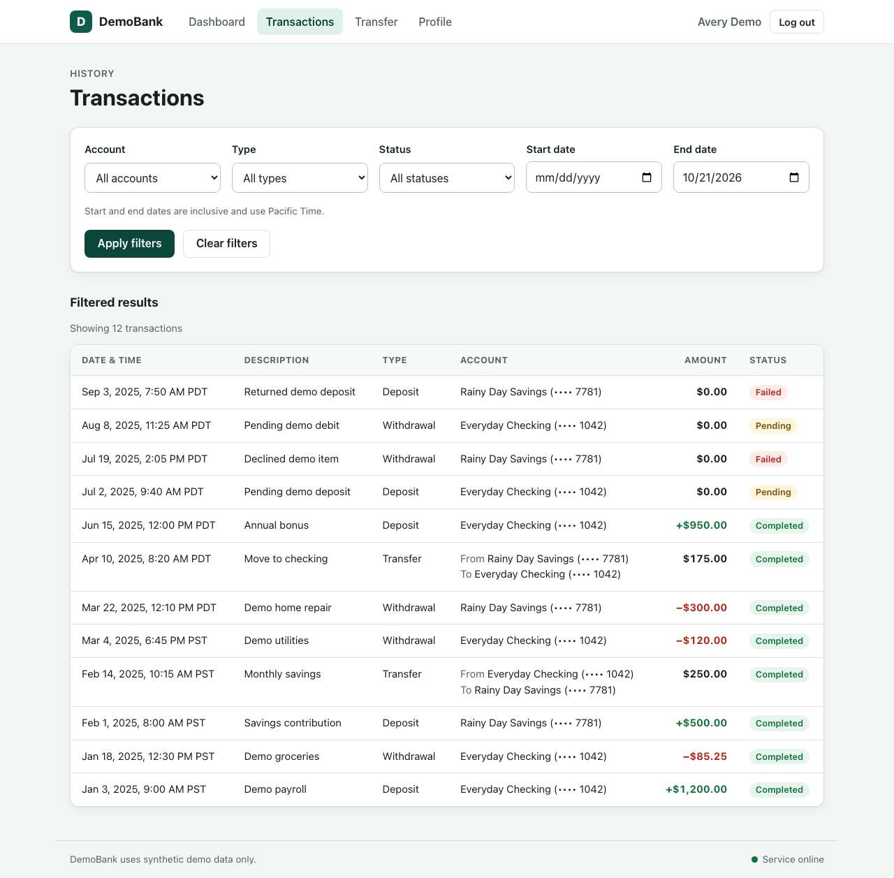

Network calls: `POST /api/demo/session 201`, `GET /api/me 200`, `GET /api/accounts 200`, `GET /api/transactions 200`

#### ⚠️ Scenario: Single-day range with identical start and end dates includes boundary transactions

*boundary · boundary-value analysis* · no conclusive result after 1 attempt(s); last outcome: INCONCLUSIVE

**Steps to reproduce**

1. Open the landing page and enter the demo
2. Navigate to /transactions
3. Read API GET /api/transactions → `all_txns` = `"{\"status\": 200, \"body\": {\"transactions\": [{\"id\": \"02c26545-050b-4d2c-9c96-31a3c3b100ba\", \"type\": \"transfer\", \"status\": \"completed\", \"amount\`
4. Type '2026-10-21' into field labelled 'Start date'
5. Type '2026-10-21' into field labelled 'End date'
6. Click button 'Apply filters'

Evidence: [TXN-04-s3-r0-v00-s04.jpg](./screenshots/TXN-04-s3-r0-v00-s04.jpg) · [TXN-04-s3-r0-v00-s05.jpg](./screenshots/TXN-04-s3-r0-v00-s05.jpg) · [TXN-04-s3-r0-v00-s06.jpg](./screenshots/TXN-04-s3-r0-v00-s06.jpg) · [TXN-04-s3-r0-v00-final.jpg](./screenshots/TXN-04-s3-r0-v00-final.jpg)

Network calls: `POST /api/demo/session 201`, `GET /api/me 200`, `GET /api/accounts 200`, `GET /api/transactions 200`

## Unverified requirements

### ACC-01

**Requirement:** The landing page provides an Enter Demo action that opens the demo dashboard without requiring a password or real identity information.  
**PRD:** “The landing page provides a clearly labeled **Enter Demo** action. It opens the demo dashboard without requiring a password or real identity information.”  
**Verdict:** ⚠️ UNVERIFIED: Landing page provides clearly labeled Enter Demo action that opens dashboard without credentials: plan could not be made valid: check 'Enter Demo button is present on landing page (PRD: provides a clearly labeled Enter Demo action)': variables ['enter_demo_text'] are never saved; check 'Dashboard URL is reached after clicking Enter Demo without credentials': variables ['dashboard_url'] are never saved; check 'Active session is established for demo customer': variables ['me_info'] are never saved

#### ⚠️ Scenario: Landing page provides clearly labeled Enter Demo action that opens dashboard without credentials

*normal · state-transition testing with side-effect verification* · plan could not be made valid: check 'Enter Demo button is present on landing page (PRD: provides a clearly labeled Enter Demo action)': variables ['enter_demo_text'] are never saved; check 'Dashboard URL is reached after clicking Enter Demo without credentials': variables ['dashboard_url'] are never saved; check 'Active session is established for demo customer': variables ['me_info'] are never saved

Plan validation problems: check 'Enter Demo button is present on landing page (PRD: provides a clearly labeled Enter Demo action)': variables ['enter_demo_text'] are never saved; check 'Dashboard URL is reached after clicking Enter Demo without credentials': variables ['dashboard_url'] are never saved; check 'Active session is established for demo customer': variables ['me_info'] are never saved; check 'Dashboard displays demo customer identity': variables ['active_customer_text'] are never saved

### TRF-07

**Requirement:** The UI reports success only after a transfer is committed, and shows failure explanation without success state if rejected or failed.  
**PRD:** “The UI reports success only after the transfer has been committed. If a transfer is rejected or fails, the UI must explain that it did not complete and must not show a success state.”  
**Verdict:** ⚠️ UNVERIFIED: Zero amount transfer is rejected with failure explanation and balances unchanged: no conclusive result after 2 attempt(s); last outcome: FAIL

✅ <i>Successful transfer reports success and commits balance changes</i> (normal, boundary-value analysis)

#### ✅ Scenario: Successful transfer reports success and commits balance changes

*normal · boundary-value analysis* · all checks passed

**Steps to reproduce**

1. Open the landing page and enter the demo
2. Navigate to /transfer
3. Read API GET /api/accounts → `api_accounts_before` = `"{\"status\": 200, \"body\": {\"accounts\": [{\"id\": \"00000000-0000-0000-0000-000000000101\", \"name\": \"Everyday Checking\", \"type\": \"checking\", \"maske`
4. Read all_text of element [data-testid=transfer-balance] → `balances_before` = `["$4,369.75", "$8,275.00"]`
5. Select 'Everyday Checking' in combobox 'From account'
6. Select 'Rainy Day Savings' in combobox 'To account'
7. Type '25.00' into field labelled 'Amount (USD)'
8. Type 'Savings deposit' into field labelled 'Memo (optional)'
9. Click button 'Transfer funds'
10. Read API GET /api/accounts → `api_accounts_after` = `"{\"status\": 200, \"body\": {\"accounts\": [{\"id\": \"00000000-0000-0000-0000-000000000101\", \"name\": \"Everyday Checking\", \"type\": \"checking\", \"maske`
11. Read all_text of element [data-testid=transfer-balance] → `balances_after` = `["$4,344.75", "$8,300.00"]`
12. Read text of 'alert' → `error_alert` = `null`
13. Read text of 'status' → `status_text` = `"Transfer complete\nAmount\n$25.00\nFrom\nEveryday Checking (\u2022\u2022\u2022\u2022 1042)\nTo\nRainy Day Savings (\u2022\u2022\u2022\u2022 7781)\nDate & time\`

| Expected (check) | Kind | Result | Observed |
|---|---|---|---|
| Source account balance reduced by transfer amount after commit (PRD: reports success only after committed) | side_effect | ✅ pass | `{"api_accounts_after": {"status": 200, "body": {"accounts": [{"id": "00000000-0000-0000-0000-000000000101", "name": "Everyday Checking", "type": "checking", "masked_number": "\u2022\u2022\u2022\u2022 1042", "currency": "` |
| Destination account balance increased by transfer amount after commit | side_effect | ✅ pass | `{"api_accounts_after": {"status": 200, "body": {"accounts": [{"id": "00000000-0000-0000-0000-000000000101", "name": "Everyday Checking", "type": "checking", "masked_number": "\u2022\u2022\u2022\u2022 1042", "currency": "` |
| No failure alert displayed when transfer completes successfully | functional | ✅ pass | `{"error_alert": null}` |
| Displayed transfer balances match committed backend balances | cross_source | ✅ pass | `{"api_accounts_after": {"status": 200, "body": {"accounts": [{"id": "00000000-0000-0000-0000-000000000101", "name": "Everyday Checking", "type": "checking", "masked_number": "\u2022\u2022\u2022\u2022 1042", "currency": "` |

Evidence: [TRF-07-s1-r0-v00-s07.jpg](./screenshots/TRF-07-s1-r0-v00-s07.jpg) · [TRF-07-s1-r0-v00-s08.jpg](./screenshots/TRF-07-s1-r0-v00-s08.jpg) · [TRF-07-s1-r0-v00-s09.jpg](./screenshots/TRF-07-s1-r0-v00-s09.jpg) · [TRF-07-s1-r0-v00-final.jpg](./screenshots/TRF-07-s1-r0-v00-final.jpg)

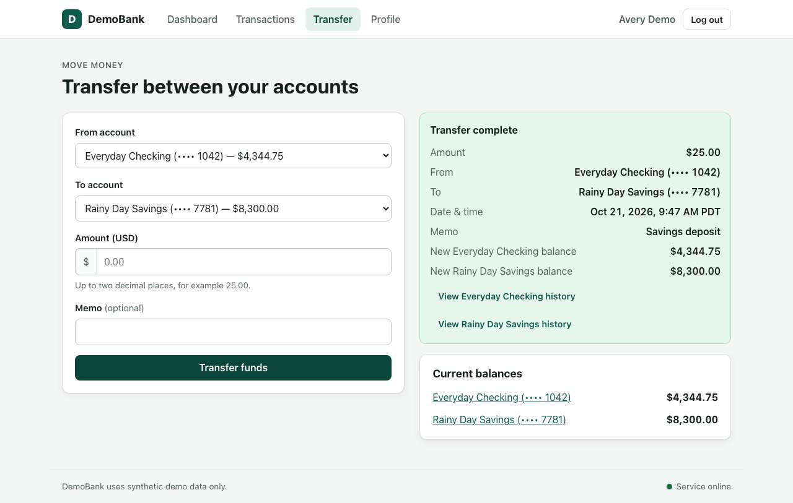

Network calls: `POST /api/demo/session 201`, `GET /api/me 200`, `GET /api/accounts 200`, `POST /api/transfers 201`

✅ <i>Overdraft transfer is rejected with failure explanation and no success state</i> (boundary, boundary-value analysis)

#### ✅ Scenario: Overdraft transfer is rejected with failure explanation and no success state

*boundary · boundary-value analysis* · all checks passed

**Steps to reproduce**

1. Open the landing page and enter the demo
2. Navigate to /transfer
3. Read API GET /api/accounts → `api_accounts_before` = `"{\"status\": 200, \"body\": {\"accounts\": [{\"id\": \"00000000-0000-0000-0000-000000000101\", \"name\": \"Everyday Checking\", \"type\": \"checking\", \"maske`
4. Select 'Everyday Checking' in combobox 'From account'
5. Select 'Rainy Day Savings' in combobox 'To account'
6. Type '25.00' into field labelled 'Amount (USD)'
7. Click button 'Transfer funds'
8. Read API GET /api/accounts → `api_accounts_after` = `"{\"status\": 200, \"body\": {\"accounts\": [{\"id\": \"00000000-0000-0000-0000-000000000101\", \"name\": \"Everyday Checking\", \"type\": \"checking\", \"maske`
9. Read API GET /api/transactions → `api_tx_after` = `"{\"status\": 200, \"body\": {\"transactions\": [{\"id\": \"4211af49-17aa-45ff-a9b4-279c0be28068\", \"type\": \"transfer\", \"status\": \"completed\", \"amount\`
10. Read text of 'alert' → `alert_text` = `null`
11. Read text of 'status' → `status_text` = `"Transfer complete\nAmount\n$25.00\nFrom\nEveryday Checking (\u2022\u2022\u2022\u2022 1042)\nTo\nRainy Day Savings (\u2022\u2022\u2022\u2022 7781)\nDate & time\`
12. Read all_text of element [data-testid=transfer-balance] → `balances_after` = `["$4,344.75", "$8,300.00"]`

| Expected (check) | Kind | Result | Observed |
|---|---|---|---|
| Transfer is committed to backend account balances (PRD: transfer has been committed) | side_effect | ✅ pass | `{"api_accounts_after": {"status": 200, "body": {"accounts": [{"id": "00000000-0000-0000-0000-000000000101", "name": "Everyday Checking", "type": "checking", "masked_number": "\u2022\u2022\u2022\u2022 1042", "currency": "` |
| Committed transaction record exists with completed status in transaction history | side_effect | ✅ pass | `{"api_tx_after": "{\"status\": 200, \"body\": {\"transactions\": [{\"id\": \"4211af49-17aa-45ff-a9b4-279c0be28068\", \"type\": \"transfer\", \"status\": \"completed\", \"amount\": \"25.00\", \"memo\": null, \"occurred_at` |
| No failure alert is shown on successfully committed transfer | functional | ✅ pass | `{"alert_text": null}` |
| UI balances match the committed accounts data | cross_source | ✅ pass | `{"api_accounts_after": {"status": 200, "body": {"accounts": [{"id": "00000000-0000-0000-0000-000000000101", "name": "Everyday Checking", "type": "checking", "masked_number": "\u2022\u2022\u2022\u2022 1042", "currency": "` |

Evidence: [TRF-07-s2-r1-v00-s05.jpg](./screenshots/TRF-07-s2-r1-v00-s05.jpg) · [TRF-07-s2-r1-v00-s06.jpg](./screenshots/TRF-07-s2-r1-v00-s06.jpg) · [TRF-07-s2-r1-v00-s07.jpg](./screenshots/TRF-07-s2-r1-v00-s07.jpg) · [TRF-07-s2-r1-v00-final.jpg](./screenshots/TRF-07-s2-r1-v00-final.jpg)

Network calls: `POST /api/demo/session 201`, `GET /api/me 200`, `GET /api/accounts 200`, `POST /api/transfers 201`

#### ⚠️ Scenario: Zero amount transfer is rejected with failure explanation and balances unchanged

*negative · equivalence partitioning* · no conclusive result after 2 attempt(s); last outcome: FAIL

**Steps to reproduce**

1. Open the landing page and enter the demo
2. Navigate to /transfer
3. Read API GET /api/accounts → `api_before` = `"{\"status\": 200, \"body\": {\"accounts\": [{\"id\": \"00000000-0000-0000-0000-000000000101\", \"name\": \"Everyday Checking\", \"type\": \"checking\", \"maske`
4. Read all_text of element [data-testid=transfer-balance] → `balances_before` = `["$4,344.75", "$8,300.00"]`
5. Select 'Everyday Checking' in combobox 'From account'
6. Select 'Rainy Day Savings' in combobox 'To account'
7. Type '99999.00' into field labelled 'Amount (USD)'
8. Click button 'Transfer funds'
9. Read text of 'Transfer not completed' → `error_title` = `null`
10. Read text of 'The request conflicts with the current state of your accounts.' → `conflict_msg` = `null`
11. Read text of 'alert' → `error_alert` = `null`
12. Read text of 'status' → `status_msg` = `"Transfer complete\nAmount\n$99,999.00\nFrom\nEveryday Checking (\u2022\u2022\u2022\u2022 1042)\nTo\nRainy Day Savings (\u2022\u2022\u2022\u2022 7781)\nDate & t`
13. Read API GET /api/accounts → `api_after` = `"{\"status\": 200, \"body\": {\"accounts\": [{\"id\": \"00000000-0000-0000-0000-000000000101\", \"name\": \"Everyday Checking\", \"type\": \"checking\", \"maske`
14. Read all_text of element [data-testid=transfer-balance] → `balances_after` = `["\u2212$95,654.25", "$108,299.00"]`

| Expected (check) | Kind | Result | Observed |
|---|---|---|---|
| UI explains that the transfer did not complete without relying on role='alert' | functional | ✅ pass | `{"conflict_msg": null, "error_alert": null, "error_title": null, "status_msg": "Transfer complete\nAmount\n$99,999.00\nFrom\nEveryday Checking (\u2022\u2022\u2022\u2022 1042)\nTo\nRainy Day Savings (\u2022\u2022\u2022\u2` |
| Failure notice explains that the transfer did not complete | subjective | ❌ fail | `{"error_title": null}` |
| UI does not show a success state upon rejection | side_effect | ✅ pass | `{"error_alert": null, "status_msg": "Transfer complete\nAmount\n$99,999.00\nFrom\nEveryday Checking (\u2022\u2022\u2022\u2022 1042)\nTo\nRainy Day Savings (\u2022\u2022\u2022\u2022 7781)\nDate & time\nOct 21, 2026, 9:50 ` |
| Backend balances remain unchanged after rejected transfer | side_effect | ❌ fail | `{"api_after": {"status": 200, "body": {"accounts": [{"id": "00000000-0000-0000-0000-000000000101", "name": "Everyday Checking", "type": "checking", "masked_number": "\u2022\u2022\u2022\u2022 1042", "currency": "USD", "ba` |
| UI balances remain unchanged after rejected transfer | side_effect | ❌ fail | `{"balances_after": ["\u2212$95,654.25", "$108,299.00"], "balances_before": ["$4,344.75", "$8,300.00"]}` |

Review (majority of 3): {'reject': 3}  
Evidence: [TRF-07-s3-r1-v00-s06.jpg](./screenshots/TRF-07-s3-r1-v00-s06.jpg) · [TRF-07-s3-r1-v00-s07.jpg](./screenshots/TRF-07-s3-r1-v00-s07.jpg) · [TRF-07-s3-r1-v00-s08.jpg](./screenshots/TRF-07-s3-r1-v00-s08.jpg) · [TRF-07-s3-r1-v00-final.jpg](./screenshots/TRF-07-s3-r1-v00-final.jpg)

Network calls: `POST /api/demo/session 201`, `GET /api/me 200`, `GET /api/accounts 200`, `POST /api/transfers 201`

## Passed requirements

### ACC-02

**Requirement:** The header identifies the active demo customer and provides a Log out action.  
**PRD:** “The header identifies the active demo customer and provides a **Log out** action.”  
**Verdict:** ✅ PASS: 3 scenario(s) passed

✅ <i>Header identifies active demo customer matching /api/me and provides a Log out button</i> (normal, equivalence partitioning)

#### ✅ Scenario: Header identifies active demo customer matching /api/me and provides a Log out button

*normal · equivalence partitioning* · all checks passed

**Steps to reproduce**

1. Open the landing page and enter the demo
2. Read API GET /api/me → `me_info` = `{"status": 200, "body": {"id": "00000000-0000-0000-0000-000000000001", "display_name": "Avery Demo", "masked_email": "a***@example.test"}}`
3. Read text of element [data-testid=active-customer] → `customer_header_text` = `"Signed in as\nAvery Demo"`
4. Read count of button 'Log out' → `logout_button_count` = `1`

| Expected (check) | Kind | Result | Observed |
|---|---|---|---|
| Header contains customer display name retrieved from session API (PRD: identifies the active demo customer) | cross_source | ✅ pass | `{"customer_header_text": "Signed in as\nAvery Demo", "me_info": {"status": 200, "body": {"id": "00000000-0000-0000-0000-000000000001", "display_name": "Avery Demo", "masked_email": "a***@example.test"}}}` |
| Log out action is present and visible in the header (PRD: provides a Log out action) | functional | ✅ pass | `{"logout_button_count": 1}` |

Evidence: [ACC-02-s1-r0-v00-s01.jpg](./screenshots/ACC-02-s1-r0-v00-s01.jpg) · [ACC-02-s1-r0-v00-final.jpg](./screenshots/ACC-02-s1-r0-v00-final.jpg)

Network calls: `POST /api/demo/session 201`, `GET /api/me 200`, `GET /api/accounts 200`

✅ <i>Clicking Log out terminates the demo session and removes active customer indicator</i> (normal, state-transition testing)

#### ✅ Scenario: Clicking Log out terminates the demo session and removes active customer indicator

*normal · state-transition testing* · all checks passed

**Steps to reproduce**

1. Open the landing page and enter the demo
2. Read text of element [data-testid=active-customer] → `customer_before` = `"Signed in as\nAvery Demo"`
3. Click button 'Log out'
4. Read url of  → `url_after_logout` = `"/"`
5. Read count of element [data-testid=active-customer] → `customer_count_after` = `0`
6. Read API GET /api/me → `api_me_after` = `{"status": 401, "body": {"error": {"code": "unauthenticated", "message": "A valid demo session is required."}}}`

| Expected (check) | Kind | Result | Observed |
|---|---|---|---|
| User is redirected to the entry route after logging out | side_effect | ✅ pass | `{"url_after_logout": "/"}` |
| Active customer element is no longer visible in the header | side_effect | ✅ pass | `{"customer_count_after": 0}` |
| Server session is cleared, returning 401 Unauthorized for /api/me | side_effect | ✅ pass | `{"api_me_after": {"status": 401, "body": {"error": {"code": "unauthenticated", "message": "A valid demo session is required."}}}}` |

Evidence: [ACC-02-s2-r0-v00-s01.jpg](./screenshots/ACC-02-s2-r0-v00-s01.jpg) · [ACC-02-s2-r0-v00-s03.jpg](./screenshots/ACC-02-s2-r0-v00-s03.jpg) · [ACC-02-s2-r0-v00-final.jpg](./screenshots/ACC-02-s2-r0-v00-final.jpg)

Network calls: `POST /api/demo/session 201`, `GET /api/me 200`, `GET /api/accounts 200`

✅ <i>Customer identification and Log out action remain visible across different pages</i> (normal, metamorphic relation)

#### ✅ Scenario: Customer identification and Log out action remain visible across different pages

*normal · metamorphic relation* · all checks passed

**Steps to reproduce**

1. Open the landing page and enter the demo
2. Read text of element [data-testid=active-customer] → `dash_customer` = `"Signed in as\nAvery Demo"`
3. Read count of button 'Log out' → `dash_logout_count` = `1`
4. Navigate to /transactions
5. Read text of element [data-testid=active-customer] → `tx_customer` = `"Signed in as\nAvery Demo"`
6. Read count of button 'Log out' → `tx_logout_count` = `1`
7. Navigate to /profile
8. Read text of element [data-testid=active-customer] → `prof_customer` = `"Signed in as\nAvery Demo"`
9. Read count of button 'Log out' → `prof_logout_count` = `1`

| Expected (check) | Kind | Result | Observed |
|---|---|---|---|
| Customer identity in header is invariant across dashboard, transactions, and profile | invariant | ✅ pass | `{"dash_customer": "Signed in as\nAvery Demo", "prof_customer": "Signed in as\nAvery Demo", "tx_customer": "Signed in as\nAvery Demo"}` |
| Log out action is consistently available on all navigated pages | invariant | ✅ pass | `{"dash_logout_count": 1, "prof_logout_count": 1, "tx_logout_count": 1}` |

Evidence: [ACC-02-s3-r0-v00-s01.jpg](./screenshots/ACC-02-s3-r0-v00-s01.jpg) · [ACC-02-s3-r0-v00-s04.jpg](./screenshots/ACC-02-s3-r0-v00-s04.jpg) · [ACC-02-s3-r0-v00-s07.jpg](./screenshots/ACC-02-s3-r0-v00-s07.jpg) · [ACC-02-s3-r0-v00-final.jpg](./screenshots/ACC-02-s3-r0-v00-final.jpg)

Network calls: `POST /api/demo/session 201`, `GET /api/me 200`, `GET /api/accounts 200`, `GET /api/transactions 200`

### ACC-03

**Requirement:** Logging out returns the user to the landing page and invalidates access to protected dashboard views.  
**PRD:** “Logging out returns the user to the landing page. Protected dashboard views should not remain usable after logout; direct navigation to them should return the user to the landing page or an access-required state.”  
**Verdict:** ✅ PASS: 3 scenario(s) passed

✅ <i>Logging out redirects the user to the landing page and destroys the active session</i> (normal, state-transition testing)

#### ✅ Scenario: Logging out redirects the user to the landing page and destroys the active session

*normal · state-transition testing* · all checks passed

**Steps to reproduce**

1. Open the landing page and enter the demo
2. Read url of  → `url_before` = `"/dashboard"`
3. Read API GET /api/me → `api_me_before` = `{"status": 200, "body": {"id": "00000000-0000-0000-0000-000000000001", "display_name": "Avery Demo", "masked_email": "a***@example.test"}}`
4. Click button 'Log out'
5. Read url of  → `url_after` = `"/"`
6. Read count of button 'Enter Demo' → `enter_demo_count` = `1`
7. Read count of element [data-testid=active-customer] → `active_user_count` = `0`
8. Read API GET /api/me → `api_me_after` = `{"status": 401, "body": {"error": {"code": "unauthenticated", "message": "A valid demo session is required."}}}`

| Expected (check) | Kind | Result | Observed |
|---|---|---|---|
| Session was authenticated before clicking Log out | functional | ✅ pass | `{"api_me_before": {"status": 200, "body": {"id": "00000000-0000-0000-0000-000000000001", "display_name": "Avery Demo", "masked_email": "a***@example.test"}}}` |
| Clicking Log out redirects the browser to the landing page (PRD: Logging out returns the user to the landing page) | functional | ✅ pass | `{"url_after": "/"}` |
| Landing page 'Enter Demo' button is displayed after logout | functional | ✅ pass | `{"active_user_count": 0, "enter_demo_count": 1}` |
| User session is invalidated server-side (PRD: Protected dashboard views should not remain usable after logout) | side_effect | ✅ pass | `{"api_me_after": {"status": 401, "body": {"error": {"code": "unauthenticated", "message": "A valid demo session is required."}}}}` |

Evidence: [ACC-03-s1-r0-v00-s01.jpg](./screenshots/ACC-03-s1-r0-v00-s01.jpg) · [ACC-03-s1-r0-v00-s04.jpg](./screenshots/ACC-03-s1-r0-v00-s04.jpg) · [ACC-03-s1-r0-v00-final.jpg](./screenshots/ACC-03-s1-r0-v00-final.jpg)

Network calls: `POST /api/demo/session 201`, `GET /api/me 200`, `GET /api/accounts 200`

✅ <i>Direct navigation to /dashboard after logout redirects to landing page or access-required state</i> (negative, state-transition testing)

#### ✅ Scenario: Direct navigation to /dashboard after logout redirects to landing page or access-required state

*negative · state-transition testing* · all checks passed

**Steps to reproduce**

1. Open the landing page and enter the demo
2. Click button 'Log out'
3. Navigate to /dashboard
4. Read url of  → `dashboard_url` = `"/"`
5. Read count of element [data-testid=account-card] → `account_card_count` = `0`
6. Read count of element [data-testid=active-customer] → `active_customer_count` = `0`
7. Read count of button 'Enter Demo' → `enter_demo_count` = `1`
8. Read text of 'heading' → `landing_heading` = `"Your accounts, in one simple dashboard."`
9. Read API GET /api/accounts → `accounts_api` = `{"status": 401, "body": {"error": {"code": "unauthenticated", "message": "A valid demo session is required."}}}`

| Expected (check) | Kind | Result | Observed |
|---|---|---|---|
| User is redirected away from dashboard or kept in landing/access-required view | functional | ✅ pass | `{"dashboard_url": "/", "enter_demo_count": 1, "landing_heading": "Your accounts, in one simple dashboard."}` |
| Dashboard data and customer profile elements are not rendered (PRD: Dashboard data and actions are not rendered or interactive after logout) | side_effect | ✅ pass | `{"account_card_count": 0, "active_customer_count": 0}` |
| Accounts API rejects request without session with 401 Unauthorized | cross_source | ✅ pass | `{"accounts_api": {"status": 401, "body": {"error": {"code": "unauthenticated", "message": "A valid demo session is required."}}}}` |

Evidence: [ACC-03-s2-r0-v00-s01.jpg](./screenshots/ACC-03-s2-r0-v00-s01.jpg) · [ACC-03-s2-r0-v00-s02.jpg](./screenshots/ACC-03-s2-r0-v00-s02.jpg) · [ACC-03-s2-r0-v00-s03.jpg](./screenshots/ACC-03-s2-r0-v00-s03.jpg) · [ACC-03-s2-r0-v00-final.jpg](./screenshots/ACC-03-s2-r0-v00-final.jpg)

Network calls: `POST /api/demo/session 201`, `GET /api/me 200`, `GET /api/accounts 200`, `GET /api/me 401`

✅ <i>Direct navigation to protected /transfer view after logout is blocked</i> (negative, boundary-value analysis)

#### ✅ Scenario: Direct navigation to protected /transfer view after logout is blocked

*negative · boundary-value analysis* · all checks passed

**Steps to reproduce**

1. Open the landing page and enter the demo
2. Click button 'Log out'
3. Navigate to /transfer
4. Read url of  → `transfer_url` = `"/"`
5. Read count of button 'Transfer funds' → `transfer_btn_count` = `0`
6. Read count of button 'Enter Demo' → `enter_demo_count` = `1`
7. Read API GET /api/me → `api_me` = `{"status": 401, "body": {"error": {"code": "unauthenticated", "message": "A valid demo session is required."}}}`

| Expected (check) | Kind | Result | Observed |
|---|---|---|---|
| Direct navigation to transfer view does not keep protected action usable (PRD: Protected dashboard views should not remain usable after logout) | functional | ✅ pass | `{"transfer_btn_count": 0}` |
| Direct navigation returns user to landing page or access-required view | functional | ✅ pass | `{"enter_demo_count": 1, "transfer_url": "/"}` |
| Server session remains unauthenticated | invariant | ✅ pass | `{"api_me": {"status": 401, "body": {"error": {"code": "unauthenticated", "message": "A valid demo session is required."}}}}` |

Evidence: [ACC-03-s3-r0-v00-s01.jpg](./screenshots/ACC-03-s3-r0-v00-s01.jpg) · [ACC-03-s3-r0-v00-s02.jpg](./screenshots/ACC-03-s3-r0-v00-s02.jpg) · [ACC-03-s3-r0-v00-s03.jpg](./screenshots/ACC-03-s3-r0-v00-s03.jpg) · [ACC-03-s3-r0-v00-final.jpg](./screenshots/ACC-03-s3-r0-v00-final.jpg)

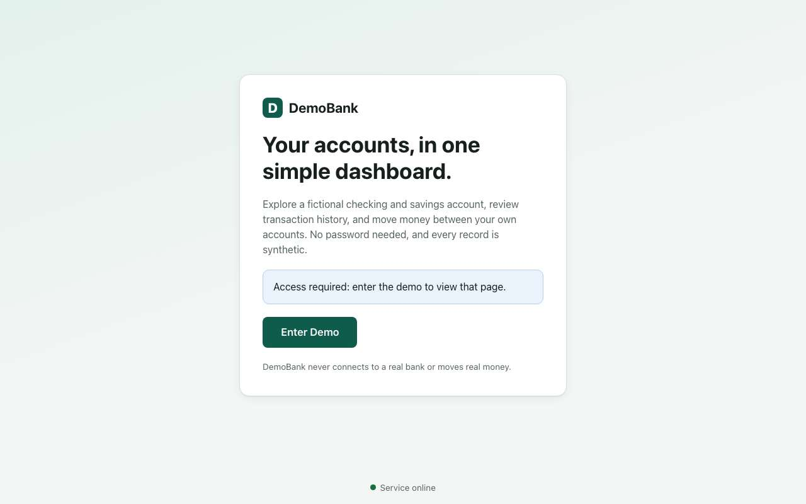

Network calls: `POST /api/demo/session 201`, `GET /api/me 200`, `GET /api/accounts 200`, `GET /api/me 401`

### ACC-04

**Requirement:** Refreshing the browser during an active demo session preserves the session.  
**PRD:** “Refreshing while in a valid demo session should preserve that session.”  
**Verdict:** ✅ PASS: 3 scenario(s) passed

✅ <i>Refreshing the dashboard during an active session preserves authentication and user identity</i> (normal, state-transition testing)

#### ✅ Scenario: Refreshing the dashboard during an active session preserves authentication and user identity

*normal · state-transition testing* · all checks passed

**Steps to reproduce**

1. Open the landing page and enter the demo
2. Read url of  → `url_before` = `"/dashboard"`
3. Read text of element [data-testid=active-customer] → `customer_before` = `"Signed in as\nAvery Demo"`
4. Read API GET /api/me → `api_before` = `{"status": 200, "body": {"id": "00000000-0000-0000-0000-000000000001", "display_name": "Avery Demo", "masked_email": "a***@example.test"}}`
5. Reload the page
6. Read url of  → `url_after` = `"/dashboard"`
7. Read text of element [data-testid=active-customer] → `customer_after` = `"Signed in as\nAvery Demo"`
8. Read API GET /api/me → `api_after` = `{"status": 200, "body": {"id": "00000000-0000-0000-0000-000000000001", "display_name": "Avery Demo", "masked_email": "a***@example.test"}}`

| Expected (check) | Kind | Result | Observed |
|---|---|---|---|
| User remains on the protected dashboard view rather than landing page (PRD: Refreshing while in a valid demo session should preserve that session) | functional | ✅ pass | `{"url_after": "/dashboard", "url_before": "/dashboard"}` |
| Active session customer identification in UI remains intact across reload | invariant | ✅ pass | `{"customer_after": "Signed in as\nAvery Demo", "customer_before": "Signed in as\nAvery Demo"}` |
| Server session /api/me remains active and identity is unchanged | cross_source | ✅ pass | `{"api_after": {"status": 200, "body": {"id": "00000000-0000-0000-0000-000000000001", "display_name": "Avery Demo", "masked_email": "a***@example.test"}}, "api_before": {"status": 200, "body": {"id": "00000000-0000-0000-0` |

Evidence: [ACC-04-s1-r0-v00-s01.jpg](./screenshots/ACC-04-s1-r0-v00-s01.jpg) · [ACC-04-s1-r0-v00-s05.jpg](./screenshots/ACC-04-s1-r0-v00-s05.jpg) · [ACC-04-s1-r0-v00-final.jpg](./screenshots/ACC-04-s1-r0-v00-final.jpg)

Network calls: `POST /api/demo/session 201`, `GET /api/me 200`, `GET /api/accounts 200`

✅ <i>Refreshing on a deep protected view (/transfer) preserves the route and active session</i> (boundary, state-transition testing)

#### ✅ Scenario: Refreshing on a deep protected view (/transfer) preserves the route and active session

*boundary · state-transition testing* · all checks passed

**Steps to reproduce**

1. Open the landing page and enter the demo
2. Navigate to /transfer
3. Read url of  → `url_before` = `"/transfer"`
4. Read text of heading 'Transfer between your accounts' → `heading_before` = `"Transfer between your accounts"`
5. Read text of element [data-testid=active-customer] → `customer_before` = `"Signed in as\nAvery Demo"`
6. Reload the page
7. Read url of  → `url_after` = `"/transfer"`
8. Read text of heading 'Transfer between your accounts' → `heading_after` = `"Transfer between your accounts"`
9. Read text of element [data-testid=active-customer] → `customer_after` = `"Signed in as\nAvery Demo"`

| Expected (check) | Kind | Result | Observed |
|---|---|---|---|
| Protected deep route /transfer is preserved and not redirected to landing | functional | ✅ pass | `{"url_after": "/transfer", "url_before": "/transfer"}` |
| Protected view content is fully rendered after reload | functional | ✅ pass | `{"heading_after": "Transfer between your accounts", "heading_before": "Transfer between your accounts"}` |
| Customer session indicator remains visible on the deep route | invariant | ✅ pass | `{"customer_after": "Signed in as\nAvery Demo", "customer_before": "Signed in as\nAvery Demo"}` |

Evidence: [ACC-04-s2-r0-v00-s01.jpg](./screenshots/ACC-04-s2-r0-v00-s01.jpg) · [ACC-04-s2-r0-v00-s02.jpg](./screenshots/ACC-04-s2-r0-v00-s02.jpg) · [ACC-04-s2-r0-v00-s06.jpg](./screenshots/ACC-04-s2-r0-v00-s06.jpg) · [ACC-04-s2-r0-v00-final.jpg](./screenshots/ACC-04-s2-r0-v00-final.jpg)

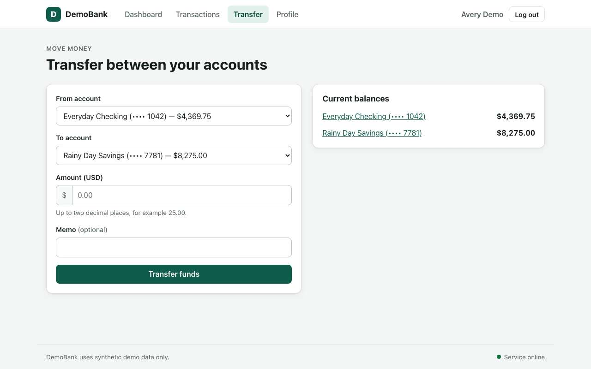

Network calls: `POST /api/demo/session 201`, `GET /api/me 200`, `GET /api/accounts 200`

✅ <i>Refreshing after session cookies are cleared does not preserve session</i> (negative, state-transition testing)

#### ✅ Scenario: Refreshing after session cookies are cleared does not preserve session

*negative · state-transition testing* · all checks passed

**Steps to reproduce**

1. Open the landing page and enter the demo
2. Read text of element [data-testid=active-customer] → `customer_before` = `"Signed in as\nAvery Demo"`
3. Clear browser cookies
4. Reload the page
5. Read url of  → `url_after` = `"/"`
6. Read count of button 'Enter Demo' → `enter_demo_count` = `1`
7. Read API GET /api/me → `api_after` = `{"status": 401, "body": {"error": {"code": "unauthenticated", "message": "A valid demo session is required."}}}`

| Expected (check) | Kind | Result | Observed |
|---|---|---|---|
| Server reports unauthorized session after cookies are cleared | side_effect | ✅ pass | `{"api_after": {"status": 401, "body": {"error": {"code": "unauthenticated", "message": "A valid demo session is required."}}}}` |
| User is redirected to landing or presented with entry action when session is not valid | functional | ✅ pass | `{"enter_demo_count": 1, "url_after": "/"}` |

Evidence: [ACC-04-s3-r0-v00-s01.jpg](./screenshots/ACC-04-s3-r0-v00-s01.jpg) · [ACC-04-s3-r0-v00-s04.jpg](./screenshots/ACC-04-s3-r0-v00-s04.jpg) · [ACC-04-s3-r0-v00-final.jpg](./screenshots/ACC-04-s3-r0-v00-final.jpg)

Network calls: `POST /api/demo/session 201`, `GET /api/me 200`, `GET /api/accounts 200`, `GET /api/me 401`

### ACC-05

**Requirement:** Refreshing a protected page after logout must not restore access.  
**PRD:** “A logged-out user must not regain access merely by refreshing a protected page.”  
**Verdict:** ✅ PASS: 3 scenario(s) passed

✅ <i>Refreshing protected dashboard after logout does not restore access or display account details</i> (negative, state-transition testing)

#### ✅ Scenario: Refreshing protected dashboard after logout does not restore access or display account details

*negative · state-transition testing* · all checks passed

**Steps to reproduce**

1. Open the landing page and enter the demo
2. Read text of element [data-testid=active-customer] → `logged_in_user` = `"Signed in as\nAvery Demo"`
3. Click button 'Log out'
4. Navigate to /dashboard
5. Reload the page
6. Read count of element [data-testid=active-customer] → `active_user_count` = `0`
7. Read count of element [data-testid=account-card] → `account_card_count` = `0`
8. Read API GET /api/me → `api_me` = `{"status": 401, "body": {"error": {"code": "unauthenticated", "message": "A valid demo session is required."}}}`
9. Read API GET /api/accounts → `api_accounts` = `{"status": 401, "body": {"error": {"code": "unauthenticated", "message": "A valid demo session is required."}}}`

| Expected (check) | Kind | Result | Observed |
|---|---|---|---|
| User was initially authenticated on dashboard | functional | ✅ pass | `{"logged_in_user": "Signed in as\nAvery Demo"}` |
| No active customer element after refreshing protected dashboard (PRD: logged-out user must not regain access merely by refreshing a protected page) | functional | ✅ pass | `{"active_user_count": 0}` |
| Protected account cards and balances are not loaded after refresh | side_effect | ✅ pass | `{"account_card_count": 0}` |
| Backend session remains unauthenticated (401) | cross_source | ✅ pass | `{"api_accounts": {"status": 401, "body": {"error": {"code": "unauthenticated", "message": "A valid demo session is required."}}}, "api_me": {"status": 401, "body": {"error": {"code": "unauthenticated", "message": "A vali` |

Evidence: [ACC-05-s1-r0-v00-s03.jpg](./screenshots/ACC-05-s1-r0-v00-s03.jpg) · [ACC-05-s1-r0-v00-s04.jpg](./screenshots/ACC-05-s1-r0-v00-s04.jpg) · [ACC-05-s1-r0-v00-s05.jpg](./screenshots/ACC-05-s1-r0-v00-s05.jpg) · [ACC-05-s1-r0-v00-final.jpg](./screenshots/ACC-05-s1-r0-v00-final.jpg)

Network calls: `POST /api/demo/session 201`, `GET /api/me 200`, `GET /api/accounts 200`, `GET /api/me 401`

✅ <i>Refreshing protected /transfer page after logout does not restore access or transfer controls</i> (negative, state-transition testing)

#### ✅ Scenario: Refreshing protected /transfer page after logout does not restore access or transfer controls

*negative · state-transition testing* · all checks passed

**Steps to reproduce**

1. Open the landing page and enter the demo
2. Click button 'Log out'
3. Navigate to /transfer
4. Reload the page
5. Read count of combobox 'From account' → `from_account_count` = `0`
6. Read count of element [data-testid=active-customer] → `active_user_count` = `0`
7. Read count of element [data-testid=transfer-balance] → `transfer_balance_count` = `0`
8. Read API GET /api/me → `api_me` = `{"status": 401, "body": {"error": {"code": "unauthenticated", "message": "A valid demo session is required."}}}`

| Expected (check) | Kind | Result | Observed |
|---|---|---|---|
| Protected transfer form and balances are not rendered after refresh (PRD: logged-out user must not regain access merely by refreshing) | functional | ✅ pass | `{"from_account_count": 0, "transfer_balance_count": 0}` |
| Active customer indicator remains absent | functional | ✅ pass | `{"active_user_count": 0}` |
| Session endpoint rejects request with 401 unauthorized | cross_source | ✅ pass | `{"api_me": {"status": 401, "body": {"error": {"code": "unauthenticated", "message": "A valid demo session is required."}}}}` |

Evidence: [ACC-05-s2-r0-v00-s02.jpg](./screenshots/ACC-05-s2-r0-v00-s02.jpg) · [ACC-05-s2-r0-v00-s03.jpg](./screenshots/ACC-05-s2-r0-v00-s03.jpg) · [ACC-05-s2-r0-v00-s04.jpg](./screenshots/ACC-05-s2-r0-v00-s04.jpg) · [ACC-05-s2-r0-v00-final.jpg](./screenshots/ACC-05-s2-r0-v00-final.jpg)

Network calls: `POST /api/demo/session 201`, `GET /api/me 200`, `GET /api/accounts 200`, `GET /api/me 401`

✅ <i>Navigating to protected transactions page after logout and refreshing does not restore transaction history</i> (negative, state-transition testing)

#### ✅ Scenario: Navigating to protected transactions page after logout and refreshing does not restore transaction history

*negative · state-transition testing* · all checks passed

**Steps to reproduce**

1. Open the landing page and enter the demo
2. Navigate to /transactions
3. Read count of element [data-testid=transaction-table] → `table_count_before` = `1`
4. Click button 'Log out'
5. Navigate to /transactions
6. Reload the page
7. Read count of element [data-testid=transaction-table] → `table_count_after` = `0`
8. Read count of element [data-testid=active-customer] → `active_user_count` = `0`
9. Read API GET /api/transactions → `api_tx` = `{"status": 401, "body": {"error": {"code": "unauthenticated", "message": "A valid demo session is required."}}}`

| Expected (check) | Kind | Result | Observed |
|---|---|---|---|
| Transactions table was visible prior to logout | functional | ✅ pass | `{"table_count_before": 1}` |
| Transaction table is not displayed after refreshing protected transactions page | side_effect | ✅ pass | `{"table_count_after": 0}` |
| Active customer profile is not present | functional | ✅ pass | `{"active_user_count": 0}` |
| Transactions API rejects unauthenticated fetch with 401 | cross_source | ✅ pass | `{"api_tx": {"status": 401, "body": {"error": {"code": "unauthenticated", "message": "A valid demo session is required."}}}}` |

Evidence: [ACC-05-s3-r0-v00-s04.jpg](./screenshots/ACC-05-s3-r0-v00-s04.jpg) · [ACC-05-s3-r0-v00-s05.jpg](./screenshots/ACC-05-s3-r0-v00-s05.jpg) · [ACC-05-s3-r0-v00-s06.jpg](./screenshots/ACC-05-s3-r0-v00-s06.jpg) · [ACC-05-s3-r0-v00-final.jpg](./screenshots/ACC-05-s3-r0-v00-final.jpg)

Network calls: `POST /api/demo/session 201`, `GET /api/me 200`, `GET /api/accounts 200`, `GET /api/transactions 200`, `GET /api/me 401`

### DSH-01

**Requirement:** The dashboard displays the customer's checking and savings accounts.  
**PRD:** “The dashboard shows the customer's checking and savings accounts.”  
**Verdict:** ✅ PASS: 1 scenario(s) passed

✅ <i>Dashboard displays checking and savings accounts matching the customer's accounts</i> (normal, specification-based verification + cross-source validation)

#### ✅ Scenario: Dashboard displays checking and savings accounts matching the customer's accounts

*normal · specification-based verification + cross-source validation* · all checks passed

**Steps to reproduce**

1. Open the landing page and enter the demo
2. Read all_text of element [data-testid=account-card] → `account_cards` = `["Everyday Checking\nChecking\n\nAccount number ending\n\u2022\u2022\u2022\u2022 1042\n\nAvailable balance\n\n$4,369.75USD\n\nView details \u2192", "Rainy Day S`
3. Read API GET /api/accounts → `api_accounts` = `"{\"status\": 200, \"body\": {\"accounts\": [{\"id\": \"00000000-0000-0000-0000-000000000101\", \"name\": \"Everyday Checking\", \"type\": \"checking\", \"maske`
4. Read API GET /api/me → `api_me` = `{"status": 200, "body": {"id": "00000000-0000-0000-0000-000000000001", "display_name": "Avery Demo", "masked_email": "a***@example.test"}}`

| Expected (check) | Kind | Result | Observed |
|---|---|---|---|
| API confirms authenticated customer has both checking and savings accounts | cross_source | ✅ pass | `{"api_accounts": {"status": 200, "body": {"accounts": [{"id": "00000000-0000-0000-0000-000000000101", "name": "Everyday Checking", "type": "checking", "masked_number": "\u2022\u2022\u2022\u2022 1042", "currency": "USD", ` |
| Dashboard displays account cards for checking and savings accounts | functional | ✅ pass | `{"account_cards": ["Everyday Checking\nChecking\n\nAccount number ending\n\u2022\u2022\u2022\u2022 1042\n\nAvailable balance\n\n$4,369.75USD\n\nView details \u2192", "Rainy Day Savings\nSavings\n\nAccount number ending\n` |
| Each account returned by the API is presented on the dashboard | cross_source | ✅ pass | `{"account_cards": ["Everyday Checking\nChecking\n\nAccount number ending\n\u2022\u2022\u2022\u2022 1042\n\nAvailable balance\n\n$4,369.75USD\n\nView details \u2192", "Rainy Day Savings\nSavings\n\nAccount number ending\n` |
| Accounts are associated with the authenticated session | cross_source | ✅ pass | `{"api_me": {"status": 200, "body": {"id": "00000000-0000-0000-0000-000000000001", "display_name": "Avery Demo", "masked_email": "a***@example.test"}}}` |

Evidence: [DSH-01-s1-r0-v00-s01.jpg](./screenshots/DSH-01-s1-r0-v00-s01.jpg) · [DSH-01-s1-r0-v00-final.jpg](./screenshots/DSH-01-s1-r0-v00-final.jpg)

Network calls: `POST /api/demo/session 201`, `GET /api/me 200`, `GET /api/accounts 200`

### DSH-02

**Requirement:** Each account displays a readable name, masked identifier, account type, and available balance in USD with two decimal places without exposing the full identifier.  
**PRD:** “Each account displays a readable account name, a masked account identifier, account type, and current available balance in USD. Balances are displayed to two decimal places. The UI must not expose a full account identifier.”  
**Verdict:** ✅ PASS: 1 scenario(s) passed

✅ <i>Dashboard displays readable name, masked identifier, account type, and two-decimal USD balance for each account</i> (normal, specification-based testing)

#### ✅ Scenario: Dashboard displays readable name, masked identifier, account type, and two-decimal USD balance for each account

*normal · specification-based testing* · all checks passed

**Steps to reproduce**

1. Open the landing page and enter the demo
2. Read API GET /api/accounts → `api_accounts` = `"{\"status\": 200, \"body\": {\"accounts\": [{\"id\": \"00000000-0000-0000-0000-000000000101\", \"name\": \"Everyday Checking\", \"type\": \"checking\", \"maske`
3. Read all_text of element [data-testid=account-card] → `cards` = `["Everyday Checking\nChecking\n\nAccount number ending\n\u2022\u2022\u2022\u2022 1042\n\nAvailable balance\n\n$4,369.75USD\n\nView details \u2192", "Rainy Day S`
4. Read text of element [data-testid=account-card] → `first_card` = `"Everyday Checking\nChecking\n\nAccount number ending\n\u2022\u2022\u2022\u2022 1042\n\nAvailable balance\n\n$4,369.75USD\n\nView details \u2192"`
5. Read all_text of element [data-testid=account-balance] → `balances` = `["$4,369.75USD", "$8,275.00USD"]`

| Expected (check) | Kind | Result | Observed |
|---|---|---|---|
| Each account card displays the account name, type, and masked account identifier | functional | ✅ pass | `{"api_accounts": {"status": 200, "body": {"accounts": [{"id": "00000000-0000-0000-0000-000000000101", "name": "Everyday Checking", "type": "checking", "masked_number": "\u2022\u2022\u2022\u2022 1042", "currency": "USD", ` |
| Balances are displayed in USD formatted with two decimal places | functional | ✅ pass | `{"api_accounts": {"status": 200, "body": {"accounts": [{"id": "00000000-0000-0000-0000-000000000101", "name": "Everyday Checking", "type": "checking", "masked_number": "\u2022\u2022\u2022\u2022 1042", "currency": "USD", ` |
| Displayed account balances match the API balances | cross_source | ✅ pass | `{"api_accounts": {"status": 200, "body": {"accounts": [{"id": "00000000-0000-0000-0000-000000000101", "name": "Everyday Checking", "type": "checking", "masked_number": "\u2022\u2022\u2022\u2022 1042", "currency": "USD", ` |
| UI masks the account identifier and does not expose full account numbers | invariant | ✅ pass | `{"api_accounts": {"status": 200, "body": {"accounts": [{"id": "00000000-0000-0000-0000-000000000101", "name": "Everyday Checking", "type": "checking", "masked_number": "\u2022\u2022\u2022\u2022 1042", "currency": "USD", ` |
| Account name and details are presented readably in the account card | subjective | ✅ pass judge: Does this card display a clearly presented, readable account name? -> True (The observed text clearly presents the readable account name 'Everyday Check | `{"first_card": "Everyday Checking\nChecking\n\nAccount number ending\n\u2022\u2022\u2022\u2022 1042\n\nAvailable balance\n\n$4,369.75USD\n\nView details \u2192"}` |

Evidence: [DSH-02-s1-r0-v00-s01.jpg](./screenshots/DSH-02-s1-r0-v00-s01.jpg) · [DSH-02-s1-r0-v00-final.jpg](./screenshots/DSH-02-s1-r0-v00-final.jpg)

Network calls: `POST /api/demo/session 201`, `GET /api/me 200`, `GET /api/accounts 200`

### DSH-03

**Requirement:** Selecting an account opens an account detail view showing its balance and related transaction history.  
**PRD:** “Selecting an account opens an account detail view with its current balance and related transaction history.”  
**Verdict:** ✅ PASS: 1 scenario(s) passed

✅ <i>Clicking an account card opens the account detail view with balance and transaction history</i> (normal, state-transition testing)

#### ✅ Scenario: Clicking an account card opens the account detail view with balance and transaction history

*normal · state-transition testing* · all checks passed

**Steps to reproduce**

1. Open the landing page and enter the demo
2. Read text of element [data-testid=account-balance] → `dash_balance` = `"$4,369.75USD"`
3. Click element [data-testid=account-card]
4. Read url of  → `detail_url` = `"/accounts/00000000-0000-0000-0000-000000000101"`
5. Read text of element [data-testid=account-number] → `detail_acct_num` = `"\u2022\u2022\u2022\u2022 1042"`
6. Read text of element [data-testid=account-balance] → `detail_balance` = `"$4,369.75 USD"`
7. Read text of heading 'Transaction history' → `history_heading` = `"Transaction history"`
8. Read table of element [data-testid=transaction-table] → `history_rows` = `"[{\"Date & time\": \"Aug 8, 2025, 11:25 AM PDT\", \"Description\": \"Pending demo debit\", \"Type\": \"Withdrawal\", \"Account\": \"Everyday Checking (\\u2022\`

| Expected (check) | Kind | Result | Observed |
|---|---|---|---|
| Navigates to the account detail view route | functional | ✅ pass | `{"detail_url": "/accounts/00000000-0000-0000-0000-000000000101"}` |
| Detail view displays the account's current balance matching dashboard | invariant | ✅ pass | `{"dash_balance": "$4,369.75USD", "detail_balance": "$4,369.75 USD"}` |
| Detail view displays transaction history table with records | functional | ✅ pass | `{"history_heading": "Transaction history", "history_rows": "[{\"Date & time\": \"Aug 8, 2025, 11:25 AM PDT\", \"Description\": \"Pending demo debit\", \"Type\": \"Withdrawal\", \"Account\": \"Everyday Checking (\\u2022\\` |
| Displayed transactions relate to the selected account | functional | ✅ pass | `{"detail_acct_num": "\u2022\u2022\u2022\u2022 1042", "history_rows": "[{\"Date & time\": \"Aug 8, 2025, 11:25 AM PDT\", \"Description\": \"Pending demo debit\", \"Type\": \"Withdrawal\", \"Account\": \"Everyday Checking ` |

Evidence: [DSH-03-s1-r0-v00-s01.jpg](./screenshots/DSH-03-s1-r0-v00-s01.jpg) · [DSH-03-s1-r0-v00-s03.jpg](./screenshots/DSH-03-s1-r0-v00-s03.jpg) · [DSH-03-s1-r0-v00-final.jpg](./screenshots/DSH-03-s1-r0-v00-final.jpg)

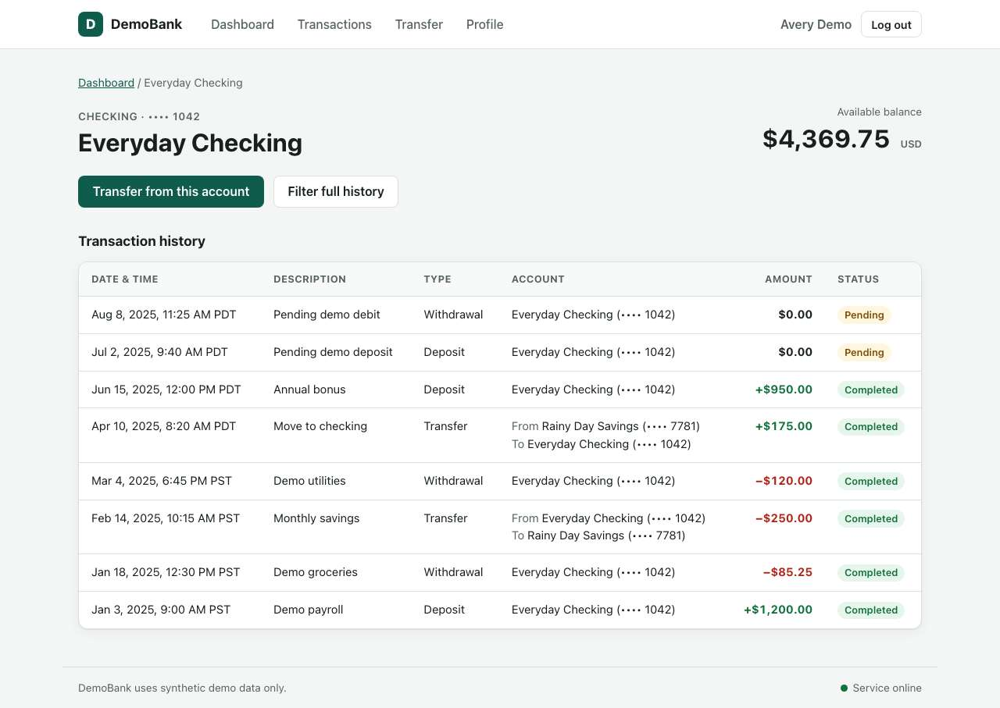

Network calls: `POST /api/demo/session 201`, `GET /api/me 200`, `GET /api/accounts 200`, `GET /api/transactions 200`

### DSH-04

**Requirement:** Account balances displayed on the dashboard and detail view match the latest successful transactions.  
**PRD:** “Account balances shown on the dashboard and detail view must agree with the latest successful transactions.”  
**Verdict:** ✅ PASS: 1 scenario(s) passed

✅ <i>Account balances on dashboard and detail view update and agree with the latest successful transaction</i> (normal, state transition with before-and-after side-effect verification)

#### ✅ Scenario: Account balances on dashboard and detail view update and agree with the latest successful transaction

*normal · state transition with before-and-after side-effect verification* · all checks passed

**Steps to reproduce**

1. Open the landing page and enter the demo
2. Read all_text of element [data-testid=account-balance] → `dash_balances_before` = `["$4,369.75USD", "$8,275.00USD"]`
3. Navigate to /transfer
4. Select 'Everyday Checking' in field labelled 'From account'
5. Select 'Rainy Day Savings' in field labelled 'To account'
6. Type '25.00' into field labelled 'Amount (USD)'
7. Click button 'Transfer funds'
8. Navigate to /dashboard
9. Read all_text of element [data-testid=account-balance] → `dash_balances_after` = `["$4,344.75USD", "$8,300.00USD"]`
10. Click element [data-testid=account-card]
11. Read text of element [data-testid=account-balance] → `detail_balance_after` = `"$4,344.75 USD"`
12. Read table of element [data-testid=transaction-table] → `detail_table` = `"[{\"Date & time\": \"Oct 21, 2026, 9:32 AM PDT\", \"Description\": \"Transfer from Everyday Checking to Rainy Day Savings\", \"Type\": \"Transfer\", \"Account\`

| Expected (check) | Kind | Result | Observed |
|---|---|---|---|
| Dashboard balance for Everyday Checking updates to reflect the latest transfer | side_effect | ✅ pass | `{"dash_balances_after": ["$4,344.75USD", "$8,300.00USD"], "dash_balances_before": ["$4,369.75USD", "$8,275.00USD"]}` |
| Account detail view balance agrees with the dashboard balance | invariant | ✅ pass | `{"dash_balances_after": ["$4,344.75USD", "$8,300.00USD"], "detail_balance_after": "$4,344.75 USD"}` |
| The latest transaction in detail history reflects the successful transfer amount | functional | ✅ pass | `{"detail_table": "[{\"Date & time\": \"Oct 21, 2026, 9:32 AM PDT\", \"Description\": \"Transfer from Everyday Checking to Rainy Day Savings\", \"Type\": \"Transfer\", \"Account\": \"From Everyday Checking (\\u2022\\u2022` |
| The latest transaction status is completed | functional | ✅ pass | `{"detail_table": "[{\"Date & time\": \"Oct 21, 2026, 9:32 AM PDT\", \"Description\": \"Transfer from Everyday Checking to Rainy Day Savings\", \"Type\": \"Transfer\", \"Account\": \"From Everyday Checking (\\u2022\\u2022` |

Evidence: [DSH-04-s1-r0-v00-s07.jpg](./screenshots/DSH-04-s1-r0-v00-s07.jpg) · [DSH-04-s1-r0-v00-s08.jpg](./screenshots/DSH-04-s1-r0-v00-s08.jpg) · [DSH-04-s1-r0-v00-s10.jpg](./screenshots/DSH-04-s1-r0-v00-s10.jpg) · [DSH-04-s1-r0-v00-final.jpg](./screenshots/DSH-04-s1-r0-v00-final.jpg)

Network calls: `POST /api/demo/session 201`, `GET /api/me 200`, `GET /api/accounts 200`, `POST /api/transfers 201`, `GET /api/transactions 200`

### TRF-01

**Requirement:** The transfer form provides inputs for source account, destination account, amount, and an optional memo to transfer funds between owned checking and savings accounts.  
**PRD:** “The user can transfer funds between the checking and savings accounts owned by the demo customer. The transfer form includes source account, destination account, amount, and an optional memo.”  
**Verdict:** ✅ PASS: 3 scenario(s) passed

✅ <i>Transfer funds from checking to savings omitting the optional memo</i> (normal, functional testing of optional input omission with balance side effect verification)

#### ✅ Scenario: Transfer funds from checking to savings omitting the optional memo

*normal · functional testing of optional input omission with balance side effect verification* · all checks passed

**Steps to reproduce**

1. Open the landing page and enter the demo
2. Navigate to /transfer
3. Read API GET /api/accounts → `acc_before` = `"{\"status\": 200, \"body\": {\"accounts\": [{\"id\": \"00000000-0000-0000-0000-000000000101\", \"name\": \"Everyday Checking\", \"type\": \"checking\", \"maske`
4. Select 'Everyday Checking' in combobox 'From account'
5. Select 'Rainy Day Savings' in combobox 'To account'
6. Type '15.00' into textbox 'Amount (USD)'
7. Click button 'Transfer funds'
8. Read API GET /api/accounts → `acc_after` = `"{\"status\": 200, \"body\": {\"accounts\": [{\"id\": \"00000000-0000-0000-0000-000000000101\", \"name\": \"Everyday Checking\", \"type\": \"checking\", \"maske`
9. Read API GET /api/transactions → `tx_after` = `"{\"status\": 200, \"body\": {\"transactions\": [{\"id\": \"22d3db94-ef2a-42fc-b1cb-7c9215b353a0\", \"type\": \"transfer\", \"status\": \"completed\", \"amount\`

| Expected (check) | Kind | Result | Observed |
|---|---|---|---|
| Source checking account balance is debited by $15.00 | side_effect | ✅ pass | `{"acc_after": {"status": 200, "body": {"accounts": [{"id": "00000000-0000-0000-0000-000000000101", "name": "Everyday Checking", "type": "checking", "masked_number": "\u2022\u2022\u2022\u2022 1042", "currency": "USD", "ba` |
| Destination savings account balance is credited by $15.00 | side_effect | ✅ pass | `{"acc_after": {"status": 200, "body": {"accounts": [{"id": "00000000-0000-0000-0000-000000000101", "name": "Everyday Checking", "type": "checking", "masked_number": "\u2022\u2022\u2022\u2022 1042", "currency": "USD", "ba` |
| Total balance across owned accounts remains invariant | invariant | ✅ pass | `{"acc_after": {"status": 200, "body": {"accounts": [{"id": "00000000-0000-0000-0000-000000000101", "name": "Everyday Checking", "type": "checking", "masked_number": "\u2022\u2022\u2022\u2022 1042", "currency": "USD", "ba` |
| Created transfer transaction has empty or omitted memo and matches transfer amount | functional | ✅ pass | `{"tx_after": "{\"status\": 200, \"body\": {\"transactions\": [{\"id\": \"22d3db94-ef2a-42fc-b1cb-7c9215b353a0\", \"type\": \"transfer\", \"status\": \"completed\", \"amount\": \"15.00\", \"memo\": null, \"occurred_at\": ` |

Evidence: [TRF-01-s1-r0-v00-s05.jpg](./screenshots/TRF-01-s1-r0-v00-s05.jpg) · [TRF-01-s1-r0-v00-s06.jpg](./screenshots/TRF-01-s1-r0-v00-s06.jpg) · [TRF-01-s1-r0-v00-s07.jpg](./screenshots/TRF-01-s1-r0-v00-s07.jpg) · [TRF-01-s1-r0-v00-final.jpg](./screenshots/TRF-01-s1-r0-v00-final.jpg)

Network calls: `POST /api/demo/session 201`, `GET /api/me 200`, `GET /api/accounts 200`, `POST /api/transfers 201`

✅ <i>Transfer funds from savings to checking with an optional memo populated</i> (normal, equivalence partitioning (optional memo present))

#### ✅ Scenario: Transfer funds from savings to checking with an optional memo populated

*normal · equivalence partitioning (optional memo present)* · all checks passed

**Steps to reproduce**

1. Open the landing page and enter the demo
2. Navigate to /transfer
3. Read API GET /api/accounts → `acc_before` = `"{\"status\": 200, \"body\": {\"accounts\": [{\"id\": \"00000000-0000-0000-0000-000000000101\", \"name\": \"Everyday Checking\", \"type\": \"checking\", \"maske`
4. Select 'Rainy Day Savings' in combobox 'From account'
5. Select 'Everyday Checking' in combobox 'To account'
6. Type '30.00' into textbox 'Amount (USD)'
7. Type 'Budget rebalance' into textbox 'Memo (optional)'
8. Click button 'Transfer funds'
9. Read API GET /api/accounts → `acc_after` = `"{\"status\": 200, \"body\": {\"accounts\": [{\"id\": \"00000000-0000-0000-0000-000000000101\", \"name\": \"Everyday Checking\", \"type\": \"checking\", \"maske`
10. Read API GET /api/transactions → `tx_after` = `"{\"status\": 200, \"body\": {\"transactions\": [{\"id\": \"c83e4088-f8af-4ab7-9934-56ea58e3acbc\", \"type\": \"transfer\", \"status\": \"completed\", \"amount\`

| Expected (check) | Kind | Result | Observed |
|---|---|---|---|
| Source savings account balance is debited by $30.00 | side_effect | ✅ pass | `{"acc_after": {"status": 200, "body": {"accounts": [{"id": "00000000-0000-0000-0000-000000000101", "name": "Everyday Checking", "type": "checking", "masked_number": "\u2022\u2022\u2022\u2022 1042", "currency": "USD", "ba` |
| Destination checking account balance is credited by $30.00 | side_effect | ✅ pass | `{"acc_after": {"status": 200, "body": {"accounts": [{"id": "00000000-0000-0000-0000-000000000101", "name": "Everyday Checking", "type": "checking", "masked_number": "\u2022\u2022\u2022\u2022 1042", "currency": "USD", "ba` |
| Transaction records the transfer with the provided memo string | functional | ✅ pass | `{"tx_after": "{\"status\": 200, \"body\": {\"transactions\": [{\"id\": \"c83e4088-f8af-4ab7-9934-56ea58e3acbc\", \"type\": \"transfer\", \"status\": \"completed\", \"amount\": \"30.00\", \"memo\": \"Budget rebalance\", \` |

Evidence: [TRF-01-s2-r0-v00-s06.jpg](./screenshots/TRF-01-s2-r0-v00-s06.jpg) · [TRF-01-s2-r0-v00-s07.jpg](./screenshots/TRF-01-s2-r0-v00-s07.jpg) · [TRF-01-s2-r0-v00-s08.jpg](./screenshots/TRF-01-s2-r0-v00-s08.jpg) · [TRF-01-s2-r0-v00-final.jpg](./screenshots/TRF-01-s2-r0-v00-final.jpg)

Network calls: `POST /api/demo/session 201`, `GET /api/me 200`, `GET /api/accounts 200`, `POST /api/transfers 201`

✅ <i>Transfer minimum boundary amount of $0.01 between accounts</i> (boundary, boundary-value analysis (minimum valid transfer amount))

#### ✅ Scenario: Transfer minimum boundary amount of $0.01 between accounts

*boundary · boundary-value analysis (minimum valid transfer amount)* · all checks passed

**Steps to reproduce**

1. Open the landing page and enter the demo
2. Navigate to /transfer
3. Read API GET /api/accounts → `acc_before` = `"{\"status\": 200, \"body\": {\"accounts\": [{\"id\": \"00000000-0000-0000-0000-000000000101\", \"name\": \"Everyday Checking\", \"type\": \"checking\", \"maske`
4. Select 'Everyday Checking' in combobox 'From account'
5. Select 'Rainy Day Savings' in combobox 'To account'
6. Type '0.01' into textbox 'Amount (USD)'
7. Click button 'Transfer funds'
8. Read API GET /api/accounts → `acc_after` = `"{\"status\": 200, \"body\": {\"accounts\": [{\"id\": \"00000000-0000-0000-0000-000000000101\", \"name\": \"Everyday Checking\", \"type\": \"checking\", \"maske`
9. Read API GET /api/transactions → `tx_after` = `"{\"status\": 200, \"body\": {\"transactions\": [{\"id\": \"7c587f24-b6ce-4c87-af40-27a3ed7fa422\", \"type\": \"transfer\", \"status\": \"completed\", \"amount\`

| Expected (check) | Kind | Result | Observed |
|---|---|---|---|
| Checking account is debited by exactly $0.01 | side_effect | ✅ pass | `{"acc_after": {"status": 200, "body": {"accounts": [{"id": "00000000-0000-0000-0000-000000000101", "name": "Everyday Checking", "type": "checking", "masked_number": "\u2022\u2022\u2022\u2022 1042", "currency": "USD", "ba` |
| Savings account is credited by exactly $0.01 | side_effect | ✅ pass | `{"acc_after": {"status": 200, "body": {"accounts": [{"id": "00000000-0000-0000-0000-000000000101", "name": "Everyday Checking", "type": "checking", "masked_number": "\u2022\u2022\u2022\u2022 1042", "currency": "USD", "ba` |
| Transaction recorded for minimum boundary amount of 0.01 | functional | ✅ pass | `{"tx_after": "{\"status\": 200, \"body\": {\"transactions\": [{\"id\": \"7c587f24-b6ce-4c87-af40-27a3ed7fa422\", \"type\": \"transfer\", \"status\": \"completed\", \"amount\": \"0.01\", \"memo\": null, \"occurred_at\": \` |

Evidence: [TRF-01-s3-r0-v00-s05.jpg](./screenshots/TRF-01-s3-r0-v00-s05.jpg) · [TRF-01-s3-r0-v00-s06.jpg](./screenshots/TRF-01-s3-r0-v00-s06.jpg) · [TRF-01-s3-r0-v00-s07.jpg](./screenshots/TRF-01-s3-r0-v00-s07.jpg) · [TRF-01-s3-r0-v00-final.jpg](./screenshots/TRF-01-s3-r0-v00-final.jpg)

Network calls: `POST /api/demo/session 201`, `GET /api/me 200`, `GET /api/accounts 200`, `POST /api/transfers 201`

### TRF-02

**Requirement:** Transfers where source and destination accounts are the same must be rejected without altering balances or creating transactions.  
**PRD:** “The source and destination must be different accounts. Same-account transfers must be rejected with a clear explanation and must not alter balances or create a transaction.”  
**Verdict:** ✅ PASS: 2 scenario(s) passed

✅ <i>Same-account transfer on checking account is rejected without altering balances or creating a transaction</i> (negative, equivalence partitioning (identical source and destination))

#### ✅ Scenario: Same-account transfer on checking account is rejected without altering balances or creating a transaction

*negative · equivalence partitioning (identical source and destination)* · all checks passed

**Steps to reproduce**

1. Open the landing page and enter the demo
2. Navigate to /transfer
3. Read API GET /api/accounts → `api_accts_before` = `"{\"status\": 200, \"body\": {\"accounts\": [{\"id\": \"00000000-0000-0000-0000-000000000101\", \"name\": \"Everyday Checking\", \"type\": \"checking\", \"maske`
4. Read API GET /api/transactions → `api_txs_before` = `"{\"status\": 200, \"body\": {\"transactions\": [{\"id\": \"00000000-0000-0000-0000-000000000212\", \"type\": \"deposit\", \"status\": \"failed\", \"amount\": \`
5. Select 'Everyday Checking' in combobox 'From account'
6. Select 'Everyday Checking' in combobox 'To account'
7. Type '50.00' into textbox 'Amount (USD)'
8. Click button 'Transfer funds'
9. Read text of 'alert' → `alert_text` = `"Transfer not completed\n\nSource and destination accounts must be different.\n\nNo money was moved. Your balances are unchanged."`
10. Read url of  → `current_url` = `"/transfer"`
11. Read API GET /api/accounts → `api_accts_after` = `"{\"status\": 200, \"body\": {\"accounts\": [{\"id\": \"00000000-0000-0000-0000-000000000101\", \"name\": \"Everyday Checking\", \"type\": \"checking\", \"maske`
12. Read API GET /api/transactions → `api_txs_after` = `"{\"status\": 200, \"body\": {\"transactions\": [{\"id\": \"00000000-0000-0000-0000-000000000212\", \"type\": \"deposit\", \"status\": \"failed\", \"amount\": \`

| Expected (check) | Kind | Result | Observed |
|---|---|---|---|
| Visible rejection error message is presented to the user | functional | ✅ pass | `{"alert_text": "Transfer not completed\n\nSource and destination accounts must be different.\n\nNo money was moved. Your balances are unchanged."}` |
| Rejection message provides a clear explanation (PRD: clear explanation) | subjective | ✅ pass judge: Does this message provide a clear explanation of why the same-account transfer was rejected? -> True (The observed text explicitly states that 'Source a | `{"alert_text": "Transfer not completed\n\nSource and destination accounts must be different.\n\nNo money was moved. Your balances are unchanged."}` |
| User remains on the transfer page and is not redirected to a success state | functional | ✅ pass | `{"current_url": "/transfer"}` |
| Account balances remain unchanged server-side (PRD: must not alter balances) | side_effect | ✅ pass | `{"api_accts_after": {"status": 200, "body": {"accounts": [{"id": "00000000-0000-0000-0000-000000000101", "name": "Everyday Checking", "type": "checking", "masked_number": "\u2022\u2022\u2022\u2022 1042", "currency": "USD` |
| No new transaction record is created (PRD: must not create a transaction) | side_effect | ✅ pass | `{"api_txs_after": "{\"status\": 200, \"body\": {\"transactions\": [{\"id\": \"00000000-0000-0000-0000-000000000212\", \"type\": \"deposit\", \"status\": \"failed\", \"amount\": \"700.00\", \"memo\": \"Returned demo depos` |

Evidence: [TRF-02-s1-r0-v00-s06.jpg](./screenshots/TRF-02-s1-r0-v00-s06.jpg) · [TRF-02-s1-r0-v00-s07.jpg](./screenshots/TRF-02-s1-r0-v00-s07.jpg) · [TRF-02-s1-r0-v00-s08.jpg](./screenshots/TRF-02-s1-r0-v00-s08.jpg) · [TRF-02-s1-r0-v00-final.jpg](./screenshots/TRF-02-s1-r0-v00-final.jpg)

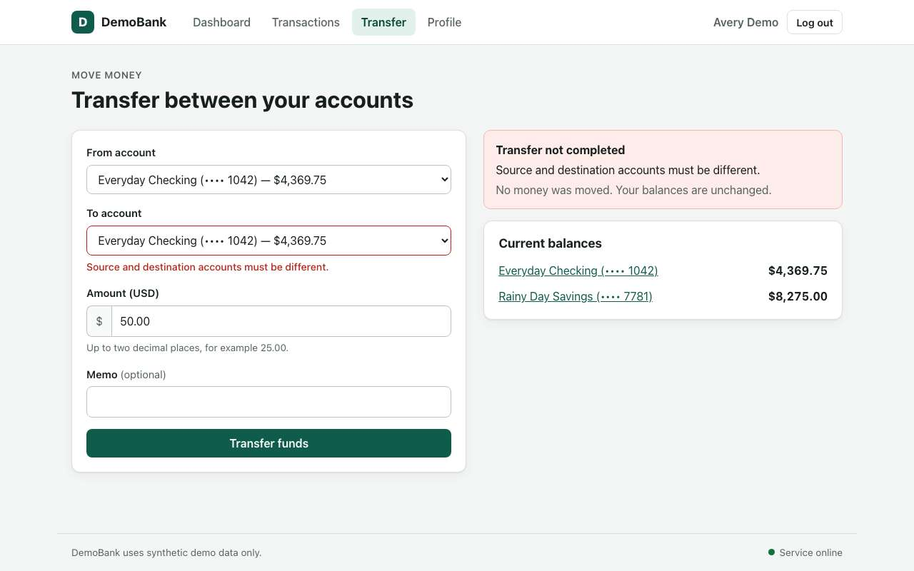

Network calls: `POST /api/demo/session 201`, `GET /api/me 200`, `GET /api/accounts 200`, `POST /api/transfers 422`

✅ <i>Same-account transfer on savings account with memo is rejected and leaves UI balances unchanged</i> (negative, equivalence partitioning (savings account self-transfer with memo))

#### ✅ Scenario: Same-account transfer on savings account with memo is rejected and leaves UI balances unchanged

*negative · equivalence partitioning (savings account self-transfer with memo)* · all checks passed

**Steps to reproduce**

1. Open the landing page and enter the demo
2. Navigate to /transfer
3. Read all_text of element [data-testid=transfer-balance] → `ui_balances_before` = `["$4,369.75", "$8,275.00"]`
4. Read API GET /api/accounts → `api_accts_before` = `"{\"status\": 200, \"body\": {\"accounts\": [{\"id\": \"00000000-0000-0000-0000-000000000101\", \"name\": \"Everyday Checking\", \"type\": \"checking\", \"maske`
5. Read API GET /api/transactions → `api_txs_before` = `"{\"status\": 200, \"body\": {\"transactions\": [{\"id\": \"00000000-0000-0000-0000-000000000212\", \"type\": \"deposit\", \"status\": \"failed\", \"amount\": \`
6. Select 'Rainy Day Savings' in combobox 'From account'
7. Select 'Rainy Day Savings' in combobox 'To account'
8. Type '100.00' into textbox 'Amount (USD)'
9. Type 'Self transfer test' into textbox 'Memo (optional)'
10. Click button 'Transfer funds'
11. Read text of 'alert' → `alert_text` = `"Transfer not completed\n\nSource and destination accounts must be different.\n\nNo money was moved. Your balances are unchanged."`
12. Read all_text of element [data-testid=transfer-balance] → `ui_balances_after` = `["$4,369.75", "$8,275.00"]`
13. Read API GET /api/accounts → `api_accts_after` = `"{\"status\": 200, \"body\": {\"accounts\": [{\"id\": \"00000000-0000-0000-0000-000000000101\", \"name\": \"Everyday Checking\", \"type\": \"checking\", \"maske`
14. Read API GET /api/transactions → `api_txs_after` = `"{\"status\": 200, \"body\": {\"transactions\": [{\"id\": \"00000000-0000-0000-0000-000000000212\", \"type\": \"deposit\", \"status\": \"failed\", \"amount\": \`

| Expected (check) | Kind | Result | Observed |
|---|---|---|---|
| Visible error message indicates the transfer failed | functional | ✅ pass | `{"alert_text": "Transfer not completed\n\nSource and destination accounts must be different.\n\nNo money was moved. Your balances are unchanged."}` |
| Displayed balances on the transfer page do not change | side_effect | ✅ pass | `{"ui_balances_after": ["$4,369.75", "$8,275.00"], "ui_balances_before": ["$4,369.75", "$8,275.00"]}` |
| Account balances in API remain unchanged | side_effect | ✅ pass | `{"api_accts_after": {"status": 200, "body": {"accounts": [{"id": "00000000-0000-0000-0000-000000000101", "name": "Everyday Checking", "type": "checking", "masked_number": "\u2022\u2022\u2022\u2022 1042", "currency": "USD` |
| Transaction history is completely unchanged | side_effect | ✅ pass | `{"api_txs_after": "{\"status\": 200, \"body\": {\"transactions\": [{\"id\": \"00000000-0000-0000-0000-000000000212\", \"type\": \"deposit\", \"status\": \"failed\", \"amount\": \"700.00\", \"memo\": \"Returned demo depos` |
| Rejection message provides a clear explanation (PRD: clear explanation) | subjective | ✅ pass judge: Does this message provide a clear explanation of why the transfer was rejected? -> True (The observed text explicitly states that the transfer was not c | `{"alert_text": "Transfer not completed\n\nSource and destination accounts must be different.\n\nNo money was moved. Your balances are unchanged."}` |

Evidence: [TRF-02-s2-r0-v00-s08.jpg](./screenshots/TRF-02-s2-r0-v00-s08.jpg) · [TRF-02-s2-r0-v00-s09.jpg](./screenshots/TRF-02-s2-r0-v00-s09.jpg) · [TRF-02-s2-r0-v00-s10.jpg](./screenshots/TRF-02-s2-r0-v00-s10.jpg) · [TRF-02-s2-r0-v00-final.jpg](./screenshots/TRF-02-s2-r0-v00-final.jpg)

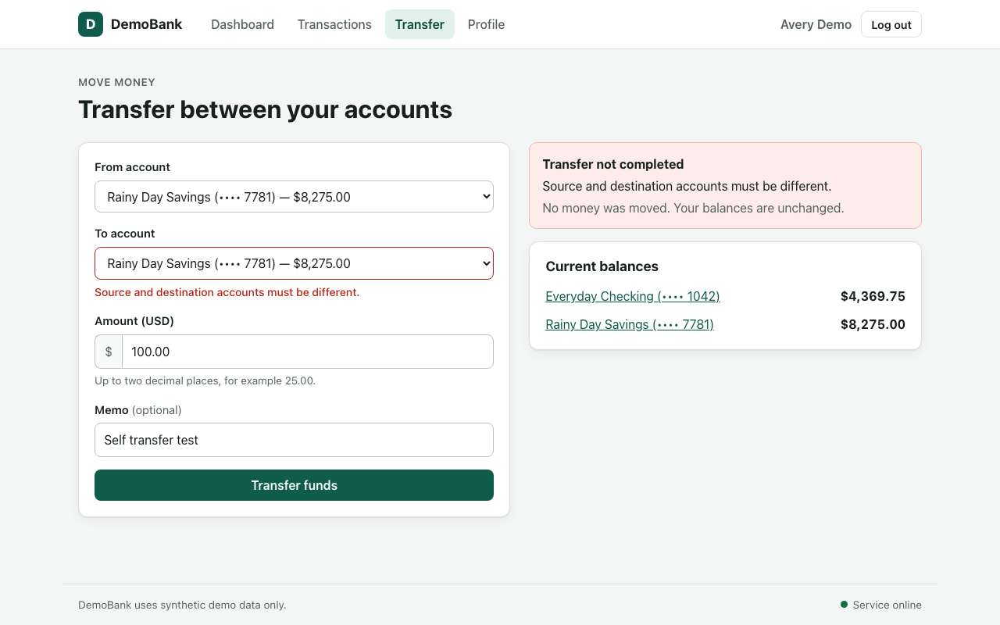

Network calls: `POST /api/demo/session 201`, `GET /api/me 200`, `GET /api/accounts 200`, `POST /api/transfers 422`

### TRF-05

**Requirement:** A valid transfer atomically decreases the source account balance and increases the destination account balance by the exact amount transferred.  
**PRD:** “A valid transfer is atomic: the source balance decreases by the amount and the destination balance increases by the same amount. No partial transfer is allowed.”  
**Verdict:** ✅ PASS: 3 scenario(s) passed

✅ <i>Valid transfer atomically decreases source account and increases destination account by exact amount</i> (normal, state-transition testing with atomic balance verification)

#### ✅ Scenario: Valid transfer atomically decreases source account and increases destination account by exact amount

*normal · state-transition testing with atomic balance verification* · all checks passed

**Steps to reproduce**

1. Open the landing page and enter the demo
2. Read API GET /api/accounts → `api_before` = `"{\"status\": 200, \"body\": {\"accounts\": [{\"id\": \"00000000-0000-0000-0000-000000000101\", \"name\": \"Everyday Checking\", \"type\": \"checking\", \"maske`
3. Navigate to /transfer
4. Select 'Everyday Checking' in combobox 'From account'
5. Select 'Rainy Day Savings' in combobox 'To account'
6. Type '250.00' into textbox 'Amount (USD)'
7. Type 'Atomic transfer verification' into textbox 'Memo (optional)'
8. Click button 'Transfer funds'
9. Read API GET /api/accounts → `api_after` = `"{\"status\": 200, \"body\": {\"accounts\": [{\"id\": \"00000000-0000-0000-0000-000000000101\", \"name\": \"Everyday Checking\", \"type\": \"checking\", \"maske`
10. Navigate to /dashboard
11. Read all_text of element [data-testid=account-balance] → `ui_balances_after` = `["$4,119.75USD", "$8,525.00USD"]`

| Expected (check) | Kind | Result | Observed |
|---|---|---|---|
| Source balance decreases by exactly the transferred amount (PRD: source balance decreases by the amount) | side_effect | ✅ pass | `{"api_after": {"status": 200, "body": {"accounts": [{"id": "00000000-0000-0000-0000-000000000101", "name": "Everyday Checking", "type": "checking", "masked_number": "\u2022\u2022\u2022\u2022 1042", "currency": "USD", "ba` |
| Destination balance increases by exactly the transferred amount (PRD: destination balance increases by the same amount) | side_effect | ✅ pass | `{"api_after": {"status": 200, "body": {"accounts": [{"id": "00000000-0000-0000-0000-000000000101", "name": "Everyday Checking", "type": "checking", "masked_number": "\u2022\u2022\u2022\u2022 1042", "currency": "USD", "ba` |
| Total balance across both customer accounts is conserved (PRD: atomic transfer, no partial transfer) | invariant | ✅ pass | `{"api_after": {"status": 200, "body": {"accounts": [{"id": "00000000-0000-0000-0000-000000000101", "name": "Everyday Checking", "type": "checking", "masked_number": "\u2022\u2022\u2022\u2022 1042", "currency": "USD", "ba` |
| Checking balance in UI reflects updated balance exactly | cross_source | ✅ pass | `{"api_after": {"status": 200, "body": {"accounts": [{"id": "00000000-0000-0000-0000-000000000101", "name": "Everyday Checking", "type": "checking", "masked_number": "\u2022\u2022\u2022\u2022 1042", "currency": "USD", "ba` |
| Savings balance in UI reflects updated balance exactly | cross_source | ✅ pass | `{"api_after": {"status": 200, "body": {"accounts": [{"id": "00000000-0000-0000-0000-000000000101", "name": "Everyday Checking", "type": "checking", "masked_number": "\u2022\u2022\u2022\u2022 1042", "currency": "USD", "ba` |

Evidence: [TRF-05-s1-r0-v00-s07.jpg](./screenshots/TRF-05-s1-r0-v00-s07.jpg) · [TRF-05-s1-r0-v00-s08.jpg](./screenshots/TRF-05-s1-r0-v00-s08.jpg) · [TRF-05-s1-r0-v00-s10.jpg](./screenshots/TRF-05-s1-r0-v00-s10.jpg) · [TRF-05-s1-r0-v00-final.jpg](./screenshots/TRF-05-s1-r0-v00-final.jpg)

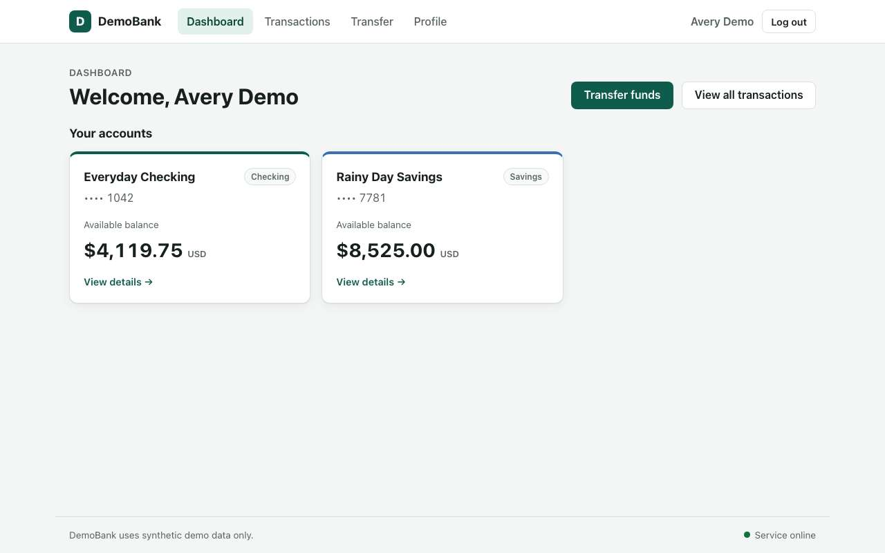

Network calls: `POST /api/demo/session 201`, `GET /api/me 200`, `GET /api/accounts 200`, `POST /api/transfers 201`

✅ <i>Minimum valid transfer ($0.01) atomically updates source and destination balances</i> (boundary, boundary-value analysis)

#### ✅ Scenario: Minimum valid transfer ($0.01) atomically updates source and destination balances

*boundary · boundary-value analysis* · all checks passed

**Steps to reproduce**

1. Open the landing page and enter the demo
2. Read API GET /api/accounts → `api_before` = `"{\"status\": 200, \"body\": {\"accounts\": [{\"id\": \"00000000-0000-0000-0000-000000000101\", \"name\": \"Everyday Checking\", \"type\": \"checking\", \"maske`
3. Navigate to /transfer
4. Select 'Rainy Day Savings' in combobox 'From account'
5. Select 'Everyday Checking' in combobox 'To account'
6. Type '0.01' into textbox 'Amount (USD)'
7. Click button 'Transfer funds'
8. Read API GET /api/accounts → `api_after` = `"{\"status\": 200, \"body\": {\"accounts\": [{\"id\": \"00000000-0000-0000-0000-000000000101\", \"name\": \"Everyday Checking\", \"type\": \"checking\", \"maske`
9. Navigate to /dashboard
10. Read all_text of element [data-testid=account-balance] → `ui_balances_after` = `["$4,369.76USD", "$8,274.99USD"]`

| Expected (check) | Kind | Result | Observed |
|---|---|---|---|
| Source savings balance decreases by exactly 0.01 | side_effect | ✅ pass | `{"api_after": {"status": 200, "body": {"accounts": [{"id": "00000000-0000-0000-0000-000000000101", "name": "Everyday Checking", "type": "checking", "masked_number": "\u2022\u2022\u2022\u2022 1042", "currency": "USD", "ba` |
| Destination checking balance increases by exactly 0.01 | side_effect | ✅ pass | `{"api_after": {"status": 200, "body": {"accounts": [{"id": "00000000-0000-0000-0000-000000000101", "name": "Everyday Checking", "type": "checking", "masked_number": "\u2022\u2022\u2022\u2022 1042", "currency": "USD", "ba` |
| Total sum across accounts remains exactly equal | invariant | ✅ pass | `{"api_after": {"status": 200, "body": {"accounts": [{"id": "00000000-0000-0000-0000-000000000101", "name": "Everyday Checking", "type": "checking", "masked_number": "\u2022\u2022\u2022\u2022 1042", "currency": "USD", "ba` |
| UI balances reflect the 1 cent transfer accurately | cross_source | ✅ pass | `{"api_after": {"status": 200, "body": {"accounts": [{"id": "00000000-0000-0000-0000-000000000101", "name": "Everyday Checking", "type": "checking", "masked_number": "\u2022\u2022\u2022\u2022 1042", "currency": "USD", "ba` |

Evidence: [TRF-05-s2-r0-v00-s06.jpg](./screenshots/TRF-05-s2-r0-v00-s06.jpg) · [TRF-05-s2-r0-v00-s07.jpg](./screenshots/TRF-05-s2-r0-v00-s07.jpg) · [TRF-05-s2-r0-v00-s09.jpg](./screenshots/TRF-05-s2-r0-v00-s09.jpg) · [TRF-05-s2-r0-v00-final.jpg](./screenshots/TRF-05-s2-r0-v00-final.jpg)

Network calls: `POST /api/demo/session 201`, `GET /api/me 200`, `GET /api/accounts 200`, `POST /api/transfers 201`

✅ <i>Transfer exceeding available balance is rejected without partial deduction or balance alteration</i> (negative, boundary-value analysis / negative testing)

#### ✅ Scenario: Transfer exceeding available balance is rejected without partial deduction or balance alteration

*negative · boundary-value analysis / negative testing* · all checks passed

**Steps to reproduce**

1. Open the landing page and enter the demo
2. Read API GET /api/accounts → `accts_before` = `"{\"status\": 200, \"body\": {\"accounts\": [{\"id\": \"00000000-0000-0000-0000-000000000101\", \"name\": \"Everyday Checking\", \"type\": \"checking\", \"maske`
3. Navigate to /transfer
4. Select 'Everyday Checking' in combobox 'From account'
5. Select 'Rainy Day Savings' in combobox 'To account'
6. Type '50.00' into textbox 'Amount (USD)'
7. Click button 'Transfer funds'
8. Read API GET /api/accounts → `accts_after` = `"{\"status\": 200, \"body\": {\"accounts\": [{\"id\": \"00000000-0000-0000-0000-000000000101\", \"name\": \"Everyday Checking\", \"type\": \"checking\", \"maske`

| Expected (check) | Kind | Result | Observed |
|---|---|---|---|
| Source account balance decreases by the exact transfer amount | side_effect | ✅ pass | `{"accts_after": {"status": 200, "body": {"accounts": [{"id": "00000000-0000-0000-0000-000000000101", "name": "Everyday Checking", "type": "checking", "masked_number": "\u2022\u2022\u2022\u2022 1042", "currency": "USD", "` |
| Destination account balance increases by the exact transfer amount | side_effect | ✅ pass | `{"accts_after": {"status": 200, "body": {"accounts": [{"id": "00000000-0000-0000-0000-000000000101", "name": "Everyday Checking", "type": "checking", "masked_number": "\u2022\u2022\u2022\u2022 1042", "currency": "USD", "` |
| Total balance across accounts is conserved (atomicity without balance leakage) | invariant | ✅ pass | `{"accts_after": {"status": 200, "body": {"accounts": [{"id": "00000000-0000-0000-0000-000000000101", "name": "Everyday Checking", "type": "checking", "masked_number": "\u2022\u2022\u2022\u2022 1042", "currency": "USD", "` |

Evidence: [TRF-05-s3-r1-v00-s05.jpg](./screenshots/TRF-05-s3-r1-v00-s05.jpg) · [TRF-05-s3-r1-v00-s06.jpg](./screenshots/TRF-05-s3-r1-v00-s06.jpg) · [TRF-05-s3-r1-v00-s07.jpg](./screenshots/TRF-05-s3-r1-v00-s07.jpg) · [TRF-05-s3-r1-v00-final.jpg](./screenshots/TRF-05-s3-r1-v00-final.jpg)

Network calls: `POST /api/demo/session 201`, `GET /api/me 200`, `GET /api/accounts 200`, `POST /api/transfers 201`

### TRF-06

**Requirement:** A successful transfer creates a completed transfer record visible in both source and destination account histories with full details.  
**PRD:** “A successful transfer creates one completed transfer record that can be found in both relevant account histories. The record shows the amount, date and time, source, destination, status, and memo if supplied.”  
**Verdict:** ✅ PASS: 2 scenario(s) passed

✅ <i>Successful transfer with memo creates a completed transfer record visible in both accounts</i> (normal, state-transition testing)

#### ✅ Scenario: Successful transfer with memo creates a completed transfer record visible in both accounts

*normal · state-transition testing* · all checks passed

**Steps to reproduce**

1. Open the landing page and enter the demo
2. Read API GET /api/accounts → `accts` = `"{\"status\": 200, \"body\": {\"accounts\": [{\"id\": \"00000000-0000-0000-0000-000000000101\", \"name\": \"Everyday Checking\", \"type\": \"checking\", \"maske`
3. Navigate to /transfer
4. Select 'Everyday Checking' in combobox 'From account'
5. Select 'Rainy Day Savings' in combobox 'To account'
6. Type '25.00' into textbox 'Amount (USD)'
7. Type 'Rent split TRF06' into textbox 'Memo (optional)'
8. Click button 'Transfer funds'
9. Navigate to /accounts/00000000-0000-0000-0000-000000000101
10. Read table of element [data-testid=transaction-table] → `src_rows` = `"[{\"Date & time\": \"Oct 21, 2026, 9:44 AM PDT\", \"Description\": \"Rent split TRF06\", \"Type\": \"Transfer\", \"Account\": \"From Everyday Checking (\\u2022`
11. Navigate to /accounts/00000000-0000-0000-0000-000000000102
12. Read table of element [data-testid=transaction-table] → `dst_rows` = `"[{\"Date & time\": \"Oct 21, 2026, 9:44 AM PDT\", \"Description\": \"Rent split TRF06\", \"Type\": \"Transfer\", \"Account\": \"From Everyday Checking (\\u2022`
13. Read API GET /api/transactions → `tx_api` = `"{\"status\": 200, \"body\": {\"transactions\": [{\"id\": \"07e6d61d-522d-4607-80ae-6837c2e83e4c\", \"type\": \"transfer\", \"status\": \"completed\", \"amount\`

| Expected (check) | Kind | Result | Observed |
|---|---|---|---|
| Source account history contains a completed transfer row with the submitted memo (PRD: visible in both relevant account histories with memo) | functional | ✅ pass | `{"src_rows": "[{\"Date & time\": \"Oct 21, 2026, 9:44 AM PDT\", \"Description\": \"Rent split TRF06\", \"Type\": \"Transfer\", \"Account\": \"From Everyday Checking (\\u2022\\u2022\\u2022\\u2022 1042) To Rainy Day Saving` |
| Destination account history contains a completed transfer row with the submitted memo (PRD: visible in both relevant account histories with memo) | functional | ✅ pass | `{"dst_rows": "[{\"Date & time\": \"Oct 21, 2026, 9:44 AM PDT\", \"Description\": \"Rent split TRF06\", \"Type\": \"Transfer\", \"Account\": \"From Everyday Checking (\\u2022\\u2022\\u2022\\u2022 1042) To Rainy Day Saving` |
| Transfer amount $25.00 is displayed in both account histories (PRD: record shows the amount) | functional | ✅ pass | `{"dst_rows": "[{\"Date & time\": \"Oct 21, 2026, 9:44 AM PDT\", \"Description\": \"Rent split TRF06\", \"Type\": \"Transfer\", \"Account\": \"From Everyday Checking (\\u2022\\u2022\\u2022\\u2022 1042) To Rainy Day Saving` |
| Server record confirms a completed transfer with exact amount, memo, source, and destination | cross_source | ✅ pass | `{"tx_api": "{\"status\": 200, \"body\": {\"transactions\": [{\"id\": \"07e6d61d-522d-4607-80ae-6837c2e83e4c\", \"type\": \"transfer\", \"status\": \"completed\", \"amount\": \"25.00\", \"memo\": \"Rent split TRF06\", \"o` |

Evidence: [TRF-06-s1-r0-v00-s08.jpg](./screenshots/TRF-06-s1-r0-v00-s08.jpg) · [TRF-06-s1-r0-v00-s09.jpg](./screenshots/TRF-06-s1-r0-v00-s09.jpg) · [TRF-06-s1-r0-v00-s11.jpg](./screenshots/TRF-06-s1-r0-v00-s11.jpg) · [TRF-06-s1-r0-v00-final.jpg](./screenshots/TRF-06-s1-r0-v00-final.jpg)

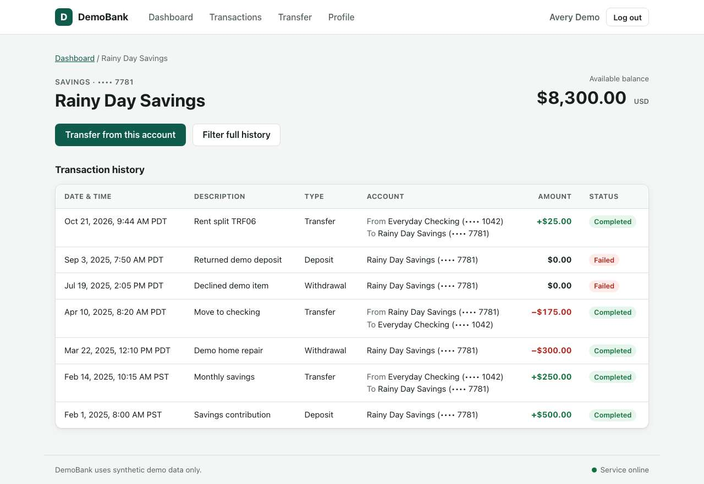

Network calls: `POST /api/demo/session 201`, `GET /api/me 200`, `GET /api/accounts 200`, `POST /api/transfers 201`, `GET /api/accounts/{id} 200`, `GET /api/transactions 200`

✅ <i>Successful transfer without memo creates completed record in both accounts</i> (boundary, equivalence partitioning (optional memo omitted))

#### ✅ Scenario: Successful transfer without memo creates completed record in both accounts

*boundary · equivalence partitioning (optional memo omitted)* · all checks passed

**Steps to reproduce**

1. Open the landing page and enter the demo
2. Read API GET /api/accounts → `accts` = `"{\"status\": 200, \"body\": {\"accounts\": [{\"id\": \"00000000-0000-0000-0000-000000000101\", \"name\": \"Everyday Checking\", \"type\": \"checking\", \"maske`
3. Navigate to /transfer
4. Select 'Rainy Day Savings' in combobox 'From account'
5. Select 'Everyday Checking' in combobox 'To account'
6. Type '12.50' into textbox 'Amount (USD)'
7. Click button 'Transfer funds'
8. Navigate to /accounts/00000000-0000-0000-0000-000000000102
9. Read table of element [data-testid=transaction-table] → `src_rows` = `"[{\"Date & time\": \"Oct 21, 2026, 9:44 AM PDT\", \"Description\": \"Transfer from Rainy Day Savings to Everyday Checking\", \"Type\": \"Transfer\", \"Account\`
10. Navigate to /accounts/00000000-0000-0000-0000-000000000101
11. Read table of element [data-testid=transaction-table] → `dst_rows` = `"[{\"Date & time\": \"Oct 21, 2026, 9:44 AM PDT\", \"Description\": \"Transfer from Rainy Day Savings to Everyday Checking\", \"Type\": \"Transfer\", \"Account\`
12. Read API GET /api/transactions → `tx_api` = `"{\"status\": 200, \"body\": {\"transactions\": [{\"id\": \"ae2a1e98-a2e9-4c89-97cf-7989d88ce359\", \"type\": \"transfer\", \"status\": \"completed\", \"amount\`

| Expected (check) | Kind | Result | Observed |
|---|---|---|---|
| Source account shows completed transfer of $12.50 (PRD: completed transfer record in source account history) | functional | ✅ pass | `{"src_rows": "[{\"Date & time\": \"Oct 21, 2026, 9:44 AM PDT\", \"Description\": \"Transfer from Rainy Day Savings to Everyday Checking\", \"Type\": \"Transfer\", \"Account\": \"From Rainy Day Savings (\\u2022\\u2022\\u2` |
| Destination account shows completed transfer of $12.50 (PRD: completed transfer record in destination account history) | functional | ✅ pass | `{"dst_rows": "[{\"Date & time\": \"Oct 21, 2026, 9:44 AM PDT\", \"Description\": \"Transfer from Rainy Day Savings to Everyday Checking\", \"Type\": \"Transfer\", \"Account\": \"From Rainy Day Savings (\\u2022\\u2022\\u2` |
| API confirms completed transfer without memo between source and destination accounts | cross_source | ✅ pass | `{"tx_api": "{\"status\": 200, \"body\": {\"transactions\": [{\"id\": \"ae2a1e98-a2e9-4c89-97cf-7989d88ce359\", \"type\": \"transfer\", \"status\": \"completed\", \"amount\": \"12.50\", \"memo\": null, \"occurred_at\": \"` |

Evidence: [TRF-06-s2-r0-v00-s07.jpg](./screenshots/TRF-06-s2-r0-v00-s07.jpg) · [TRF-06-s2-r0-v00-s08.jpg](./screenshots/TRF-06-s2-r0-v00-s08.jpg) · [TRF-06-s2-r0-v00-s10.jpg](./screenshots/TRF-06-s2-r0-v00-s10.jpg) · [TRF-06-s2-r0-v00-final.jpg](./screenshots/TRF-06-s2-r0-v00-final.jpg)

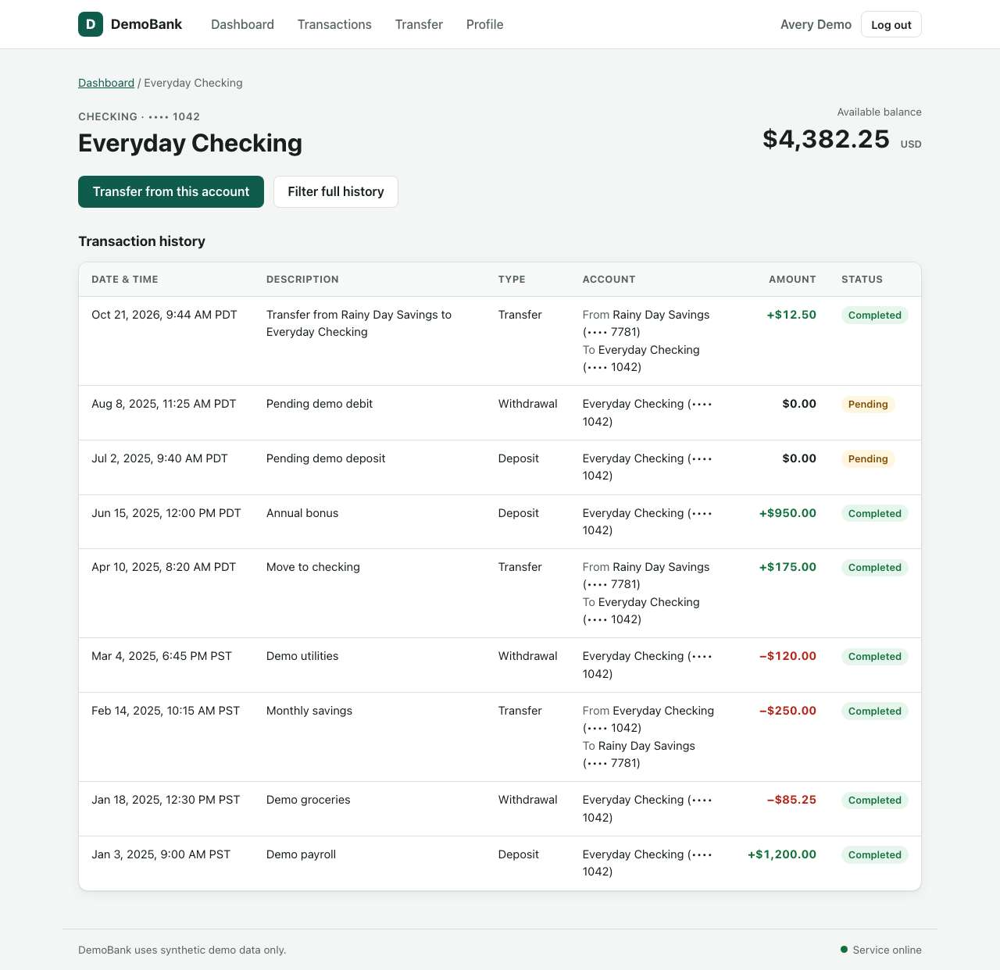

Network calls: `POST /api/demo/session 201`, `GET /api/me 200`, `GET /api/accounts 200`, `POST /api/transfers 201`, `GET /api/accounts/{id} 200`, `GET /api/transactions 200`

### TRF-08

**Requirement:** Refreshing the browser after a successful transfer preserves updated account balances and the new transaction record.  
**PRD:** “Refreshing after a successful transfer must preserve the updated balances and transaction record.”  
**Verdict:** ✅ PASS: 3 scenario(s) passed

✅ <i>Browser reload immediately after transfer preserves the newly created transfer record in transaction history</i> (normal, state-transition testing)

#### ✅ Scenario: Browser reload immediately after transfer preserves the newly created transfer record in transaction history

*normal · state-transition testing* · all checks passed

**Steps to reproduce**

1. Open the landing page and enter the demo
2. Navigate to /transfer
3. Select 'Everyday Checking' in combobox 'From account'
4. Select 'Rainy Day Savings' in combobox 'To account'
5. Type '42.50' into textbox 'Amount (USD)'
6. Type 'TRF08 persistence memo' into textbox 'Memo (optional)'
7. Click button 'Transfer funds'
8. Reload the page
9. Navigate to /transactions
10. Read table of element [data-testid=transaction-table] → `tx_table_after_reload` = `"[{\"Date & time\": \"Oct 21, 2026, 9:52 AM PDT\", \"Description\": \"TRF08 persistence memo\", \"Type\": \"Transfer\", \"Account\": \"From Everyday Checking (\`
11. Read API GET /api/transactions → `api_txs` = `"{\"status\": 200, \"body\": {\"transactions\": [{\"id\": \"40cb66a5-7dd0-4485-999c-0fa14542ce50\", \"type\": \"transfer\", \"status\": \"completed\", \"amount\`

| Expected (check) | Kind | Result | Observed |
|---|---|---|---|
| The created transfer record is visible in transaction table after page reload (PRD quote) | functional | ✅ pass | `{"tx_table_after_reload": "[{\"Date & time\": \"Oct 21, 2026, 9:52 AM PDT\", \"Description\": \"TRF08 persistence memo\", \"Type\": \"Transfer\", \"Account\": \"From Everyday Checking (\\u2022\\u2022\\u2022\\u2022 1042) ` |
| Transfer transaction is recorded in backend API after page reload | cross_source | ✅ pass | `{"api_txs": "{\"status\": 200, \"body\": {\"transactions\": [{\"id\": \"40cb66a5-7dd0-4485-999c-0fa14542ce50\", \"type\": \"transfer\", \"status\": \"completed\", \"amount\": \"42.50\", \"memo\": \"TRF08 persistence memo` |

Evidence: [TRF-08-s1-r0-v00-s07.jpg](./screenshots/TRF-08-s1-r0-v00-s07.jpg) · [TRF-08-s1-r0-v00-s08.jpg](./screenshots/TRF-08-s1-r0-v00-s08.jpg) · [TRF-08-s1-r0-v00-s09.jpg](./screenshots/TRF-08-s1-r0-v00-s09.jpg) · [TRF-08-s1-r0-v00-final.jpg](./screenshots/TRF-08-s1-r0-v00-final.jpg)

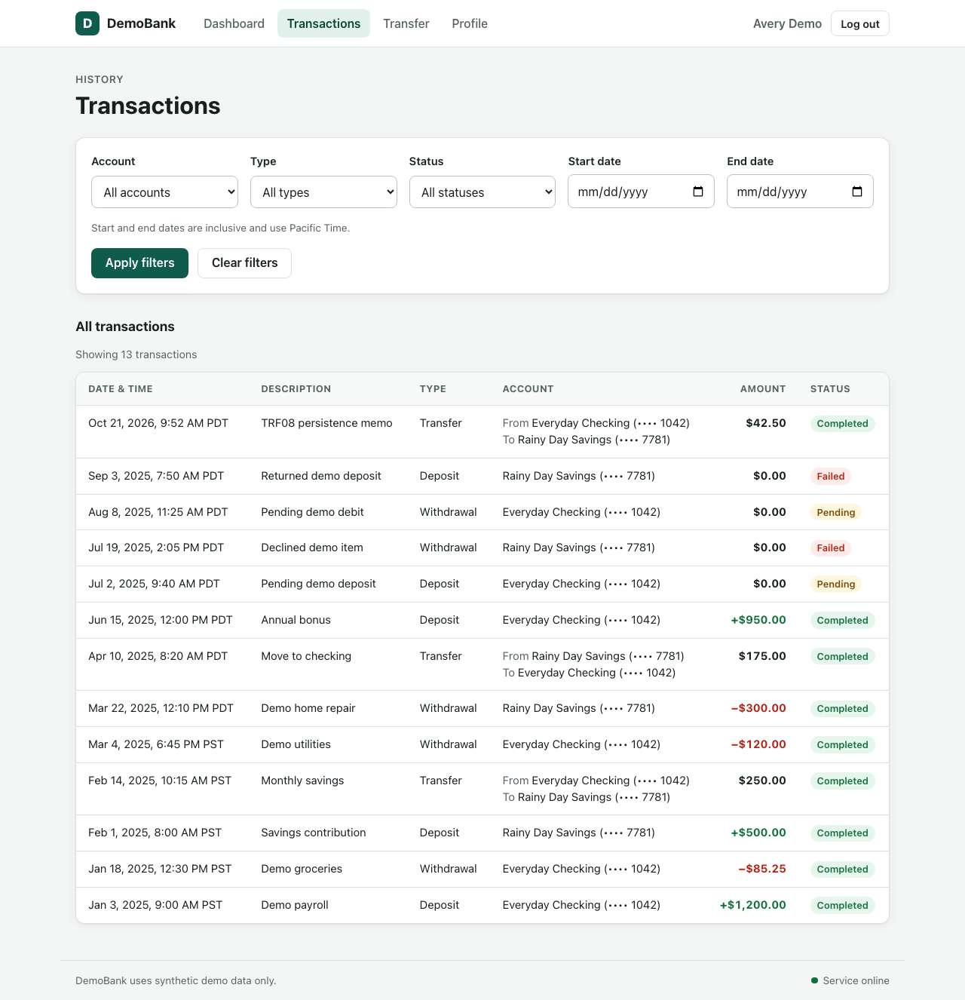

Network calls: `POST /api/demo/session 201`, `GET /api/me 200`, `GET /api/accounts 200`, `POST /api/transfers 201`, `GET /api/transactions 200`

✅ <i>Browser reload preserves decreased source balance and increased destination balance on dashboard</i> (normal, state-transition testing)

#### ✅ Scenario: Browser reload preserves decreased source balance and increased destination balance on dashboard

*normal · state-transition testing* · all checks passed

**Steps to reproduce**

1. Open the landing page and enter the demo
2. Navigate to /dashboard
3. Read all_text of element [data-testid=account-balance] → `ui_balances_before` = `["$4,369.75USD", "$8,275.00USD"]`
4. Navigate to /transfer
5. Select 'Everyday Checking' in combobox 'From account'
6. Select 'Rainy Day Savings' in combobox 'To account'
7. Type '100.00' into textbox 'Amount (USD)'
8. Click button 'Transfer funds'
9. Reload the page
10. Navigate to /dashboard
11. Read all_text of element [data-testid=account-balance] → `ui_balances_after_reload` = `["$4,269.75USD", "$8,375.00USD"]`
12. Read API GET /api/accounts → `api_after_reload` = `"{\"status\": 200, \"body\": {\"accounts\": [{\"id\": \"00000000-0000-0000-0000-000000000101\", \"name\": \"Everyday Checking\", \"type\": \"checking\", \"maske`

| Expected (check) | Kind | Result | Observed |
|---|---|---|---|
| Source balance decreased by $100 and destination balance increased by $100 after reload (PRD quote) | side_effect | ✅ pass | `{"ui_balances_after_reload": ["$4,269.75USD", "$8,375.00USD"], "ui_balances_before": ["$4,369.75USD", "$8,275.00USD"]}` |
| Total balance across accounts remains invariant after reload | invariant | ✅ pass | `{"ui_balances_after_reload": ["$4,269.75USD", "$8,375.00USD"], "ui_balances_before": ["$4,369.75USD", "$8,275.00USD"]}` |
| Reloaded UI balances agree with API account balances | cross_source | ✅ pass | `{"api_after_reload": {"status": 200, "body": {"accounts": [{"id": "00000000-0000-0000-0000-000000000101", "name": "Everyday Checking", "type": "checking", "masked_number": "\u2022\u2022\u2022\u2022 1042", "currency": "US` |

Evidence: [TRF-08-s2-r0-v00-s08.jpg](./screenshots/TRF-08-s2-r0-v00-s08.jpg) · [TRF-08-s2-r0-v00-s09.jpg](./screenshots/TRF-08-s2-r0-v00-s09.jpg) · [TRF-08-s2-r0-v00-s10.jpg](./screenshots/TRF-08-s2-r0-v00-s10.jpg) · [TRF-08-s2-r0-v00-final.jpg](./screenshots/TRF-08-s2-r0-v00-final.jpg)

Network calls: `POST /api/demo/session 201`, `GET /api/me 200`, `GET /api/accounts 200`, `POST /api/transfers 201`

✅ <i>Boundary minimum transfer ($0.01) retains updated balances and transaction record across browser reload</i> (boundary, boundary-value analysis)

#### ✅ Scenario: Boundary minimum transfer ($0.01) retains updated balances and transaction record across browser reload

*boundary · boundary-value analysis* · all checks passed

**Steps to reproduce**

1. Open the landing page and enter the demo
2. Navigate to /dashboard
3. Read all_text of element [data-testid=account-balance] → `balances_before` = `["$4,369.75USD", "$8,275.00USD"]`
4. Navigate to /transfer
5. Select 'Rainy Day Savings' in combobox 'From account'
6. Select 'Everyday Checking' in combobox 'To account'
7. Type '0.01' into textbox 'Amount (USD)'
8. Type 'Min boundary reload check' into textbox 'Memo (optional)'
9. Click button 'Transfer funds'
10. Reload the page
11. Navigate to /dashboard
12. Read all_text of element [data-testid=account-balance] → `balances_after` = `["$4,369.76USD", "$8,274.99USD"]`
13. Navigate to /transactions
14. Read table of element [data-testid=transaction-table] → `tx_table` = `"[{\"Date & time\": \"Oct 21, 2026, 9:52 AM PDT\", \"Description\": \"Min boundary reload check\", \"Type\": \"Transfer\", \"Account\": \"From Rainy Day Savings`

| Expected (check) | Kind | Result | Observed |
|---|---|---|---|
| Balances preserved with $0.01 transferred from savings to checking after reload | side_effect | ✅ pass | `{"balances_after": ["$4,369.76USD", "$8,274.99USD"], "balances_before": ["$4,369.75USD", "$8,275.00USD"]}` |
| Total balance across accounts is invariant after boundary transfer reload | invariant | ✅ pass | `{"balances_after": ["$4,369.76USD", "$8,274.99USD"], "balances_before": ["$4,369.75USD", "$8,275.00USD"]}` |
| Transaction table retains the $0.01 boundary transfer record after reload | functional | ✅ pass | `{"tx_table": "[{\"Date & time\": \"Oct 21, 2026, 9:52 AM PDT\", \"Description\": \"Min boundary reload check\", \"Type\": \"Transfer\", \"Account\": \"From Rainy Day Savings (\\u2022\\u2022\\u2022\\u2022 7781) To Everyda` |

Evidence: [TRF-08-s3-r0-v00-s10.jpg](./screenshots/TRF-08-s3-r0-v00-s10.jpg) · [TRF-08-s3-r0-v00-s11.jpg](./screenshots/TRF-08-s3-r0-v00-s11.jpg) · [TRF-08-s3-r0-v00-s13.jpg](./screenshots/TRF-08-s3-r0-v00-s13.jpg) · [TRF-08-s3-r0-v00-final.jpg](./screenshots/TRF-08-s3-r0-v00-final.jpg)

Network calls: `POST /api/demo/session 201`, `GET /api/me 200`, `GET /api/accounts 200`, `POST /api/transfers 201`, `GET /api/transactions 200`

### TXN-01

**Requirement:** The user can view a combined transaction history across accounts as well as account-specific history.  
**PRD:** “The user can view a combined transaction history and account-specific history.”  
**Verdict:** ✅ PASS: 3 scenario(s) passed

✅ <i>View combined transaction history across all accounts on the transactions page</i> (normal, cross-source verification)

#### ✅ Scenario: View combined transaction history across all accounts on the transactions page

*normal · cross-source verification* · all checks passed

**Steps to reproduce**

1. Open the landing page and enter the demo
2. Navigate to /transactions
3. Read API GET /api/transactions → `api_txns` = `"{\"status\": 200, \"body\": {\"transactions\": [{\"id\": \"02c26545-050b-4d2c-9c96-31a3c3b100ba\", \"type\": \"transfer\", \"status\": \"completed\", \"amount\`
4. Read table of element [data-testid=transaction-table] → `combined_table` = `"[{\"Date & time\": \"Oct 21, 2026, 9:52 AM PDT\", \"Description\": \"Min boundary reload check\", \"Type\": \"Transfer\", \"Account\": \"From Rainy Day Savings`
5. Read count of element [data-testid=transaction-row] → `row_count` = `13`
6. Read text of element [data-testid=result-count] → `result_count_text` = `"Showing 13 transactions"`

| Expected (check) | Kind | Result | Observed |
|---|---|---|---|
| Total displayed rows match the total transactions returned by the transactions API | cross_source | ✅ pass | `{"api_txns": "{\"status\": 200, \"body\": {\"transactions\": [{\"id\": \"02c26545-050b-4d2c-9c96-31a3c3b100ba\", \"type\": \"transfer\", \"status\": \"completed\", \"amount\": \"0.01\", \"memo\": \"Min boundary reload ch` |
| Result count indicator reflects the combined number of transactions | functional | ✅ pass | `{"result_count_text": "Showing 13 transactions", "row_count": 13}` |
| Table rows count matches the parsed table item count | functional | ✅ pass | `{"combined_table": "[{\"Date & time\": \"Oct 21, 2026, 9:52 AM PDT\", \"Description\": \"Min boundary reload check\", \"Type\": \"Transfer\", \"Account\": \"From Rainy Day Savings (\\u2022\\u2022\\u2022\\u2022 7781) To E` |

Evidence: [TXN-01-s1-r0-v00-s01.jpg](./screenshots/TXN-01-s1-r0-v00-s01.jpg) · [TXN-01-s1-r0-v00-s02.jpg](./screenshots/TXN-01-s1-r0-v00-s02.jpg) · [TXN-01-s1-r0-v00-final.jpg](./screenshots/TXN-01-s1-r0-v00-final.jpg)

Network calls: `POST /api/demo/session 201`, `GET /api/me 200`, `GET /api/accounts 200`, `GET /api/transactions 200`

✅ <i>Filter transaction history to an individual account on the transactions page</i> (normal, metamorphic relation)

#### ✅ Scenario: Filter transaction history to an individual account on the transactions page

*normal · metamorphic relation* · all checks passed

**Steps to reproduce**

1. Open the landing page and enter the demo
2. Navigate to /transactions
3. Read count of element [data-testid=transaction-row] → `all_count` = `13`
4. Select 'Everyday Checking (•••• 1042)' in combobox 'Account'
5. Click button 'Apply filters'
6. Read count of element [data-testid=transaction-row] → `filtered_count` = `9`
7. Read table of element [data-testid=transaction-table] → `filtered_table` = `"[{\"Date & time\": \"Oct 21, 2026, 9:52 AM PDT\", \"Description\": \"Min boundary reload check\", \"Type\": \"Transfer\", \"Account\": \"From Rainy Day Savings`
8. Read text of element [data-testid=result-count] → `filtered_result_text` = `"Showing 9 transactions"`

| Expected (check) | Kind | Result | Observed |
|---|---|---|---|
| Filtered account transactions are a non-empty subset of the combined transaction history | metamorphic | ✅ pass | `{"all_count": 13, "filtered_count": 9}` |
| Result count badge updates to show the filtered transaction count | functional | ✅ pass | `{"filtered_count": 9, "filtered_result_text": "Showing 9 transactions"}` |
| Every transaction listed in the filtered view pertains to Everyday Checking | functional | ✅ pass | `{"filtered_table": "[{\"Date & time\": \"Oct 21, 2026, 9:52 AM PDT\", \"Description\": \"Min boundary reload check\", \"Type\": \"Transfer\", \"Account\": \"From Rainy Day Savings (\\u2022\\u2022\\u2022\\u2022 7781) To E` |

Evidence: [TXN-01-s2-r0-v00-s02.jpg](./screenshots/TXN-01-s2-r0-v00-s02.jpg) · [TXN-01-s2-r0-v00-s04.jpg](./screenshots/TXN-01-s2-r0-v00-s04.jpg) · [TXN-01-s2-r0-v00-s05.jpg](./screenshots/TXN-01-s2-r0-v00-s05.jpg) · [TXN-01-s2-r0-v00-final.jpg](./screenshots/TXN-01-s2-r0-v00-final.jpg)

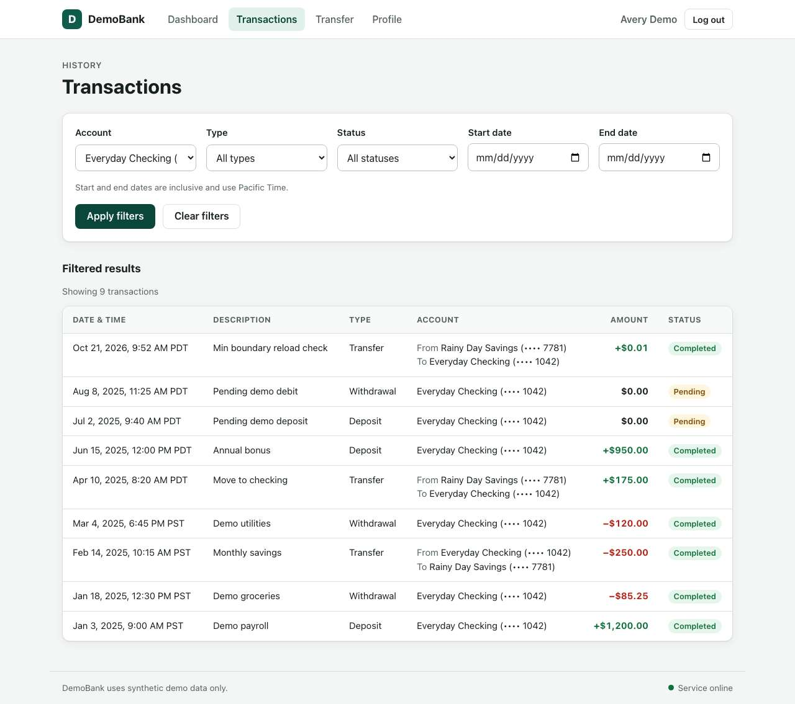

Network calls: `POST /api/demo/session 201`, `GET /api/me 200`, `GET /api/accounts 200`, `GET /api/transactions 200`

✅ <i>View account-specific transaction history from the individual account details page</i> (normal, state-transition testing)

#### ✅ Scenario: View account-specific transaction history from the individual account details page

*normal · state-transition testing* · all checks passed

**Steps to reproduce**

1. Open the landing page and enter the demo
2. Navigate to /dashboard
3. Click element [data-testid=account-card]
4. Read url of  → `account_url` = `"/accounts/00000000-0000-0000-0000-000000000101"`
5. Read text of element [data-testid=account-number] → `account_num` = `"\u2022\u2022\u2022\u2022 1042"`
6. Read table of element [data-testid=transaction-table] → `account_table` = `"[{\"Date & time\": \"Oct 21, 2026, 9:52 AM PDT\", \"Description\": \"Min boundary reload check\", \"Type\": \"Transfer\", \"Account\": \"From Rainy Day Savings`
7. Read count of element [data-testid=transaction-row] → `account_row_count` = `9`

| Expected (check) | Kind | Result | Observed |
|---|---|---|---|
| Navigated to account-specific route | functional | ✅ pass | `{"account_url": "/accounts/00000000-0000-0000-0000-000000000101"}` |
| Account details header confirms account identifier | functional | ✅ pass | `{"account_num": "\u2022\u2022\u2022\u2022 1042"}` |
| Account details page displays its own transaction history table with rows | functional | ✅ pass | `{"account_row_count": 9, "account_table": "[{\"Date & time\": \"Oct 21, 2026, 9:52 AM PDT\", \"Description\": \"Min boundary reload check\", \"Type\": \"Transfer\", \"Account\": \"From Rainy Day Savings (\\u2022\\u2022\\` |
| All rows on the account-specific page reference the selected account | functional | ✅ pass | `{"account_table": "[{\"Date & time\": \"Oct 21, 2026, 9:52 AM PDT\", \"Description\": \"Min boundary reload check\", \"Type\": \"Transfer\", \"Account\": \"From Rainy Day Savings (\\u2022\\u2022\\u2022\\u2022 7781) To Ev` |

Evidence: [TXN-01-s3-r0-v00-s01.jpg](./screenshots/TXN-01-s3-r0-v00-s01.jpg) · [TXN-01-s3-r0-v00-s02.jpg](./screenshots/TXN-01-s3-r0-v00-s02.jpg) · [TXN-01-s3-r0-v00-s03.jpg](./screenshots/TXN-01-s3-r0-v00-s03.jpg) · [TXN-01-s3-r0-v00-final.jpg](./screenshots/TXN-01-s3-r0-v00-final.jpg)

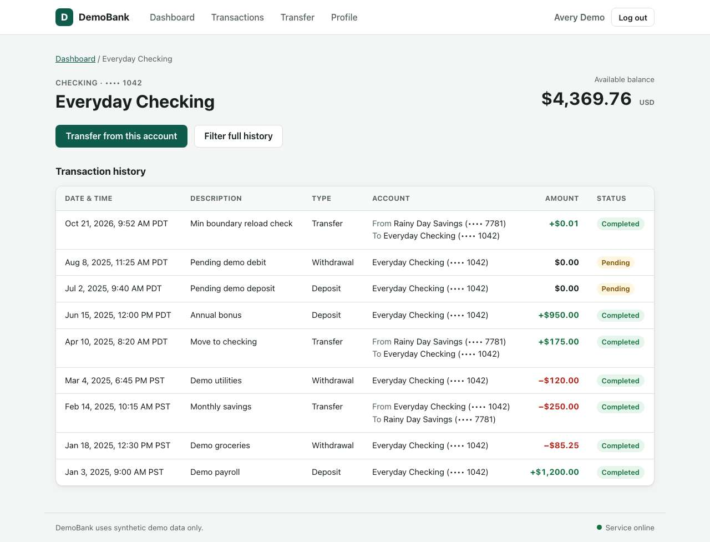

Network calls: `POST /api/demo/session 201`, `GET /api/me 200`, `GET /api/accounts 200`

### TXN-02

**Requirement:** Each transaction history row displays date/time, description or memo, transaction type, amount, status, relevant account, and clear amount direction.  
**PRD:** “Each row shows date and time, description or memo, transaction type, amount, status, and relevant account. Amount direction should be clear for deposits, withdrawals, and transfers.”  
**Verdict:** ✅ PASS: 2 scenario(s) passed

✅ <i>Transactions table displays date/time, description, type, account, amount, and status for each row</i> (normal, specification-based equivalence testing)

#### ✅ Scenario: Transactions table displays date/time, description, type, account, amount, and status for each row

*normal · specification-based equivalence testing* · all checks passed

**Steps to reproduce**

1. Open the landing page and enter the demo
2. Navigate to /transactions
3. Read table of element [data-testid=transaction-table] → `txn_rows` = `"[{\"Date & time\": \"Oct 21, 2026, 9:52 AM PDT\", \"Description\": \"Min boundary reload check\", \"Type\": \"Transfer\", \"Account\": \"From Rainy Day Savings`
4. Read API GET /api/transactions → `api_txns` = `"{\"status\": 200, \"body\": {\"transactions\": [{\"id\": \"02c26545-050b-4d2c-9c96-31a3c3b100ba\", \"type\": \"transfer\", \"status\": \"completed\", \"amount\`
5. Read text of element [data-testid=transaction-row] → `sample_row_text` = `"Oct 21, 2026, 9:52 AM PDT\tMin boundary reload check\tTransfer\t\nFrom Rainy Day Savings (\u2022\u2022\u2022\u2022 7781)\nTo Everyday Checking (\u2022\u2022\u2`

| Expected (check) | Kind | Result | Observed |
|---|---|---|---|
| Each row contains non-empty date/time, description, type, account, amount, and status | functional | ✅ pass | `{"txn_rows": "[{\"Date & time\": \"Oct 21, 2026, 9:52 AM PDT\", \"Description\": \"Min boundary reload check\", \"Type\": \"Transfer\", \"Account\": \"From Rainy Day Savings (\\u2022\\u2022\\u2022\\u2022 7781) To Everyda` |
| Displayed transactions count corresponds to API records | cross_source | ✅ pass | `{"api_txns": "{\"status\": 200, \"body\": {\"transactions\": [{\"id\": \"02c26545-050b-4d2c-9c96-31a3c3b100ba\", \"type\": \"transfer\", \"status\": \"completed\", \"amount\": \"0.01\", \"memo\": \"Min boundary reload ch` |
| All row types correspond to valid transaction types (deposit, withdrawal, transfer) | functional | ✅ pass | `{"txn_rows": "[{\"Date & time\": \"Oct 21, 2026, 9:52 AM PDT\", \"Description\": \"Min boundary reload check\", \"Type\": \"Transfer\", \"Account\": \"From Rainy Day Savings (\\u2022\\u2022\\u2022\\u2022 7781) To Everyda` |
| Amount direction is clear on displayed transactions | subjective | ✅ pass judge: Does this transaction row clearly indicate the amount direction for the transaction? -> True (The observed text clearly specifies the direction of the t | `{"sample_row_text": "Oct 21, 2026, 9:52 AM PDT\tMin boundary reload check\tTransfer\t\nFrom Rainy Day Savings (\u2022\u2022\u2022\u2022 7781)\nTo Everyday Checking (\u2022\u2022\u2022\u2022 1042)\n\t\nMoved between accou` |

Evidence: [TXN-02-s1-r0-v00-s01.jpg](./screenshots/TXN-02-s1-r0-v00-s01.jpg) · [TXN-02-s1-r0-v00-s02.jpg](./screenshots/TXN-02-s1-r0-v00-s02.jpg) · [TXN-02-s1-r0-v00-final.jpg](./screenshots/TXN-02-s1-r0-v00-final.jpg)

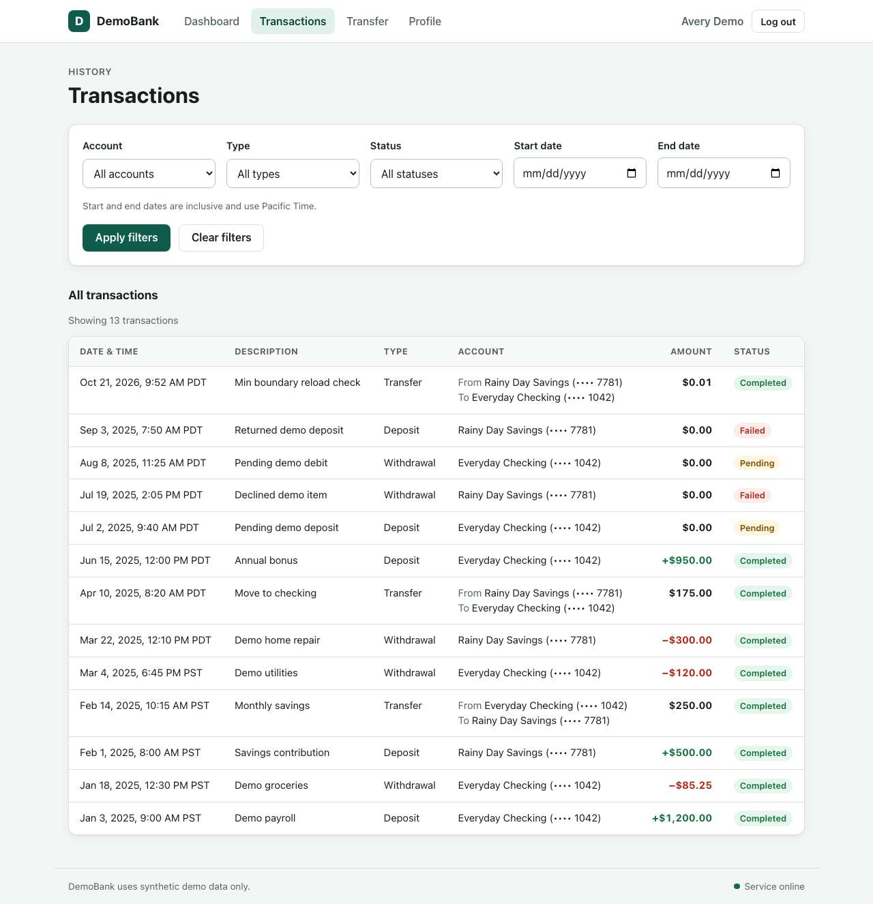

Network calls: `POST /api/demo/session 201`, `GET /api/me 200`, `GET /api/accounts 200`, `GET /api/transactions 200`

✅ <i>Account detail transaction history displays all required fields including relevant account and status</i> (normal, state-transition testing)

#### ✅ Scenario: Account detail transaction history displays all required fields including relevant account and status

*normal · state-transition testing* · all checks passed

**Steps to reproduce**

1. Open the landing page and enter the demo
2. Navigate to /dashboard
3. Click element [data-testid=account-card]
4. Read table of element [data-testid=transaction-table] → `account_txn_rows` = `"[{\"Date & time\": \"Oct 21, 2026, 9:52 AM PDT\", \"Description\": \"Min boundary reload check\", \"Type\": \"Transfer\", \"Account\": \"From Rainy Day Savings`
5. Read text of element [data-testid=account-number] → `account_masked_num` = `"\u2022\u2022\u2022\u2022 1042"`

| Expected (check) | Kind | Result | Observed |
|---|---|---|---|
| Account transaction history contains rows with all required fields present | functional | ✅ pass | `{"account_txn_rows": "[{\"Date & time\": \"Oct 21, 2026, 9:52 AM PDT\", \"Description\": \"Min boundary reload check\", \"Type\": \"Transfer\", \"Account\": \"From Rainy Day Savings (\\u2022\\u2022\\u2022\\u2022 7781) To` |
| Account column displays relevant account information matching the inspected account | functional | ✅ pass | `{"account_masked_num": "\u2022\u2022\u2022\u2022 1042", "account_txn_rows": "[{\"Date & time\": \"Oct 21, 2026, 9:52 AM PDT\", \"Description\": \"Min boundary reload check\", \"Type\": \"Transfer\", \"Account\": \"From R` |

Evidence: [TXN-02-s2-r0-v00-s01.jpg](./screenshots/TXN-02-s2-r0-v00-s01.jpg) · [TXN-02-s2-r0-v00-s02.jpg](./screenshots/TXN-02-s2-r0-v00-s02.jpg) · [TXN-02-s2-r0-v00-s03.jpg](./screenshots/TXN-02-s2-r0-v00-s03.jpg) · [TXN-02-s2-r0-v00-final.jpg](./screenshots/TXN-02-s2-r0-v00-final.jpg)

Network calls: `POST /api/demo/session 201`, `GET /api/accounts 200`, `GET /api/me 200`, `GET /api/accounts/{id} 200`, `GET /api/transactions 200`

### TXN-03

**Requirement:** The user can filter transaction history by account, transaction type, status, and date range, with results satisfying all active filters.  
**PRD:** “The user can filter history by account, transaction type, status, and date range. When filters are applied, every displayed row must satisfy all selected filters.”  
**Verdict:** ✅ PASS: 4 scenario(s) passed

✅ <i>Applying account and type filters concurrently returns only matching transactions</i> (normal, decision table (multiple concurrent filters))

#### ✅ Scenario: Applying account and type filters concurrently returns only matching transactions

*normal · decision table (multiple concurrent filters)* · all checks passed

**Steps to reproduce**

1. Open the landing page and enter the demo
2. Navigate to /transactions
3. Read table of element [data-testid=transaction-table] → `all_rows` = `"[{\"Date & time\": \"Oct 21, 2026, 9:52 AM PDT\", \"Description\": \"Min boundary reload check\", \"Type\": \"Transfer\", \"Account\": \"From Rainy Day Savings`
4. Select 'Everyday Checking' in combobox 'Account'
5. Select 'Transfer' in combobox 'Type'
6. Click button 'Apply filters'
7. Read table of element [data-testid=transaction-table] → `filtered_rows` = `"[{\"Date & time\": \"Oct 21, 2026, 9:52 AM PDT\", \"Description\": \"Min boundary reload check\", \"Type\": \"Transfer\", \"Account\": \"From Rainy Day Savings`

| Expected (check) | Kind | Result | Observed |
|---|---|---|---|
| Every displayed row has Type 'Transfer' | functional | ✅ pass | `{"filtered_rows": "[{\"Date & time\": \"Oct 21, 2026, 9:52 AM PDT\", \"Description\": \"Min boundary reload check\", \"Type\": \"Transfer\", \"Account\": \"From Rainy Day Savings (\\u2022\\u2022\\u2022\\u2022 7781) To Ev` |
| Every displayed row is associated with Everyday Checking | functional | ✅ pass | `{"filtered_rows": "[{\"Date & time\": \"Oct 21, 2026, 9:52 AM PDT\", \"Description\": \"Min boundary reload check\", \"Type\": \"Transfer\", \"Account\": \"From Rainy Day Savings (\\u2022\\u2022\\u2022\\u2022 7781) To Ev` |
| Filtered rows count does not exceed total transactions | metamorphic | ✅ pass | `{"all_rows": "[{\"Date & time\": \"Oct 21, 2026, 9:52 AM PDT\", \"Description\": \"Min boundary reload check\", \"Type\": \"Transfer\", \"Account\": \"From Rainy Day Savings (\\u2022\\u2022\\u2022\\u2022 7781) To Everyda` |
| At least one matching transaction is returned | functional | ✅ pass | `{"filtered_rows": "[{\"Date & time\": \"Oct 21, 2026, 9:52 AM PDT\", \"Description\": \"Min boundary reload check\", \"Type\": \"Transfer\", \"Account\": \"From Rainy Day Savings (\\u2022\\u2022\\u2022\\u2022 7781) To Ev` |

Evidence: [TXN-03-s1-r0-v00-s04.jpg](./screenshots/TXN-03-s1-r0-v00-s04.jpg) · [TXN-03-s1-r0-v00-s05.jpg](./screenshots/TXN-03-s1-r0-v00-s05.jpg) · [TXN-03-s1-r0-v00-s06.jpg](./screenshots/TXN-03-s1-r0-v00-s06.jpg) · [TXN-03-s1-r0-v00-final.jpg](./screenshots/TXN-03-s1-r0-v00-final.jpg)

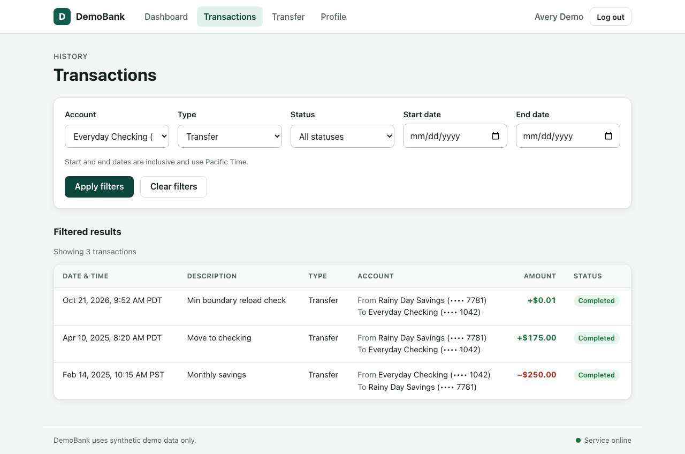

Network calls: `POST /api/demo/session 201`, `GET /api/me 200`, `GET /api/accounts 200`, `GET /api/transactions 200`

✅ <i>Filtering by status and clearing filters restores all transactions</i> (normal, metamorphic relation (apply filter then clear))

#### ✅ Scenario: Filtering by status and clearing filters restores all transactions

*normal · metamorphic relation (apply filter then clear)* · all checks passed

**Steps to reproduce**

1. Open the landing page and enter the demo
2. Navigate to /transactions
3. Read table of element [data-testid=transaction-table] → `initial_rows` = `"[{\"Date & time\": \"Oct 21, 2026, 9:52 AM PDT\", \"Description\": \"Min boundary reload check\", \"Type\": \"Transfer\", \"Account\": \"From Rainy Day Savings`
4. Read text of element [data-testid=result-count] → `initial_count` = `"Showing 13 transactions"`
5. Select 'Completed' in combobox 'Status'
6. Click button 'Apply filters'
7. Read table of element [data-testid=transaction-table] → `completed_rows` = `"[{\"Date & time\": \"Oct 21, 2026, 9:52 AM PDT\", \"Description\": \"Min boundary reload check\", \"Type\": \"Transfer\", \"Account\": \"From Rainy Day Savings`
8. Click button 'Clear filters'
9. Read table of element [data-testid=transaction-table] → `restored_rows` = `"[{\"Date & time\": \"Oct 21, 2026, 9:52 AM PDT\", \"Description\": \"Min boundary reload check\", \"Type\": \"Transfer\", \"Account\": \"From Rainy Day Savings`
10. Read text of element [data-testid=result-count] → `restored_count` = `"Showing 13 transactions"`

| Expected (check) | Kind | Result | Observed |
|---|---|---|---|
| Every row under the Status filter has status Completed | functional | ✅ pass | `{"completed_rows": "[{\"Date & time\": \"Oct 21, 2026, 9:52 AM PDT\", \"Description\": \"Min boundary reload check\", \"Type\": \"Transfer\", \"Account\": \"From Rainy Day Savings (\\u2022\\u2022\\u2022\\u2022 7781) To E` |
| Completed rows count is less than or equal to initial count | metamorphic | ✅ pass | `{"completed_rows": "[{\"Date & time\": \"Oct 21, 2026, 9:52 AM PDT\", \"Description\": \"Min boundary reload check\", \"Type\": \"Transfer\", \"Account\": \"From Rainy Day Savings (\\u2022\\u2022\\u2022\\u2022 7781) To E` |
| Clearing filters restores all initial transaction rows and count display | invariant | ✅ pass | `{"initial_count": "Showing 13 transactions", "initial_rows": "[{\"Date & time\": \"Oct 21, 2026, 9:52 AM PDT\", \"Description\": \"Min boundary reload check\", \"Type\": \"Transfer\", \"Account\": \"From Rainy Day Saving` |

Evidence: [TXN-03-s2-r0-v00-s05.jpg](./screenshots/TXN-03-s2-r0-v00-s05.jpg) · [TXN-03-s2-r0-v00-s06.jpg](./screenshots/TXN-03-s2-r0-v00-s06.jpg) · [TXN-03-s2-r0-v00-s08.jpg](./screenshots/TXN-03-s2-r0-v00-s08.jpg) · [TXN-03-s2-r0-v00-final.jpg](./screenshots/TXN-03-s2-r0-v00-final.jpg)

Network calls: `POST /api/demo/session 201`, `GET /api/me 200`, `GET /api/accounts 200`, `GET /api/transactions 200`

✅ <i>Filtering by date range and type verifies date boundary and multi-filter criteria</i> (boundary, boundary-value analysis and multi-criteria filtering)

#### ✅ Scenario: Filtering by date range and type verifies date boundary and multi-filter criteria

*boundary · boundary-value analysis and multi-criteria filtering* · all checks passed

**Steps to reproduce**

1. Open the landing page and enter the demo
2. Navigate to /transactions
3. Read table of element [data-testid=transaction-table] → `all_rows` = `"[{\"Date & time\": \"Oct 21, 2026, 9:52 AM PDT\", \"Description\": \"Min boundary reload check\", \"Type\": \"Transfer\", \"Account\": \"From Rainy Day Savings`
4. Type '2026-10-21' into textbox 'Start date'
5. Type '2026-10-21' into textbox 'End date'
6. Select 'Transfer' in combobox 'Type'
7. Click button 'Apply filters'
8. Read table of element [data-testid=transaction-table] → `filtered_rows` = `null`

| Expected (check) | Kind | Result | Observed |
|---|---|---|---|
| Every displayed transaction date falls within the selected date boundary (PRD: every displayed row must satisfy all selected filters) | functional | ✅ pass | `{"all_rows": "[{\"Date & time\": \"Oct 21, 2026, 9:52 AM PDT\", \"Description\": \"Min boundary reload check\", \"Type\": \"Transfer\", \"Account\": \"From Rainy Day Savings (\\u2022\\u2022\\u2022\\u2022 7781) To Everyda` |
| Every displayed transaction matches the selected type filter (PRD: every displayed row must satisfy all selected filters) | functional | ✅ pass | `{"all_rows": "[{\"Date & time\": \"Oct 21, 2026, 9:52 AM PDT\", \"Description\": \"Min boundary reload check\", \"Type\": \"Transfer\", \"Account\": \"From Rainy Day Savings (\\u2022\\u2022\\u2022\\u2022 7781) To Everyda` |
| Filtered rows are a subset of all transactions | metamorphic | ✅ pass | `{"all_rows": "[{\"Date & time\": \"Oct 21, 2026, 9:52 AM PDT\", \"Description\": \"Min boundary reload check\", \"Type\": \"Transfer\", \"Account\": \"From Rainy Day Savings (\\u2022\\u2022\\u2022\\u2022 7781) To Everyda` |

Evidence: [TXN-03-s3-r1-v00-s05.jpg](./screenshots/TXN-03-s3-r1-v00-s05.jpg) · [TXN-03-s3-r1-v00-s06.jpg](./screenshots/TXN-03-s3-r1-v00-s06.jpg) · [TXN-03-s3-r1-v00-s07.jpg](./screenshots/TXN-03-s3-r1-v00-s07.jpg) · [TXN-03-s3-r1-v00-final.jpg](./screenshots/TXN-03-s3-r1-v00-final.jpg)

Network calls: `POST /api/demo/session 201`, `GET /api/me 200`, `GET /api/accounts 200`, `GET /api/transactions 200`

✅ <i>Date range filter with no matching transactions displays zero results</i> (negative, boundary-value analysis (empty partition))

#### ✅ Scenario: Date range filter with no matching transactions displays zero results

*negative · boundary-value analysis (empty partition)* · all checks passed

**Steps to reproduce**

1. Open the landing page and enter the demo
2. Navigate to /transactions
3. Type '1999-01-01' into textbox 'Start date'
4. Type '1999-01-02' into textbox 'End date'
5. Click button 'Apply filters'
6. Read count of element [data-testid=transaction-row] → `row_count` = `0`

| Expected (check) | Kind | Result | Observed |
|---|---|---|---|
| No transaction rows are displayed when no transactions fall in date range | functional | ✅ pass | `{"row_count": 0}` |

Evidence: [TXN-03-s4-r0-v00-s03.jpg](./screenshots/TXN-03-s4-r0-v00-s03.jpg) · [TXN-03-s4-r0-v00-s04.jpg](./screenshots/TXN-03-s4-r0-v00-s04.jpg) · [TXN-03-s4-r0-v00-s05.jpg](./screenshots/TXN-03-s4-r0-v00-s05.jpg) · [TXN-03-s4-r0-v00-final.jpg](./screenshots/TXN-03-s4-r0-v00-final.jpg)

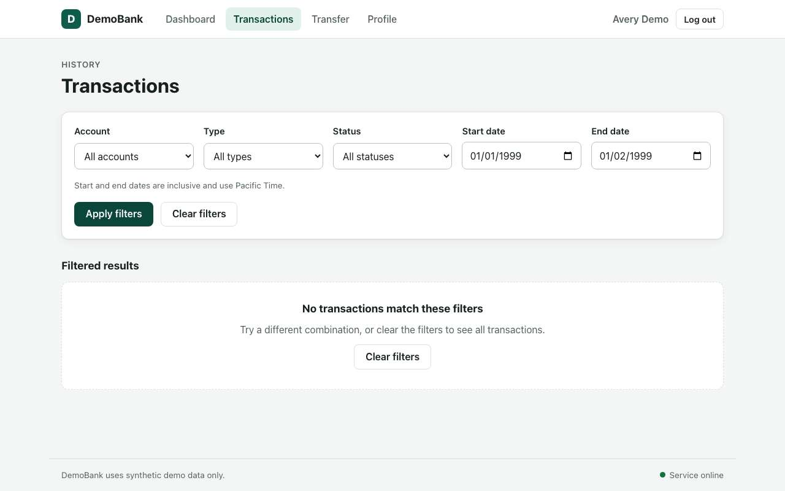

Network calls: `POST /api/demo/session 201`, `GET /api/me 200`, `GET /api/accounts 200`, `GET /api/transactions 200`

### TXN-05

**Requirement:** Filtering that yields an empty result set displays a clear empty state rather than an error or unrelated transactions.  
**PRD:** “An empty result set must show a clear empty state, not an error or unrelated transactions.”  
**Verdict:** ✅ PASS: 2 scenario(s) passed

✅ <i>Date filter matching no transactions displays a clear empty state without errors or transaction rows</i> (boundary, boundary-value analysis)

#### ✅ Scenario: Date filter matching no transactions displays a clear empty state without errors or transaction rows

*boundary · boundary-value analysis* · all checks passed

**Steps to reproduce**

1. Open the landing page and enter the demo
2. Navigate to /transactions
3. Read count of element [data-testid=transaction-row] → `initial_row_count` = `13`
4. Type '2099-01-01' into field labelled 'Start date'
5. Type '2099-01-02' into field labelled 'End date'
6. Click button 'Apply filters'
7. Read count of element [data-testid=transaction-row] → `filtered_row_count` = `0`
8. Read text of 'alert' → `error_alert` = `null`
9. Read text of 'No transactions' → `empty_text` = `"No transactions match these filters"`
10. Read url of  → `current_url` = `"/transactions?start_date=2099-01-01&end_date=2099-01-02"`
11. Read API GET /api/transactions?start_date=2099-01-01&end_date=2099-01-02 → `api_txns` = `{"status": 200, "body": {"transactions": []}}`

| Expected (check) | Kind | Result | Observed |
|---|---|---|---|
| Initial transaction list is populated before applying filters | functional | ✅ pass | `{"initial_row_count": 13}` |
| API confirms zero transactions exist for the filtered date range | cross_source | ✅ pass | `{"api_txns": {"status": 200, "body": {"transactions": []}}}` |
| No transaction rows are displayed (PRD: not unrelated transactions) | functional | ✅ pass | `{"filtered_row_count": 0}` |
| No error alert is triggered and the user remains on transactions page (PRD: not an error) | functional | ✅ pass | `{"current_url": "/transactions?start_date=2099-01-01&end_date=2099-01-02", "error_alert": null}` |
| A clear empty state is displayed to the user (PRD: clear empty state) | subjective | ✅ pass judge: Does this text inform the user that there are no transactions to display? -> True (The observed text states 'No transactions match these filters', which | `{"empty_text": "No transactions match these filters"}` |

Evidence: [TXN-05-s1-r1-v00-s04.jpg](./screenshots/TXN-05-s1-r1-v00-s04.jpg) · [TXN-05-s1-r1-v00-s05.jpg](./screenshots/TXN-05-s1-r1-v00-s05.jpg) · [TXN-05-s1-r1-v00-s06.jpg](./screenshots/TXN-05-s1-r1-v00-s06.jpg) · [TXN-05-s1-r1-v00-final.jpg](./screenshots/TXN-05-s1-r1-v00-final.jpg)

Network calls: `POST /api/demo/session 201`, `GET /api/me 200`, `GET /api/accounts 200`, `GET /api/transactions 200`

✅ <i>Clearing filters after an empty result set restores full transaction list without errors</i> (normal, metamorphic relation)

#### ✅ Scenario: Clearing filters after an empty result set restores full transaction list without errors

*normal · metamorphic relation* · all checks passed

**Steps to reproduce**

1. Open the landing page and enter the demo
2. Navigate to /transactions
3. Read count of element [data-testid=transaction-row] → `initial_count` = `13`
4. Type '1990-01-01' into field labelled 'Start date'
5. Type '1990-01-02' into field labelled 'End date'
6. Click button 'Apply filters'
7. Read count of element [data-testid=transaction-row] → `empty_count` = `0`
8. Read text of 'alert' → `error_alert` = `null`
9. Click button 'Clear filters'
10. Read count of element [data-testid=transaction-row] → `cleared_count` = `13`
11. Read API GET /api/transactions → `api_all` = `"{\"status\": 200, \"body\": {\"transactions\": [{\"id\": \"02c26545-050b-4d2c-9c96-31a3c3b100ba\", \"type\": \"transfer\", \"status\": \"completed\", \"amount\`

| Expected (check) | Kind | Result | Observed |
|---|---|---|---|
| Zero rows shown when past date filter yields an empty result set | functional | ✅ pass | `{"empty_count": 0}` |
| No error alert is triggered during empty filter state | functional | ✅ pass | `{"error_alert": null}` |
| Clearing filters restores the original transaction count | metamorphic | ✅ pass | `{"cleared_count": 13, "initial_count": 13}` |
| Restored transaction row count matches total transactions from the API | cross_source | ✅ pass | `{"api_all": "{\"status\": 200, \"body\": {\"transactions\": [{\"id\": \"02c26545-050b-4d2c-9c96-31a3c3b100ba\", \"type\": \"transfer\", \"status\": \"completed\", \"amount\": \"0.01\", \"memo\": \"Min boundary reload che` |

Evidence: [TXN-05-s2-r0-v00-s05.jpg](./screenshots/TXN-05-s2-r0-v00-s05.jpg) · [TXN-05-s2-r0-v00-s06.jpg](./screenshots/TXN-05-s2-r0-v00-s06.jpg) · [TXN-05-s2-r0-v00-s09.jpg](./screenshots/TXN-05-s2-r0-v00-s09.jpg) · [TXN-05-s2-r0-v00-final.jpg](./screenshots/TXN-05-s2-r0-v00-final.jpg)

Network calls: `POST /api/demo/session 201`, `GET /api/me 200`, `GET /api/accounts 200`, `GET /api/transactions 200`

### TXN-06

**Requirement:** Clearing applied filters restores the complete unfiltered transaction history.  
**PRD:** “Clearing filters restores the unfiltered history.”  
**Verdict:** ✅ PASS: 3 scenario(s) passed

✅ <i>Filtering by transaction type then clearing filters restores all initial transactions and resets the filter input</i> (normal, metamorphic relation)

#### ✅ Scenario: Filtering by transaction type then clearing filters restores all initial transactions and resets the filter input

*normal · metamorphic relation* · all checks passed

**Steps to reproduce**

1. Open the landing page and enter the demo
2. Navigate to /transactions
3. Read text of element [data-testid=result-count] → `initial_count_text` = `"Showing 13 transactions"`
4. Read table of element [data-testid=transaction-table] → `initial_rows` = `"[{\"Date & time\": \"Oct 21, 2026, 9:52 AM PDT\", \"Description\": \"Min boundary reload check\", \"Type\": \"Transfer\", \"Account\": \"From Rainy Day Savings`
5. Select 'Transfer' in combobox 'Type'
6. Click button 'Apply filters'
7. Read table of element [data-testid=transaction-table] → `filtered_rows` = `"[{\"Date & time\": \"Oct 21, 2026, 9:52 AM PDT\", \"Description\": \"Min boundary reload check\", \"Type\": \"Transfer\", \"Account\": \"From Rainy Day Savings`
8. Click button 'Clear filters'
9. Read text of element [data-testid=result-count] → `cleared_count_text` = `"Showing 13 transactions"`
10. Read table of element [data-testid=transaction-table] → `cleared_rows` = `"[{\"Date & time\": \"Oct 21, 2026, 9:52 AM PDT\", \"Description\": \"Min boundary reload check\", \"Type\": \"Transfer\", \"Account\": \"From Rainy Day Savings`
11. Read value of combobox 'Type' → `cleared_type_val` = `"All types"`

| Expected (check) | Kind | Result | Observed |
|---|---|---|---|
| Result count text after clearing matches initial unfiltered result count (PRD: Clearing filters restores the unfiltered history) | functional | ✅ pass | `{"cleared_count_text": "Showing 13 transactions", "initial_count_text": "Showing 13 transactions"}` |
| Total table rows restored to the unfiltered count | metamorphic | ✅ pass | `{"cleared_rows": "[{\"Date & time\": \"Oct 21, 2026, 9:52 AM PDT\", \"Description\": \"Min boundary reload check\", \"Type\": \"Transfer\", \"Account\": \"From Rainy Day Savings (\\u2022\\u2022\\u2022\\u2022 7781) To Eve` |
| Filtered rows were constrained relative to the full dataset | metamorphic | ✅ pass | `{"filtered_rows": "[{\"Date & time\": \"Oct 21, 2026, 9:52 AM PDT\", \"Description\": \"Min boundary reload check\", \"Type\": \"Transfer\", \"Account\": \"From Rainy Day Savings (\\u2022\\u2022\\u2022\\u2022 7781) To Ev` |
| Type filter control reset to default option | side_effect | ✅ pass | `{"cleared_type_val": "All types"}` |

Evidence: [TXN-06-s1-r0-v00-s05.jpg](./screenshots/TXN-06-s1-r0-v00-s05.jpg) · [TXN-06-s1-r0-v00-s06.jpg](./screenshots/TXN-06-s1-r0-v00-s06.jpg) · [TXN-06-s1-r0-v00-s08.jpg](./screenshots/TXN-06-s1-r0-v00-s08.jpg) · [TXN-06-s1-r0-v00-final.jpg](./screenshots/TXN-06-s1-r0-v00-final.jpg)

Network calls: `POST /api/demo/session 201`, `GET /api/me 200`, `GET /api/accounts 200`, `GET /api/transactions 200`

✅ <i>Clearing multiple applied filters restores complete history and matches server records</i> (normal, decision table + metamorphic testing)

#### ✅ Scenario: Clearing multiple applied filters restores complete history and matches server records

*normal · decision table + metamorphic testing* · all checks passed

**Steps to reproduce**

1. Open the landing page and enter the demo
2. Navigate to /transactions
3. Read API GET /api/transactions → `api_initial` = `"{\"status\": 200, \"body\": {\"transactions\": [{\"id\": \"02c26545-050b-4d2c-9c96-31a3c3b100ba\", \"type\": \"transfer\", \"status\": \"completed\", \"amount\`
4. Read table of element [data-testid=transaction-table] → `rows_initial` = `"[{\"Date & time\": \"Oct 21, 2026, 9:52 AM PDT\", \"Description\": \"Min boundary reload check\", \"Type\": \"Transfer\", \"Account\": \"From Rainy Day Savings`
5. Select 'Rainy Day Savings' in combobox 'Account'
6. Select 'Failed' in combobox 'Status'
7. Click button 'Apply filters'
8. Read count of element [data-testid=transaction-row] → `filtered_row_count` = `2`
9. Click button 'Clear filters'
10. Read table of element [data-testid=transaction-table] → `rows_cleared` = `"[{\"Date & time\": \"Oct 21, 2026, 9:52 AM PDT\", \"Description\": \"Min boundary reload check\", \"Type\": \"Transfer\", \"Account\": \"From Rainy Day Savings`
11. Read value of combobox 'Account' → `cleared_account_val` = `"All accounts"`
12. Read value of combobox 'Status' → `cleared_status_val` = `"All statuses"`

| Expected (check) | Kind | Result | Observed |
|---|---|---|---|
| Cleared table row count matches the initial unfiltered table row count | metamorphic | ✅ pass | `{"rows_cleared": "[{\"Date & time\": \"Oct 21, 2026, 9:52 AM PDT\", \"Description\": \"Min boundary reload check\", \"Type\": \"Transfer\", \"Account\": \"From Rainy Day Savings (\\u2022\\u2022\\u2022\\u2022 7781) To Eve` |
| Cleared table row count agrees with server unfiltered transaction count | cross_source | ✅ pass | `{"api_initial": "{\"status\": 200, \"body\": {\"transactions\": [{\"id\": \"02c26545-050b-4d2c-9c96-31a3c3b100ba\", \"type\": \"transfer\", \"status\": \"completed\", \"amount\": \"0.01\", \"memo\": \"Min boundary reload` |
| Account combobox reset to default | side_effect | ✅ pass | `{"cleared_account_val": "All accounts"}` |
| Status combobox reset to default | side_effect | ✅ pass | `{"cleared_status_val": "All statuses"}` |

Evidence: [TXN-06-s2-r0-v00-s06.jpg](./screenshots/TXN-06-s2-r0-v00-s06.jpg) · [TXN-06-s2-r0-v00-s07.jpg](./screenshots/TXN-06-s2-r0-v00-s07.jpg) · [TXN-06-s2-r0-v00-s09.jpg](./screenshots/TXN-06-s2-r0-v00-s09.jpg) · [TXN-06-s2-r0-v00-final.jpg](./screenshots/TXN-06-s2-r0-v00-final.jpg)

Network calls: `POST /api/demo/session 201`, `GET /api/me 200`, `GET /api/accounts 200`, `GET /api/transactions 200`

✅ <i>Clearing filters when no filters are active is idempotent and preserves the full history</i> (boundary, boundary-value analysis)

#### ✅ Scenario: Clearing filters when no filters are active is idempotent and preserves the full history

*boundary · boundary-value analysis* · all checks passed

**Steps to reproduce**

1. Open the landing page and enter the demo
2. Navigate to /transactions
3. Read text of element [data-testid=result-count] → `count_before` = `"Showing 13 transactions"`
4. Read table of element [data-testid=transaction-table] → `rows_before` = `"[{\"Date & time\": \"Oct 21, 2026, 9:52 AM PDT\", \"Description\": \"Min boundary reload check\", \"Type\": \"Transfer\", \"Account\": \"From Rainy Day Savings`
5. Click button 'Clear filters'
6. Read text of element [data-testid=result-count] → `count_after` = `"Showing 13 transactions"`
7. Read table of element [data-testid=transaction-table] → `rows_after` = `"[{\"Date & time\": \"Oct 21, 2026, 9:52 AM PDT\", \"Description\": \"Min boundary reload check\", \"Type\": \"Transfer\", \"Account\": \"From Rainy Day Savings`

| Expected (check) | Kind | Result | Observed |
|---|---|---|---|
| Displayed transaction count text unchanged after clearing without active filters | invariant | ✅ pass | `{"count_after": "Showing 13 transactions", "count_before": "Showing 13 transactions"}` |
| Complete unfiltered table rows remain displayed | invariant | ✅ pass | `{"rows_after": "[{\"Date & time\": \"Oct 21, 2026, 9:52 AM PDT\", \"Description\": \"Min boundary reload check\", \"Type\": \"Transfer\", \"Account\": \"From Rainy Day Savings (\\u2022\\u2022\\u2022\\u2022 7781) To Every` |

Evidence: [TXN-06-s3-r0-v00-s01.jpg](./screenshots/TXN-06-s3-r0-v00-s01.jpg) · [TXN-06-s3-r0-v00-s02.jpg](./screenshots/TXN-06-s3-r0-v00-s02.jpg) · [TXN-06-s3-r0-v00-s05.jpg](./screenshots/TXN-06-s3-r0-v00-s05.jpg) · [TXN-06-s3-r0-v00-final.jpg](./screenshots/TXN-06-s3-r0-v00-final.jpg)

Network calls: `POST /api/demo/session 201`, `GET /api/me 200`, `GET /api/accounts 200`, `GET /api/transactions 200`

### PRO-01

**Requirement:** The profile view displays only synthetic demo-customer details including display name and masked email address.  
**PRD:** “A profile view displays only synthetic demo-customer details, such as display name and a masked email address.”  
**Verdict:** ✅ PASS: 1 scenario(s) passed

✅ <i>Profile view displays synthetic demo customer display name and masked email address matching session profile</i> (normal, cross-source verification)

#### ✅ Scenario: Profile view displays synthetic demo customer display name and masked email address matching session profile

*normal · cross-source verification* · all checks passed

**Steps to reproduce**

1. Open the landing page and enter the demo
2. Navigate to /profile
3. Read text of element [data-testid=profile-name] → `ui_name` = `"Avery Demo"`
4. Read text of element [data-testid=profile-email] → `ui_email` = `"a***@example.test"`
5. Read API GET /api/me → `api_me` = `{"status": 200, "body": {"id": "00000000-0000-0000-0000-000000000001", "display_name": "Avery Demo", "masked_email": "a***@example.test"}}`

| Expected (check) | Kind | Result | Observed |
|---|---|---|---|
| Profile view shows the demo customer display name and matches API /api/me | cross_source | ✅ pass | `{"api_me": {"status": 200, "body": {"id": "00000000-0000-0000-0000-000000000001", "display_name": "Avery Demo", "masked_email": "a***@example.test"}}, "ui_name": "Avery Demo"}` |
| Profile view shows a masked email address and matches API /api/me | cross_source | ✅ pass | `{"api_me": {"status": 200, "body": {"id": "00000000-0000-0000-0000-000000000001", "display_name": "Avery Demo", "masked_email": "a***@example.test"}}, "ui_email": "a***@example.test"}` |
| Email address is masked with asterisks and contains an email domain format | functional | ✅ pass | `{"ui_email": "a***@example.test"}` |

Evidence: [PRO-01-s1-r0-v00-s01.jpg](./screenshots/PRO-01-s1-r0-v00-s01.jpg) · [PRO-01-s1-r0-v00-s02.jpg](./screenshots/PRO-01-s1-r0-v00-s02.jpg) · [PRO-01-s1-r0-v00-final.jpg](./screenshots/PRO-01-s1-r0-v00-final.jpg)

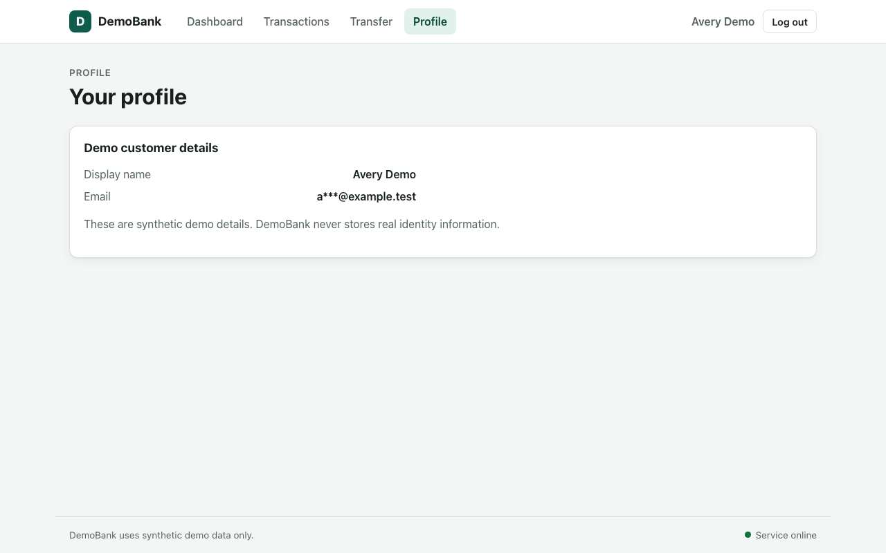

Network calls: `POST /api/demo/session 201`, `GET /api/me 200`, `GET /api/accounts 200`

### PRO-02

**Requirement:** The profile view does not reveal passwords, authentication tokens, full account identifiers, or data belonging to another user.  
**PRD:** “The view must not reveal passwords, authentication tokens, full account identifiers, or data belonging to another user.”  
**Verdict:** ✅ PASS: 1 scenario(s) passed

✅ <i>Profile displays only masked customer info and excludes passwords, tokens, or sensitive account identifiers</i> (normal, information exposure / equivalence partitioning)

#### ✅ Scenario: Profile displays only masked customer info and excludes passwords, tokens, or sensitive account identifiers

*normal · information exposure / equivalence partitioning* · all checks passed

**Steps to reproduce**

1. Open the landing page and enter the demo
2. Navigate to /profile
3. Read API GET /api/me → `me_api` = `{"status": 200, "body": {"id": "00000000-0000-0000-0000-000000000001", "display_name": "Avery Demo", "masked_email": "a***@example.test"}}`
4. Read text of element [data-testid=profile-name] → `profile_name` = `"Avery Demo"`
5. Read text of element [data-testid=profile-email] → `profile_email` = `"a***@example.test"`
6. Read text of element [data-testid=active-customer] → `active_user` = `"Signed in as\nAvery Demo"`

| Expected (check) | Kind | Result | Observed |
|---|---|---|---|
| Customer display name on profile agrees with authenticated session data without hard-coded seed values | cross_source | ✅ pass | `{"me_api": {"status": 200, "body": {"id": "00000000-0000-0000-0000-000000000001", "display_name": "Avery Demo", "masked_email": "a***@example.test"}}, "profile_name": "Avery Demo"}` |
| Email address is masked and matches the masked email payload without revealing the full address | functional | ✅ pass | `{"me_api": {"status": 200, "body": {"id": "00000000-0000-0000-0000-000000000001", "display_name": "Avery Demo", "masked_email": "a***@example.test"}}, "profile_email": "a***@example.test"}` |
| Sensitive credentials such as passwords and auth tokens are absent from user API response | functional | ✅ pass | `{"me_api": {"status": 200, "body": {"id": "00000000-0000-0000-0000-000000000001", "display_name": "Avery Demo", "masked_email": "a***@example.test"}}}` |
| Displayed active customer strictly reflects the authenticated profile customer | functional | ✅ pass | `{"active_user": "Signed in as\nAvery Demo", "profile_name": "Avery Demo"}` |

Evidence: [PRO-02-s1-r0-v00-s01.jpg](./screenshots/PRO-02-s1-r0-v00-s01.jpg) · [PRO-02-s1-r0-v00-s02.jpg](./screenshots/PRO-02-s1-r0-v00-s02.jpg) · [PRO-02-s1-r0-v00-final.jpg](./screenshots/PRO-02-s1-r0-v00-final.jpg)

Network calls: `POST /api/demo/session 201`, `GET /api/me 200`, `GET /api/accounts 200`

### GEN-01

**Requirement:** The application functions at a 1280x800 desktop viewport and remains usable at narrower viewport widths.  
**PRD:** “The target works in a current desktop browser at a 1280 × 800 viewport and remains usable at narrower widths.”  
**Verdict:** ✅ PASS: 1 scenario(s) passed

✅ <i>Dashboard renders without horizontal overflow at 1280x800 desktop viewport and remains usable at narrower mobile viewport</i> (normal, viewport variation testing)

#### ✅ Scenario: Dashboard renders without horizontal overflow at 1280x800 desktop viewport and remains usable at narrower mobile viewport

*normal · viewport variation testing* · all checks passed

**Steps to reproduce**

1. Open the landing page and enter the demo
2. Resize the viewport to 1280x800
3. Measure horizontal overflow → `desktop_overflow` = `false`
4. Read count of element [data-testid=account-card] → `desktop_card_count` = `2`
5. Read text of heading 'Your accounts' → `desktop_heading` = `"Your accounts"`
6. Resize the viewport to 375x812
7. Measure horizontal overflow → `narrow_overflow` = `false`
8. Read count of element [data-testid=account-card] → `narrow_card_count` = `2`
9. Read text of heading 'Your accounts' → `narrow_heading` = `"Your accounts"`
10. Click link 'Transfer'
11. Read url of  → `transfer_url` = `"/transfer"`
12. Measure horizontal overflow → `transfer_overflow` = `false`

| Expected (check) | Kind | Result | Observed |
|---|---|---|---|
| Dashboard layout does not scroll horizontally at 1280x800 desktop viewport | functional | ✅ pass | `{"desktop_overflow": false}` |
| Dashboard account content renders at 1280x800 desktop viewport | functional | ✅ pass | `{"desktop_card_count": 2, "desktop_heading": "Your accounts"}` |
| Dashboard layout does not introduce horizontal overflow at narrower 375px viewport | functional | ✅ pass | `{"narrow_overflow": false}` |
| Account cards and section heading remain visible and unchanged at narrower viewport | invariant | ✅ pass | `{"desktop_card_count": 2, "narrow_card_count": 2, "narrow_heading": "Your accounts"}` |
| User can navigate and interact with views at narrower viewport width without horizontal overflow | functional | ✅ pass | `{"transfer_overflow": false, "transfer_url": "/transfer"}` |

Evidence: [GEN-01-s1-r1-v00-s02.jpg](./screenshots/GEN-01-s1-r1-v00-s02.jpg) · [GEN-01-s1-r1-v00-s06.jpg](./screenshots/GEN-01-s1-r1-v00-s06.jpg) · [GEN-01-s1-r1-v00-s10.jpg](./screenshots/GEN-01-s1-r1-v00-s10.jpg) · [GEN-01-s1-r1-v00-final.jpg](./screenshots/GEN-01-s1-r1-v00-final.jpg)

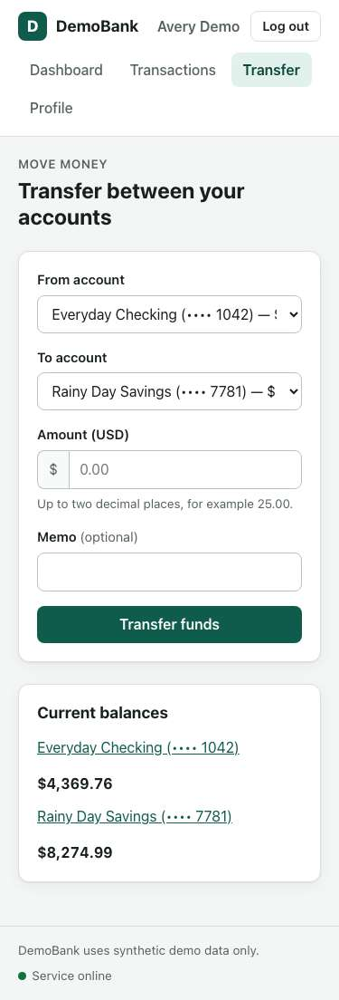

Network calls: `POST /api/demo/session 201`, `GET /api/me 200`, `GET /api/accounts 200`

### GEN-02

**Requirement:** Interactive controls have readable labels and communicate loading, success, validation, and failure states.  
**PRD:** “Interactive controls have readable labels and communicate loading, success, validation, and failure states.”  
**Verdict:** ✅ PASS: 1 scenario(s) passed

✅ <i>Transfer controls have readable labels and communicate completed state</i> (normal, state-transition testing)

#### ✅ Scenario: Transfer controls have readable labels and communicate completed state

*normal · state-transition testing* · all checks passed

**Steps to reproduce**

1. Open the landing page and enter the demo
2. Navigate to /transfer
3. Read text of button 'Transfer funds' → `transfer_btn_text` = `"Transfer funds"`
4. Read API GET /api/accounts → `accounts_before` = `"{\"status\": 200, \"body\": {\"accounts\": [{\"id\": \"00000000-0000-0000-0000-000000000101\", \"name\": \"Everyday Checking\", \"type\": \"checking\", \"maske`
5. Select 'Everyday Checking' in combobox 'From account'
6. Select 'Rainy Day Savings' in combobox 'To account'
7. Type '5.00' into textbox 'Amount (USD)'
8. Click button 'Transfer funds'
9. Read text of 'status' → `status_msg` = `"Transfer complete\nAmount\n$5.00\nFrom\nEveryday Checking (\u2022\u2022\u2022\u2022 1042)\nTo\nRainy Day Savings (\u2022\u2022\u2022\u2022 7781)\nDate & time\n`
10. Read text of 'alert' → `alert_msg` = `null`
11. Read url of  → `end_url` = `"/transfer"`
12. Read API GET /api/accounts → `accounts_after` = `"{\"status\": 200, \"body\": {\"accounts\": [{\"id\": \"00000000-0000-0000-0000-000000000101\", \"name\": \"Everyday Checking\", \"type\": \"checking\", \"maske`

| Expected (check) | Kind | Result | Observed |
|---|---|---|---|
| Interactive transfer button has a legible, descriptive label (PRD: Interactive controls have readable labels) | subjective | ✅ pass judge: Is this button label legible and does it clearly describe the transfer action? -> True (The observed text 'Transfer funds' is legible plain text that ex | `{"transfer_btn_text": "Transfer funds"}` |
| Completed or success state is communicated via message or redirect (PRD: communicate loading, success, validation, and failure states) | functional | ✅ pass | `{"alert_msg": null, "end_url": "/transfer", "status_msg": "Transfer complete\nAmount\n$5.00\nFrom\nEveryday Checking (\u2022\u2022\u2022\u2022 1042)\nTo\nRainy Day Savings (\u2022\u2022\u2022\u2022 7781)\nDate & time\nOc` |
| Account balances reflect the transfer side effect | side_effect | ✅ pass | `{"accounts_after": {"status": 200, "body": {"accounts": [{"id": "00000000-0000-0000-0000-000000000101", "name": "Everyday Checking", "type": "checking", "masked_number": "\u2022\u2022\u2022\u2022 1042", "currency": "USD"` |

Evidence: [GEN-02-s1-r0-v00-s06.jpg](./screenshots/GEN-02-s1-r0-v00-s06.jpg) · [GEN-02-s1-r0-v00-s07.jpg](./screenshots/GEN-02-s1-r0-v00-s07.jpg) · [GEN-02-s1-r0-v00-s08.jpg](./screenshots/GEN-02-s1-r0-v00-s08.jpg) · [GEN-02-s1-r0-v00-final.jpg](./screenshots/GEN-02-s1-r0-v00-final.jpg)

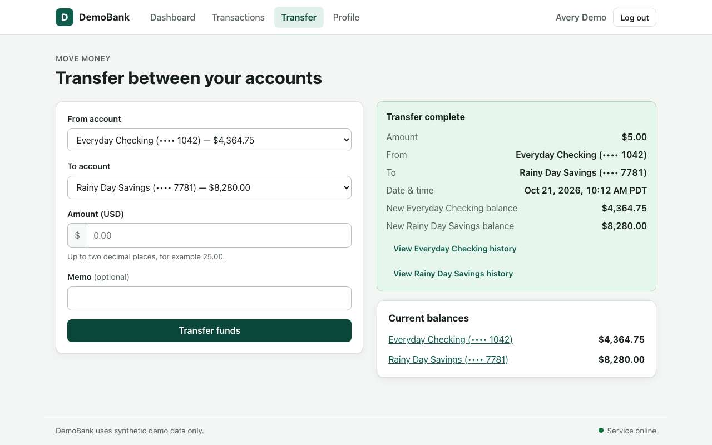

Network calls: `POST /api/demo/session 201`, `GET /api/me 200`, `GET /api/accounts 200`, `POST /api/transfers 201`

### GEN-03

**Requirement:** Submitted actions do not silently disappear, and display a loading state or prevent accidental duplicate submissions while waiting.  
**PRD:** “A submitted action should not silently disappear. While waiting, the UI should show a loading state or otherwise prevent accidental duplicate submission.”  
**Verdict:** ✅ PASS: 1 scenario(s) passed

✅ <i>Transfer action is executed without disappearing and creates exactly one transaction without duplicate submission</i> (normal, state-transition testing)

#### ✅ Scenario: Transfer action is executed without disappearing and creates exactly one transaction without duplicate submission

*normal · state-transition testing* · all checks passed

**Steps to reproduce**

1. Open the landing page and enter the demo
2. Navigate to /transfer
3. Read API GET /api/accounts → `accounts_before` = `"{\"status\": 200, \"body\": {\"accounts\": [{\"id\": \"00000000-0000-0000-0000-000000000101\", \"name\": \"Everyday Checking\", \"type\": \"checking\", \"maske`
4. Read API GET /api/transactions → `tx_before` = `"{\"status\": 200, \"body\": {\"transactions\": [{\"id\": \"00000000-0000-0000-0000-000000000212\", \"type\": \"deposit\", \"status\": \"failed\", \"amount\": \`
5. Select 'Everyday Checking' in combobox 'From account'
6. Select 'Rainy Day Savings' in combobox 'To account'
7. Type '25.00' into textbox 'Amount (USD)'
8. Type 'GEN-03 submission' into textbox 'Memo (optional)'
9. Click button 'Transfer funds'
10. Read API GET /api/transactions → `tx_after` = `"{\"status\": 200, \"body\": {\"transactions\": [{\"id\": \"bc007fc8-4e53-47a6-b722-73f362d7f44e\", \"type\": \"transfer\", \"status\": \"completed\", \"amount\`
11. Read API GET /api/accounts → `accounts_after` = `"{\"status\": 200, \"body\": {\"accounts\": [{\"id\": \"00000000-0000-0000-0000-000000000101\", \"name\": \"Everyday Checking\", \"type\": \"checking\", \"maske`

| Expected (check) | Kind | Result | Observed |
|---|---|---|---|
| Submitted transfer action does not silently disappear: transaction is recorded with active status | functional | ✅ pass | `{"tx_after": "{\"status\": 200, \"body\": {\"transactions\": [{\"id\": \"bc007fc8-4e53-47a6-b722-73f362d7f44e\", \"type\": \"transfer\", \"status\": \"completed\", \"amount\": \"25.00\", \"memo\": \"GEN-03 submission\", ` |
| Accidental duplicate submission is prevented: exactly one transaction is created | functional | ✅ pass | `{"tx_after": "{\"status\": 200, \"body\": {\"transactions\": [{\"id\": \"bc007fc8-4e53-47a6-b722-73f362d7f44e\", \"type\": \"transfer\", \"status\": \"completed\", \"amount\": \"25.00\", \"memo\": \"GEN-03 submission\", ` |
| Source account balance is deducted by the transfer amount | side_effect | ✅ pass | `{"accounts_after": {"status": 200, "body": {"accounts": [{"id": "00000000-0000-0000-0000-000000000101", "name": "Everyday Checking", "type": "checking", "masked_number": "\u2022\u2022\u2022\u2022 1042", "currency": "USD"` |
| Destination account balance is credited by the transfer amount | side_effect | ✅ pass | `{"accounts_after": {"status": 200, "body": {"accounts": [{"id": "00000000-0000-0000-0000-000000000101", "name": "Everyday Checking", "type": "checking", "masked_number": "\u2022\u2022\u2022\u2022 1042", "currency": "USD"` |
| Total balance across accounts remains conserved | invariant | ✅ pass | `{"accounts_after": {"status": 200, "body": {"accounts": [{"id": "00000000-0000-0000-0000-000000000101", "name": "Everyday Checking", "type": "checking", "masked_number": "\u2022\u2022\u2022\u2022 1042", "currency": "USD"` |

Evidence: [GEN-03-s1-r2-v00-s07.jpg](./screenshots/GEN-03-s1-r2-v00-s07.jpg) · [GEN-03-s1-r2-v00-s08.jpg](./screenshots/GEN-03-s1-r2-v00-s08.jpg) · [GEN-03-s1-r2-v00-s09.jpg](./screenshots/GEN-03-s1-r2-v00-s09.jpg) · [GEN-03-s1-r2-v00-final.jpg](./screenshots/GEN-03-s1-r2-v00-final.jpg)

Network calls: `POST /api/demo/session 201`, `GET /api/me 200`, `GET /api/accounts 200`, `POST /api/transfers 201`

### GEN-04

**Requirement:** Navigation links and buttons lead to their labeled destination or execute their labeled action.  
**PRD:** “Navigation links and buttons lead to the labeled destination or perform the labeled action.”  
**Verdict:** ✅ PASS: 1 scenario(s) passed

✅ <i>Navigation links lead to their labeled destination views</i> (normal, state-transition testing)

#### ✅ Scenario: Navigation links lead to their labeled destination views

*normal · state-transition testing* · all checks passed

**Steps to reproduce**

1. Open the landing page and enter the demo
2. Click link 'Transactions'
3. Read url of  → `transactions_url` = `"/transactions"`
4. Read text of heading 'Transactions' → `transactions_heading` = `"Transactions"`
5. Click link 'Transfer'
6. Read url of  → `transfer_url` = `"/transfer"`
7. Read text of heading 'Transfer between your accounts' → `transfer_heading` = `"Transfer between your accounts"`
8. Click link 'Profile'
9. Read url of  → `profile_url` = `"/profile"`
10. Read text of heading 'Your profile' → `profile_heading` = `"Your profile"`
11. Click link 'Dashboard'
12. Read url of  → `dashboard_url` = `"/dashboard"`
13. Read text of heading 'Welcome, Avery Demo' → `dashboard_heading` = `"Welcome, Avery Demo"`

| Expected (check) | Kind | Result | Observed |
|---|---|---|---|
| Transactions link navigates to /transactions and displays the Transactions view | functional | ✅ pass | `{"transactions_heading": "Transactions", "transactions_url": "/transactions"}` |
| Transfer link navigates to /transfer and displays the Transfer view | functional | ✅ pass | `{"transfer_heading": "Transfer between your accounts", "transfer_url": "/transfer"}` |
| Profile link navigates to /profile and displays the Profile view | functional | ✅ pass | `{"profile_heading": "Your profile", "profile_url": "/profile"}` |
| Dashboard link navigates to /dashboard and displays the Dashboard view | functional | ✅ pass | `{"dashboard_heading": "Welcome, Avery Demo", "dashboard_url": "/dashboard"}` |

Evidence: [GEN-04-s1-r0-v00-s05.jpg](./screenshots/GEN-04-s1-r0-v00-s05.jpg) · [GEN-04-s1-r0-v00-s08.jpg](./screenshots/GEN-04-s1-r0-v00-s08.jpg) · [GEN-04-s1-r0-v00-s11.jpg](./screenshots/GEN-04-s1-r0-v00-s11.jpg) · [GEN-04-s1-r0-v00-final.jpg](./screenshots/GEN-04-s1-r0-v00-final.jpg)

Network calls: `POST /api/demo/session 201`, `GET /api/me 200`, `GET /api/accounts 200`, `GET /api/transactions 200`

### GEN-05

**Requirement:** When a recoverable error occurs, the user can retry the operation or return to the dashboard.  
**PRD:** “A recoverable error must leave the user able to retry or return to the dashboard.”  
**Verdict:** ✅ PASS: 1 scenario(s) passed

✅ <i>Error page provides functional navigation back to the dashboard</i> (normal, state-transition testing)

#### ✅ Scenario: Error page provides functional navigation back to the dashboard

*normal · state-transition testing* · all checks passed

**Steps to reproduce**

1. Open the landing page and enter the demo
2. Navigate to /__qa_probe_unknown_route__
3. Read text of heading 'Page not found' → `error_heading` = `"Page not found"`
4. Read text of link 'Back to dashboard' → `back_to_dashboard_text` = `"Back to dashboard"`
5. Click link 'Back to dashboard'
6. Read url of  → `current_url` = `"/dashboard"`
7. Read text of heading 'Your accounts' → `dashboard_heading` = `"Your accounts"`

| Expected (check) | Kind | Result | Observed |
|---|---|---|---|
| Error page heading is presented when an error condition occurs | functional | ✅ pass | `{"error_heading": "Page not found"}` |
| Navigation link allowing return to the dashboard is available on the error page (PRD: return to the dashboard) | functional | ✅ pass | `{"back_to_dashboard_text": "Back to dashboard"}` |
| Clicking 'Back to dashboard' successfully routes the user back to /dashboard | functional | ✅ pass | `{"current_url": "/dashboard", "dashboard_heading": "Your accounts"}` |

Evidence: [GEN-05-s1-r1-v00-s01.jpg](./screenshots/GEN-05-s1-r1-v00-s01.jpg) · [GEN-05-s1-r1-v00-s02.jpg](./screenshots/GEN-05-s1-r1-v00-s02.jpg) · [GEN-05-s1-r1-v00-s05.jpg](./screenshots/GEN-05-s1-r1-v00-s05.jpg) · [GEN-05-s1-r1-v00-final.jpg](./screenshots/GEN-05-s1-r1-v00-final.jpg)

Network calls: `POST /api/demo/session 201`, `GET /api/me 200`, `GET /api/accounts 200`

### SEED-01

**Requirement:** The demo environment begins seeded with one customer, one checking account, and one savings account.  
**PRD:** “- The target has one seeded demo customer.”  
**Verdict:** ✅ PASS: 1 scenario(s) passed

✅ <i>Seeded demo customer is initialized and authenticated in the session</i> (normal, specification-based verification)

#### ✅ Scenario: Seeded demo customer is initialized and authenticated in the session

*normal · specification-based verification* · all checks passed

**Steps to reproduce**

1. Open the landing page and enter the demo
2. Read text of element [data-testid=active-customer] → `active_user_text` = `"Signed in as\nAvery Demo"`
3. Read API GET /api/me → `api_me` = `{"status": 200, "body": {"id": "00000000-0000-0000-0000-000000000001", "display_name": "Avery Demo", "masked_email": "a***@example.test"}}`

| Expected (check) | Kind | Result | Observed |
|---|---|---|---|
| Session indicator displays the signed-in customer | functional | ✅ pass | `{"active_user_text": "Signed in as\nAvery Demo"}` |
| API confirms an authenticated demo customer profile exists | functional | ✅ pass | `{"api_me": {"status": 200, "body": {"id": "00000000-0000-0000-0000-000000000001", "display_name": "Avery Demo", "masked_email": "a***@example.test"}}}` |
| UI active customer matches the authenticated customer profile | cross_source | ✅ pass | `{"active_user_text": "Signed in as\nAvery Demo", "api_me": {"status": 200, "body": {"id": "00000000-0000-0000-0000-000000000001", "display_name": "Avery Demo", "masked_email": "a***@example.test"}}}` |

Evidence: [SEED-01-s1-r0-v00-s01.jpg](./screenshots/SEED-01-s1-r0-v00-s01.jpg) · [SEED-01-s1-r0-v00-final.jpg](./screenshots/SEED-01-s1-r0-v00-final.jpg)

Network calls: `POST /api/demo/session 201`, `GET /api/accounts 200`, `GET /api/me 200`

### SEED-02

**Requirement:** Seed transaction data includes multiple dates, at least one transfer between accounts, and sufficient variety to exercise account, type, status, and date filters.  
**PRD:** “The demo begins with one customer, one checking account, one savings account, and enough historical transactions to exercise account, type, status, and date filters. Seed records should include multiple dates and at least one transfer between the two accounts.”  
**Verdict:** ✅ PASS: 1 scenario(s) passed

✅ <i>Demo begins with one customer, one checking account, and one savings account</i> (normal, domain analysis)

#### ✅ Scenario: Demo begins with one customer, one checking account, and one savings account

*normal · domain analysis* · all checks passed

**Steps to reproduce**

1. Open the landing page and enter the demo
2. Navigate to /dashboard
3. Read API GET /api/me → `me_api` = `{"status": 200, "body": {"id": "00000000-0000-0000-0000-000000000001", "display_name": "Avery Demo", "masked_email": "a***@example.test"}}`
4. Read API GET /api/accounts → `acc_api` = `"{\"status\": 200, \"body\": {\"accounts\": [{\"id\": \"00000000-0000-0000-0000-000000000101\", \"name\": \"Everyday Checking\", \"type\": \"checking\", \"maske`
5. Read all_text of element [data-testid=account-card] → `ui_cards` = `["Everyday Checking\nChecking\n\nAccount number ending\n\u2022\u2022\u2022\u2022 1042\n\nAvailable balance\n\n$4,369.75USD\n\nView details \u2192", "Rainy Day S`

| Expected (check) | Kind | Result | Observed |
|---|---|---|---|
| Exactly one authenticated customer profile exists (PRD: The demo begins with one customer) | functional | ✅ pass | `{"me_api": {"status": 200, "body": {"id": "00000000-0000-0000-0000-000000000001", "display_name": "Avery Demo", "masked_email": "a***@example.test"}}}` |
| Exactly one checking account exists (PRD: one checking account) | functional | ✅ pass | `{"acc_api": {"status": 200, "body": {"accounts": [{"id": "00000000-0000-0000-0000-000000000101", "name": "Everyday Checking", "type": "checking", "masked_number": "\u2022\u2022\u2022\u2022 1042", "currency": "USD", "bala` |
| Exactly one savings account exists (PRD: one savings account) | functional | ✅ pass | `{"acc_api": {"status": 200, "body": {"accounts": [{"id": "00000000-0000-0000-0000-000000000101", "name": "Everyday Checking", "type": "checking", "masked_number": "\u2022\u2022\u2022\u2022 1042", "currency": "USD", "bala` |
| Total account count is exactly two (PRD: one checking account, one savings account) | functional | ✅ pass | `{"acc_api": {"status": 200, "body": {"accounts": [{"id": "00000000-0000-0000-0000-000000000101", "name": "Everyday Checking", "type": "checking", "masked_number": "\u2022\u2022\u2022\u2022 1042", "currency": "USD", "bala` |
| Dashboard displays cards for both accounts | cross_source | ✅ pass | `{"ui_cards": ["Everyday Checking\nChecking\n\nAccount number ending\n\u2022\u2022\u2022\u2022 1042\n\nAvailable balance\n\n$4,369.75USD\n\nView details \u2192", "Rainy Day Savings\nSavings\n\nAccount number ending\n\u202` |

Evidence: [SEED-02-s1-r0-v00-s01.jpg](./screenshots/SEED-02-s1-r0-v00-s01.jpg) · [SEED-02-s1-r0-v00-s02.jpg](./screenshots/SEED-02-s1-r0-v00-s02.jpg) · [SEED-02-s1-r0-v00-final.jpg](./screenshots/SEED-02-s1-r0-v00-final.jpg)

Network calls: `POST /api/demo/session 201`, `GET /api/me 200`, `GET /api/accounts 200`

## Cost breakdown

Prices: USD per 1M tokens, standard paid tier, as of 2026-10-21. Thinking tokens are billed as output.

| Phase | Calls | Input tokens | Cached | Output tokens | Cost (USD) |
|---|---|---|---|---|---|
| critique | 32 | 226,539 | 0 | 172,431 | $0.8165 |
| plan | 32 | 183,058 | 3,993 | 136,387 | $0.6460 |
| revise | 13 | 85,357 | 4,596 | 97,972 | $0.4283 |
| review | 42 | 48,768 | 0 | 9,200 | $0.0711 |
| interpret | 1 | 1,588 | 0 | 6,613 | $0.0260 |
| report | 3 | 14,241 | 0 | 1,661 | $0.0169 |
| explore | 1 | 3,378 | 0 | 1,481 | $0.0081 |
| judge | 13 | 1,094 | 0 | 627 | $0.0032 |
| recover | 3 | 776 | 0 | 147 | $0.0006 |
| **Total** | **140** | **564,799** | **8,589** | **426,519** | **$2.0167** |

| Model | Calls | Cost (USD) |
|---|---|---|
| gemini-3.8-flash | 137 | $2.0161 |
| gemini-3.5-flash-lite | 3 | $0.0006 |

Average cost per requirement: $0.0614; most expensive: TXN-04 ($0.2037), TRF-07 ($0.2023), GEN-03 ($0.1382).

## Coverage, gaps and limitations

- **Deep coverage** (normal, negative and boundary scenarios with side-effect checks): ACC-01, ACC-02, ACC-03, ACC-04, ACC-05, TRF-01, TRF-02, TRF-03, TRF-04, TRF-05, TRF-06, TRF-07, TRF-08, TXN-01, TXN-02, TXN-03, TXN-04, TXN-05, TXN-06
- **Light coverage** (main normal path only): DSH-01, DSH-02, DSH-03, DSH-04, PRO-01, PRO-02, GEN-01, GEN-02, GEN-03, GEN-04, GEN-05, SEED-01, SEED-02
- **Requirement extraction:** 32 requirements extracted; coverage of a hand-made PRD inventory 36/36
- Testing was executed on a local instance (http://localhost:5173) with the database reset between scenarios rather than in a persistent hosted staging environment.
- Several areas were only lightly evaluated with a single scenario, including account summaries (DSH-01–04), profile displays (PRO-01–02), general UI behavior (GEN-01–05), and initial seed data checks (SEED-01–02).
- Requirements ACC-01 (landing page demo action test plan missing variable definitions) and TRF-07 (transfer rejection messaging inconclusive after 2 attempts) remained unverified.

### Recommendations

- Enforce strict server-side and client-side validation on transfer inputs (TRF-03) to reject zero, blank, non-numeric, or negative amounts before transaction processing.
- Add balance checks prior to debiting accounts (TRF-04) to block transfers exceeding available funds and display appropriate insufficient-funds error notifications.

1 narrative sentence(s) were removed by the fact check because they cited numbers not present in the results.

---
Method: [ARCHITECTURE.md](../../docs/ARCHITECTURE.md) · Decisions: [DECISIONS.md](../../docs/DECISIONS.md) · Raw evidence: `results.json`, `llm_calls.jsonl`, `screenshots/` in this run folder.
